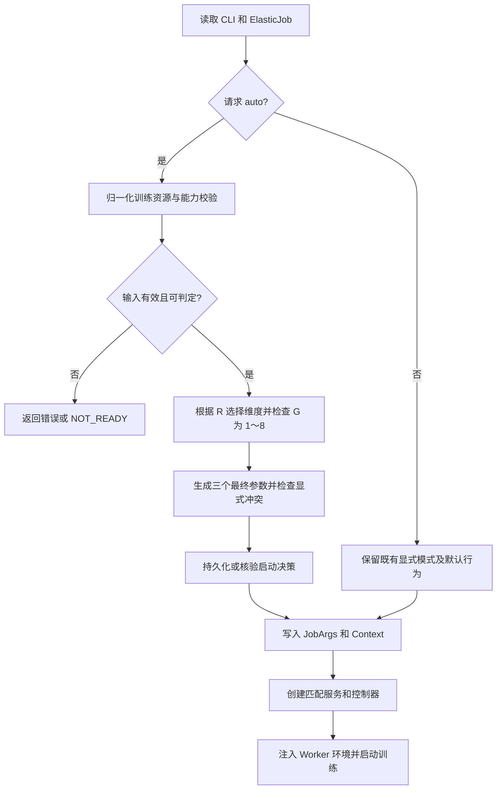

# 基于任务 YAML 的启动时弹性策略自适应设计

## 1. 文档定位

- 状态：启动自适应核心实现已落地；目标集群 GPU 端到端验收仍需部署验证。
- 日期：2026-09-20。
- 交付范围：启动策略解析、资源校验、决策持久化、控制入口隔离、Worker 配置适配及测试；实际交付约束见第 15 节。
- 核心决策：以训练 Worker 目标副本数选择默认弹性维度，以每副本 GPU 数进行资源合法性和容量校验。

本方案解决提交任务时需要手动配置弹性参数的问题。第一阶段只在启动时确定策略，运行期间维度不变。

与现有文档的关系：

- [自适应弹性总体设计](adaptive-elasticity-overall-design-cn.md)描述运行时从单机垂直扩展到多机水平的长期目标。
- [自适应水平与垂直弹性详细设计](adaptive-horizontal-vertical-elasticity-cn.md)涉及物理拓扑、容量和混合弹性控制。
- 本文是可以独立实施的启动配置适配方案，不代表上述混合弹性能力已经完成。

## 2. 目标与非目标

### 2.1 本期目标

1. 根据 ElasticJob 中训练 Worker 的目标副本数及 GPU 申请规格自动选择维度。
2. 一次性生成维度、ConfigMap 手动扩缩容开关、资源监控开关，避免配置不一致。
3. 明确单 Worker 满卡、多 Worker 少卡、资源缺失等边界。
4. 按最终维度隔离策略执行入口，保持正常故障恢复能力。
5. 保留显式 horizontal、vertical 配置和旧任务默认行为。
6. 保证 Master 重启后策略稳定，决策原因可追溯。

### 2.2 本期非目标

- 运行中自动执行 `1×4 → 1×8 → 2×8` 的跨维度切换。
- 自动推断真实物理主机数量，或实现 Worker 强制跨主机放置。
- 新增基于实时负载、成本等因素的水平增减副本算法。
- 将当前 replicas 拆分为 initial/min/max，或突破原有副本上限。
- 通用支持 PS、Ray、CPU、异构 Worker、共享 GPU、MIG 等资源形态的自动判断。
- 完整重构 Brain 协议、垂直状态机或 checkpoint 恢复机制。

## 3. 当前实现分析

以下结论来自仓库静态代码检查，不代表已完成端到端运行验证。文件路径均相对仓库根目录。

### 3.1 参数与资源读取

| 环节 | 当前实现 | 本期关注点 |
| --- | --- | --- |
| Master CLI | `dlrover/python/master/args.py`，默认 horizontal/off/off | 尚无 auto；需区分显式开关和默认值 |
| YAML 解析 | `dlrover/python/scheduler/kubernetes.py::K8sJobArgs.initilize` | 读取副本数及首个容器 requests；设备键按字符串匹配 |
| 配置汇总 | `dlrover/python/master/main.py::run/update_context` | YAML 初始化后直接应用 CLI；适合插入统一策略解析 |
| 配置模型 | `scheduler/job.py`、`common/global_context.py` | 保存三个参数，但缺少判定来源和输入摘要 |
| Worker 注入 | `master/scaler/pod_scaler.py` | 注入最终维度和资源监控环境变量 |

`group_resource.count` 对应目标 Worker 副本数；`node_resource.gpu_num` 对应每个副本的设备申请数量，不是任务总卡数。

### 3.2 垂直路径

1. `master/dist_master.py` 在 AllReduce 且 vertical 时创建垂直服务。
2. `master/node/dist_job_manager.py` 在 vertical 时初始化资源扩缩容器；手动开关开启时启动 ConfigMap watcher。
3. `elastic_agent/monitor/training.py` 在总监控入口启用后，根据资源监控开关决定是否启动资源采集。
4. `master/servicer.py` 在 vertical、资源监控 on、手动开关 off 时收集用于自动垂直决策的运行资源指标。
5. Brain 的 `brain/python/jobmanagement/job_elastic_manager.py` 根据指标决定垂直触发动作。
6. `master/node/job_resource_scaler.py` 获取计划，执行 checkpoint、替换 Worker、调参和重新组网。

因此 vertical/off/on 符合当前自动垂直入口，但不替代 Brain 可用性、有效指标及训练恢复能力检查。

### 3.3 水平路径及边界

- `master/node/job_auto_scaler.py::AllreduceTrainingAutoScaler` 负责副本调整；启动依赖 `autoScale` 和上报统计等条件。
- 周期路径调用 `get_job_resource_plan(NOT_ADJUST)`，该分支提前返回 `_get_job_resource_plan_by_original()`。
- `_get_free_gpu_node()` 当前返回 0，原始 replicas 同时约束目标上限；现有路径不能被描述为完整的负载驱动自动扩缩容。
- 已创建但 Pending 的 Worker 后续获得资源并参与组网，和动态提高 desired replicas 是两种不同机制。
- 多副本先以部分 Worker 训练，还取决于训练命令的 rendezvous 最小/最大节点范围及训练适配能力。

**对前期分析的修正：** 正常水平周期路径使用 NOT_ADJUST，不会进入需要 `_resource_optimizer` 的分支，因此不能认定该路径必然访问未初始化属性。只有水平任务错误进入 GPU/手动资源优化路径等情况才有相关风险，本期通过入口校验隔离处理。

### 3.4 必须处理的控制缺口

1. 普通 autoscaler 的初始化及启动入口并未完整按弹性维度隔离。
2. `MasterServicer._trigger_elastic()` 当前直接开启资源弹性并调用资源扩缩容器，没有先校验请求维度与任务维度。
3. Worker 使用静态环境变量感知维度，不适合仅修改 Master 参数就运行时切换。
4. 参数正确不等于训练能力具备；需要明确配置选择和实际执行的边界。

## 4. 规则定义与合理性

### 4.1 统一口径

| 符号 | 定义 | 来源 |
| --- | --- | --- |
| R | 训练 Worker 目标副本数 | `spec.replicaSpecs.worker.replicas` |
| G | 每个训练 Worker 申请的整卡数量 | 训练主容器指定设备资源键 |
| T | 同构任务总卡数，T=R×G | 计算值，仅用于展示和校验 |

当前部署固定约束：每个训练实例申请 1～8 卡，不存在合法的单实例超过 8 卡配置。本期不提供可配置容量上限。

不使用当前 Running Worker 数、Master 副本数、训练进程数或 `spec.resourceLimits.gpu` 代替 R/G。作业资源总额度与单 Worker 容量上限分别校验。

### 4.2 对原始规则的调整

原始规则“R=1 且总卡数小于 8”及“R>1 且总卡数大于 8”遗漏 `1×8`、`2×2`、`2×4` 等输入。若“大于 8”解释为每副本卡数，还会遗漏典型的 `2×8`。

本设计采用以下修订，属于对原规则的补全与调整：

| 条件 | 分类 | 最终维度 | 手动开关 | 资源监控 |
| --- | --- | --- | --- | --- |
| R=1，0<G<8 | 单 Worker，可向上扩卡 | vertical | off | on |
| R=1，G=8 | 单 Worker，已达上限 | vertical | off | on |
| R>1，0<G≤8 | 多 Worker | horizontal | off | off |
| G>8 | 非法配置，超过每实例 8 卡约束 | 自动模式校验失败 | — | — |
| R=0 | 尚无可判定训练拓扑 | 暂不产生有效策略 | — | — |
| R<0、负数/非法设备数量 | 非法输入 | 自动模式校验失败 | — | — |
| 无 GPU 或不支持的资源形态 | 超出本期范围 | 显式 auto 失败；旧显式模式保持原路径 | — | — |

R=0 的挂起任务应由现有挂起机制阻止训练启动；如果仍进入 auto 解析，则返回 `NOT_READY`，不得启动弹性控制器。由正常恢复/启动流程重新读取有效配置，不新增忙等待循环。

R=1、G=8 仍属于单 Worker 垂直模式，只禁止继续向上扩卡；缩卡是否执行取决于训练能力和优化计划。容量到顶不自动切换为 horizontal。

### 4.3 “单机/多机”的适用边界

副本数是训练拓扑意图，不是实际物理机数量。例如两个各申请 4 卡的 Worker 可能落在同一节点，也可能分布在两个节点。

本期对外推荐使用“单 Worker 垂直策略”和“多 Worker 水平策略”。平台明确实行一 Worker 一机器时，可使用单机/多机简称。若必须判断真实物理拓扑，需要 Pod 到 Node 的映射与放置策略，属于后续设计。

8 是当前部署的固定单实例申请上限。超过 8 卡只作为非法输入进行防御性校验，不设计更大单实例规格的适配，也不自动将非法规格拆分为多个 Worker。实际可调度资源仍需在执行时检查，申请上限不代表节点始终有 8 张空闲卡。

### 4.4 范围限制

auto 第一阶段只支持 Kubernetes 的 `--platform pyk8s` 路径、AllReduce、同构 Worker 和已验证的整卡设备资源。Go Operator 的 `k8s` 路径不具备本文 Worker 环境注入链路，因此显式拒绝 auto。除 worker 外存在其他参与训练的角色时，返回不支持，避免漏算训练实例。Master 和普通辅助容器不计入训练副本。

现有 NVIDIA/Ascend 路径按各自验证过的设备键配置支持清单，不因字符串包含厂商名就推断为完整设备。新增厂商或共享设备需要独立适配。

## 5. 总体流程



策略解析插入 `job_args.initilize()` 之后、`update_context()` 和 `DistributedJobMaster` 构造之前。不得让未解析的 `auto` 进入运行时控制器或 Worker 环境变量。

新增纯函数式解析模块，建议为 `master/elasticity_policy.py`：

- 输入：请求配置、归一化资源、支持能力、已有启动决策。
- 输出：有效策略或结构化错误；纯判定本身不访问 Kubernetes、不启动线程、不修改 Context。
- API 读写、持久化及日志由启动编排层负责。

## 6. 参数、资源与优先级

### 6.1 参数契约

| 参数 | 本期设计 |
| --- | --- |
| `--elastic_dimension` | 默认 auto；可显式指定 horizontal 或 vertical |
| `--configmap_manual_scale_switch` | 保留 on/off；解析层记录是否显式指定 |
| `--resource_monitor_switch` | 保留 on/off；解析层记录是否显式指定 |

不新增容量配置参数；auto 解析及垂直计划校验统一使用每实例最多 8 卡的固定约束。旧任务默认行为保持不变。

### 6.2 优先级与冲突处理

1. 显式 horizontal/vertical：保留已有开关默认值与配置方式，不按 R 自动覆盖。
2. 未指定维度：默认进入 auto，按任务 YAML 判断维度并适配两个开关。
3. 显式 auto：解析器生成三个最终参数。
4. auto 中显式开关与生成值相同：接受并记录来源。
5. auto 中显式开关与生成值不同：启动失败，打印冲突项、期望值和判定依据。
6. 不将默认 off 当作用户明确选择；可通过内部 `None` 哨兵或显式来源字段实现，最终填回兼容默认值。

例如单 Worker 自动模式下显式 `resource_monitor_switch=off` 为冲突。希望关闭资源监控的任务可继续使用显式 vertical 模式。

`worker.autoScale=false` 不应被静默改为 true。第一阶段 auto 面向自动策略执行，遇到此配置报告冲突并要求使用显式维度或启用 autoScale；历史显式模式保持既有语义。

### 6.3 资源归一化

1. 单容器模板直接选择该容器；多容器优先选择唯一名为 `main` 的训练容器。无法唯一确定时失败，不默认取第一个。
2. 识别 GPU/NPU 资源键并从支持清单读取数量；多个加速器键或不支持的 MIG 等形态报错。其他扩展资源按原配置保留，不因包含 `/` 而计为 GPU。
3. 优先读取有效 requests；requests 缺失时允许从同设备 limits 得到有效申请量，并在调度资源模型中保持一致。
4. requests 与 limits 均存在但整卡设备数量冲突时失败，不静默选择其中一个。
5. 数量必须为正整数；不要用 `int()` 截断小数后参与判定。
6. 记录资源来源字段，统一填充 `NodeGroupResource/NodeResource`，避免判定使用 limits 而实际 Pod 仍使用零 GPU。
7. 首期将新解析限定于 auto，显式模式继续使用旧路径；公共解析逻辑后续推广需单独回归。

### 6.4 Worker 启动配置

沿用 PodScaler 注入 `DLROVER_ELASTIC_DIMENSION` 和 `DLROVER_RESOURCE_MONITOR_SWITCH`，值为最终 horizontal/vertical 和 on/off。

- 注入前消除同名环境变量歧义，保证 Master 和 Worker 使用同一有效配置。
- 训练 Agent 在结构化启动配置可用的位置校验维度、`nnodes` 和 `nproc_per_node`，不由 Master 解析任意 shell 命令字符串。
- 单 Worker 垂直任务需要训练启动器支持卡数变化后的进程数适配，以及 checkpoint 保存与恢复。
- 多 Worker 弹性任务需要兼容的 rendezvous 节点范围；固定 `nnodes=R` 只能承诺等待全部副本，不能承诺部分副本先启动。
- 保留 step 上报等现有流程；资源监控 off 不应被解释为关闭所有训练监控或所有 Prometheus 指标。

## 7. 控制器隔离与执行约束

本节的严格计划内容校验用于 auto；显式模式保留既有计划处理行为。两类模式都保留控制入口维度隔离。

### 7.1 垂直模式

- 初始化垂直服务和资源扩缩容器，自动模式启用资源监控，不启动 ConfigMap 手动 watcher。
- 禁止启动改变副本数量的水平自动优化线程；不影响初始 Worker 创建和故障恢复。
- 计划执行前验证目标副本数等于当前策略允许的副本数，目标 GPU 为合法值且不超过每实例 8 卡上限，并满足任务资源额度。
- 目标 GPU 等于当前值时返回 no-op，避免不必要 checkpoint 和重建。
- 复用既有 Brain 资源计划和 Kubernetes 调度、Pending 处理，不在启动自适应功能中自行估算节点容量。扩卡是否可调度仍需目标集群验证。
- 复用现有 checkpoint 和替换流程；本期不承诺完整新增失败回滚状态机。

### 7.2 水平模式

- 保留水平控制器、成员变化和故障恢复链路。
- 不创建自动垂直执行入口，不允许 GPU 资源优化请求进入垂直替换流程。
- 水平计划只改变副本数；若同时改变每副本 GPU 规格，拒绝该计划。
- 尊重现有 replicas 上限和 autoScale 语义，不新增负载驱动水平缩容算法。
- 修复隔离问题不等于实现 `_get_free_gpu_node()` 的容量发现；后者单列后续工作。

### 7.3 RPC 与内部入口防护

`_trigger_elastic()` 在设置 `enable_elastic_resource` 等状态之前，校验任务身份、请求维度、动作类型、控制器存在性和当前执行状态。

- 水平任务收到 vertical 或 GPU 调整请求：拒绝，无状态副作用。
- 垂直任务收到水平副本调整请求：拒绝。
- 未知维度/动作：拒绝，不隐式选择默认执行器。
- 旧客户端空维度请求：仅在有效模式为 vertical、动作属于既有垂直动作且控制器可用时兼容；记录兼容日志。
- 执行中的重复请求：复用现有互斥机制，返回忙或幂等结果，不并发创建第二个资源替换流程。

在 manager/scaler 执行层保留相同的不变量校验，避免内部调用绕过 RPC 防护。对外协议暂不增加新的字段。

## 8. 重启恢复与决策记录

### 8.1 持久化设计

内部 `JobArgs` 和 `Context` 使用 `runtime_elastic_dimension` 表示生效维度；命令行 `--elastic_dimension`、策略注解中的 `elastic_dimension`、Worker 环境变量和 RPC 字段保持原名，外部接口不变。

启动时保留用户输入 `requested_elastic_dimension` 与最终生效值 `runtime_elastic_dimension`，通过前者是否为 `auto` 识别自动模式；`elastic_explicit_switches` 用于显式开关冲突检查。完整决策结果仅作为初始化局部变量用于持久化和日志，不在 `JobArgs` 中保存 `startup_elastic_policy` 成员。

在 ElasticJob 注解 `dlrover.io/startup-elastic-policy` 中保存最小决策 JSON，无需新增 CRD spec 字段。

持久化字段仅为 `schema_version`、`job_uid`、`elastic_dimension`、`resource_monitor_switch`、`configmap_manual_scale_switch`。副本数、GPU 数、资源来源、额度和原因码保留在本次解析结果及日志中，不作为恢复冲突依据。旧版包含更多字段的注解可读取，只比较上述五项，不要求迁移注解。

首次启动在创建控制器及 Worker 前完成写入。使用带版本条件的局部更新，不覆盖其他注解；冲突后重读核验。写入失败时 auto 启动失败，不能声称具有跨重启稳定性。

需确认 Master ServiceAccount 对对应 ElasticJob 有 get/patch 权限；权限变更仅作用于需要 auto 的部署，按现有 RBAC 模型限定。

### 8.2 恢复规则

- 同一任务 UID 的有效决策存在时，恢复该维度和开关，不按当前 Running 数或扩卡后的数量重新分类。
- 日常启动判定使用原始 YAML 目标资源；垂直计划校验使用当前资源和目标资源，不能混用。
- 每次启动仍对当前 YAML 资源定义做合法性校验；恢复只比较任务身份及最终控制参数。合法的 requests/limits 写法变化不会导致恢复冲突。
- 同一任务的新配置若改变最终维度或两个开关，报告冲突，需受控重新提交任务。资源诊断字段变化但最终控制参数相同时允许恢复；本功能不实现运行时 YAML 热更新。
- 新 UID 不继承旧 UID 决策；身份或有效控制参数不匹配、格式错误或版本不支持时拒绝使用并报告原因。
- 现有 Worker 存在而持久化决策缺失时，不仅凭当前副本重新选择；要求受控重建或核验现有有效配置后迁移。

## 9. 改造范围

本节保留设计时的文件级范围；具体实现与验证说明见第 15 节。

### 9.1 本期必须改造或检查的文件

| 模块/文件 | 改造内容 | 边界 |
| --- | --- | --- |
| `dlrover/python/master/elasticity_policy.py`（新增） | 归一化输入契约、决策表、配置冲突与能力校验、决策结果模型 | 纯判定逻辑，不执行扩缩容 |
| `dlrover/python/master/args.py` | 支持 auto、显式参数来源 | 旧默认值不变 |
| `dlrover/python/scheduler/kubernetes.py` | auto 资源提取、主容器选择、requests/limits 处理、决策注解读写 | 不扩大到所有设备资源 |
| `dlrover/python/scheduler/job.py` | 保存归一化输入、请求模式和有效决策 | 区分 requested 与 effective |
| `dlrover/python/common/global_context.py` | 接收最终参数和决策信息 | 运行时不得保存未解析 auto |
| `dlrover/python/master/main.py` | 串联解析、持久化、日志、Context 更新 | 必须先解析再创建服务 |
| `dlrover/python/master/dist_master.py` | 检查服务创建使用最终维度 | 不增加混合服务 |
| `dlrover/python/master/node/dist_job_manager.py` | 按维度隔离控制器启动和入口 | 保留故障恢复与初始建 Pod |
| `dlrover/python/master/node/job_auto_scaler.py` | 水平入口与计划不变量检查 | 不新增负载算法 |
| `dlrover/python/master/node/job_resource_scaler.py` | 垂直入口、每实例 8 卡上限和副本数不变量检查 | 复用垂直执行状态机 |
| `dlrover/python/master/resource/job.py` | 明确 NOT_ADJUST 和 GPU 计划边界，保护不支持动作 | 不将正常水平路径误改为垂直优化器 |
| `dlrover/python/master/servicer.py` | RPC 校验、拒绝错误维度、避免先修改全局状态 | 保留有效旧垂直请求兼容 |
| `dlrover/python/master/scaler/pod_scaler.py` | 最终环境变量一致性、同名变量处理 | 不下发 auto |
| `dlrover/python/elastic_agent/torch/training.py`、`dlrover/trainer/torch/elastic_run.py` | 检查有效维度及启动配置一致性 | 不解析任意训练 shell |
| `dlrover/python/elastic_agent/monitor/training.py` | 核验资源开关及总监控开关联动 | 保留 step 等独立上报 |
| 对应部署的 Role/ClusterRole 模板 | 核验或补充 ElasticJob 决策注解 patch 权限 | 仅按实际缺失权限修改 |
| `examples/pytorch/resource_elastic/` | 新增单/多 Worker auto 示例 | 不改写全部旧示例 |
| `dlrover/python/tests/` 及训练启动器相关测试 | 规则、启动编排、隔离、恢复及兼容回归 | 以行为为验证对象 |

部分文件经检查可能无需实际修改；实现 PR 应按最终变更收敛清单。

### 9.2 可复用、原则上不改造

- Brain GPU 瓶颈判断、现有垂直触发协议和优化器。
- checkpoint、Worker 替换及重新组网基础机制。
- 现有 ConfigMap 手动扩缩容实现，auto 通过开关使其不启动。
- Go Operator 的核心调度逻辑和 ElasticJob CRD spec；使用现有 metadata 注解承载启动决策。

如果验证发现上述模块不能满足本期必要前提，应显式扩大改造范围再评审，不能以新增三个参数掩盖依赖缺口。

### 9.3 后续独立改造

1. 真实物理拓扑识别、单机多 Worker 支持。
2. 水平容量发现与基于指标的增减副本策略。
3. initial/min/max 副本模型及可选 Pending Worker 生命周期。
4. 垂直到顶后运行时切换水平的混合控制器。
5. 指标采集与弹性决策解耦，使水平模式也可独立开启资源监控。
6. 更完整的弹性状态持久化、失败恢复及跨组件幂等协议。

## 10. 配置示例

以下是本次实现支持的配置片段，不是完整可直接提交的 YAML。Master 和 Worker 都需使用包含本次代码的镜像。

Master 共用启动参数：

```bash
python -m dlrover.python.master.main \
  --platform pyk8s \
  --job_name example-job \
  --namespace dlrover \
  --elastic_dimension auto
```

单 Worker 资源片段：

```yaml
spec:
  distributionStrategy: AllreduceStrategy
  optimizeMode: cluster
  replicaSpecs:
    worker:
      replicas: 1
      autoScale: true
      template:
        spec:
          containers:
            - name: main
              resources:
                requests:
                  nvidia.com/gpu: 4
                limits:
                  nvidia.com/gpu: 4
```

最终生效配置为 `vertical / manual off / resource monitor on`。将副本数改为 2，即使总卡数只有 8，也应生效为 `horizontal / off / off`。

训练容器仍需使用支持对应弹性能力的启动器、训练配置和镜像。Ascend 等设备应使用对应已验证资源键及 xpu 配置，不能只替换 YAML 中的数字。

## 11. 日志与错误契约

启动时输出一条结构化摘要：任务 UID、请求模式、R/G/T、设备键、资源来源、最终三个参数、决策版本和原因码。恢复时标记来源为持久化恢复。

建议原因码：

- `SINGLE_WORKER_VERTICAL`：单 Worker。
- `MULTI_WORKER_HORIZONTAL`：多 Worker。
- `NOT_READY`：零副本等尚不可判定状态。
- `UNSUPPORTED_AUTO_TOPOLOGY`：超出支持范围。
- `INVALID_GPU_RESOURCE`：设备数量或资源定义非法。
- `CAPACITY_EXCEEDED`：每副本规格超过固定 8 卡上限。
- `EXPLICIT_CONFIG_CONFLICT`：显式参数与自动结果冲突。
- `POLICY_RECOVERY_CONFLICT`：恢复决策与任务配置冲突。
- `DIMENSION_MISMATCH`：收到不匹配的弹性请求或计划。

错误消息应包含具体字段和可执行的修正建议，不能只提示“自动判断失败”。不将完整训练命令、环境变量或凭据写入决策注解。

## 12. 验证与验收

### 12.1 单元及组件测试矩阵

| 场景 | 预期 |
| --- | --- |
| 1×1 / 1×4 / 1×8 | vertical/off/on |
| 2×2 / 2×4 / 2×8 | horizontal/off/off |
| 每实例申请量大于 8（非法输入） | 校验失败，不自动拆分 Worker |
| 无 GPU、非法/负数/小数数量 | auto 明确拒绝，不截断数字 |
| R=0 | NOT_READY，不启动弹性控制器 |
| 仅 limits、requests/limits 一致 | 得到同一有效资源模型 |
| requests/limits 冲突、多设备键、多主容器歧义 | 明确拒绝 |
| Go Operator k8s/PS/Ray/CPU/Workspace/额外训练角色 | auto 不支持，显式旧路径不受新判定影响 |
| auto 下显式一致/冲突开关 | 分别接受/拒绝 |
| 未指定维度 | 按 auto 判断维度并适配开关 |
| auto 且 autoScale=false | 配置冲突，不静默改为 true |
| 两副本仅一个 Running | 保持 horizontal |
| 垂直任务触发普通 autoscaler 启动入口 | 不启动水平副本优化线程 |
| 水平任务收到垂直 RPC | 拒绝且不修改执行状态 |
| 计划同时修改副本数和每副本 GPU | 拒绝 |
| 水平 NOT_ADJUST | 保持原始计划分支，不依赖垂直优化器 |
| Worker 环境变量有重复或冲突 | 最终配置唯一、一致 |
| Master 重启、注解版本冲突、UID 不符、patch 权限缺失 | 按恢复契约处理 |
| GPU 从 limits 改为相同 requests/limits | 合法校验通过且最终控制参数一致时允许恢复 |
| 同时申请 GPU 和其他扩展设备资源 | 仅按 GPU/NPU 资源判定，保留其他资源 |
| 显式模式的既有计划结构 | 不套用 auto 新增的严格结构校验 |

### 12.2 集成验收

1. 单 Worker 从 4 卡生成合法的 8 卡垂直计划，验证指标链路、checkpoint、替换、进程适配和恢复；副本数始终为 1。
2. 单 Worker 已为 8 卡时，超过上限的计划被拒绝；不切换为水平模式。
3. 多 Worker 验证环境参数和控制器隔离；在支持弹性组网的训练配置下验证 Pending Worker 后续加入。
4. 分别验证选定水平模式和已有水平能力，不以模式选择成功冒充负载驱动扩缩容成功。
5. Master 重启后恢复同一决策，既有 Worker 不因重新分类而异常重建。
6. 回归旧版水平、自动垂直、ConfigMap 手动垂直任务和正常故障恢复。

### 12.3 完成标准

- 决策表全部有确定结果，未支持输入不静默误判。
- 三个参数在 Master、Context 和 Worker 间一致。
- 同一有效策略只允许对应弹性维度的资源变更。
- auto 能跨 Master 重启稳定恢复；无法持久化时明确失败。
- 旧任务默认行为和合法显式配置通过回归。
- 文档、示例和日志明确现有水平能力边界，不承诺尚未实现的算法。

## 13. 实施顺序与发布

1. 完成资源归一化、纯策略解析器及规则测试。
2. 接入 CLI、启动编排、决策持久化和恢复校验。
3. 完成控制器、RPC 与计划执行隔离，以及 Worker 配置一致性检查。
4. 完成双维度集成验证、旧模式回归和对应示例。
5. CLI 默认启用 auto；需要保留原有模式的部署显式指定 horizontal 或 vertical。上线前检查任务是否满足 auto 的平台、资源及拓扑约束。

配置解析、控制入口隔离和恢复验证应作为同一可发布功能交付，不只发布 auto 参数。

回退时，新提交任务移除 auto 并恢复明确的历史参数；运行中的任务保留已确定策略，不能通过修改环境变量热切换。需要降级二进制时，在受控停止/恢复流程中移除不被旧版本识别的 auto 参数并提供对应显式参数。

## 14. 总结

本设计用“副本数选择维度、每副本 GPU 校验容量”替代不完整的总卡数阈值判断，补齐 8 卡及多副本少卡边界。核心改造集中在 Master 启动配置、资源解析、决策恢复和执行入口隔离，复用已有训练与扩缩容机制。

该方案完成后，可以减少手动参数组合错误，并稳定选择已有弹性路径；完整的水平负载决策和运行时跨维度扩展仍需后续独立实施。


## 15. 实现与部署说明

### 15.1 实际支持范围

- 弹性维度默认 auto，使用 `--platform pyk8s` 即可自动判断；显式指定 horizontal 或 vertical 时使用对应模式。非 pyk8s 平台需显式指定维度，auto 不支持的任务会启动失败。
- 整卡设备键为 `nvidia.com/gpu` 和 `huawei.com/Ascend910B3`，分别要求 Master 的 `--xpu_type nvidia/ascend` 与资源键匹配。其他设备需验证后再加入支持清单。
- 自动垂直将运行时 `optimize_mode` 自动设为 `cluster`，覆盖 YAML 中的原值并记录日志，不回写 spec；重启恢复时应用相同规则。自动水平及显式维度保持原有优化模式。自动垂直仍要求可用 Brain；现有本地 SimpleOptimizer 返回空资源计划，不能作为自动垂直的静默降级路径。
- 零副本或挂起任务返回带 `NOT_READY` 的启动错误，不启动控制器；由既有恢复/重启流程在配置有效后重新启动。
- 保留所有模式的控制入口维度隔离及并发互斥；本次新增的计划结构、副本数、设备类型及额度严格校验仅作用于 auto。显式模式继续复用既有计划归一化和执行路径。

### 15.2 资源与恢复闭环

- auto 使用唯一训练主容器，支持 GPU limits 回退；CPU/内存也按有效 requests、limits 回退构建统一资源模型。
- Pod watcher 补齐 GPU 类型与数量读取，避免 Master 恢复或处理 Pod 事件时丢失实际卡数。多容器优先读取 main。
- 最小决策以 UID 和 resourceVersion 条件写入 ElasticJob 注解；409 后重读核验，其他 API 错误不会被吞掉。已有 Worker 却没有决策注解时拒绝重新分类。恢复兼容旧注解的额外字段，不比较资源来源等诊断信息。
- Worker 接收最终维度、自动策略标记和分配卡数。单 Worker 垂直启动适配本地进程数，多 Worker 水平启动校验进程数及 nnodes 范围。
- 垂直调参即使进程数已与目标一致也会上报确认，避免 Master 一直等待调参完成。

### 15.3 执行边界

- 垂直触发使用非阻塞锁，重复触发返回未接受，不覆盖正在执行的动作；完成或失败均释放锁。
- auto 计划在 checkpoint/替换前校验维度、卡数和副本不变量，校验任务 GPU 总额度；水平计划允许省略保持不变的 GPU 字段。显式模式不新增整组计划形状限制。
- 已移除本次新增的节点容量预检及回调，不额外读取节点状态或跨命名空间汇总 Pod 资源，不因当前节点容量不足而在此入口阻止替换计划。
- 容量判断继续使用既有 Brain/调度链路。移除预检并不保证新 Pod 一定可调度，资源不足时仍可能 Pending；上线前需验证已有超时、替换和恢复行为。更完整的容量保障独立设计。
- 保留原有水平成员变化能力，不新增负载驱动水平扩缩容算法。

### 15.4 示例与验证

配置片段及部署前提见 [auto 示例说明](../../examples/pytorch/resource_elastic/auto/README.md)。

新增测试位于 `dlrover/python/tests/test_elasticity_policy.py`，覆盖规则、资源读取、显式冲突、注解持久化与恢复、请求隔离、并发互斥、最小注解恢复、扩展资源共存、显式模式兼容、主容器资源恢复、调参确认和 Master 启动编排。相关旧参数、PodScaler、水平控制器、Worker 启动器测试纳入回归。

本地测试不替代第 12.2 节的真实 GPU 集群验收；当前环境未执行实际训练 checkpoint、Pod 替换与多机通信测试。仓库部分旧服务测试存在构造参数缺失及 HTTP 错误日志问题，已使用修改前副本复现，不能将其计为本次功能验证通过。
