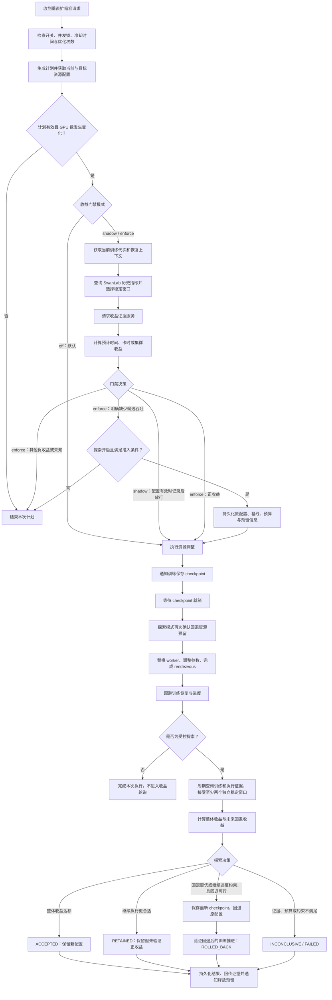
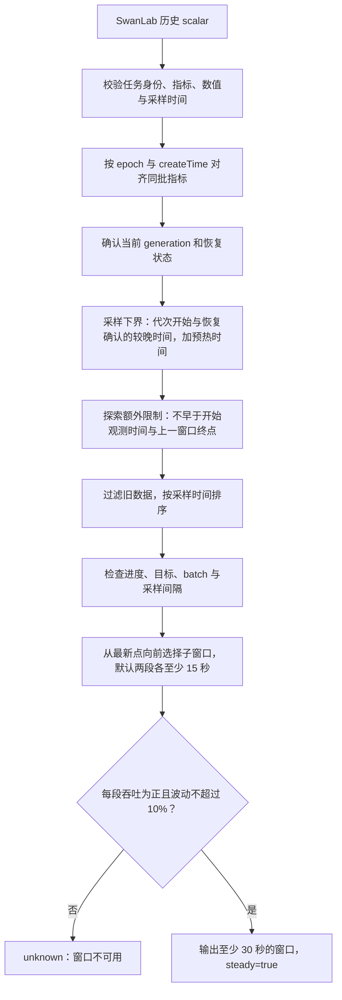

# 垂直弹性收益评估整体流程说明

整理日期：2026-10-29。本文根据当前仓库实现说明资源调整前的收益评估、SwanLab 数据获取、受控探索及回退流程。文中的配置值是代码默认值，不代表线上任务的实际配置。

当前流程先生成资源计划，在通知训练保存 checkpoint 前评估收益。有可信候选性能时进行事前预测；明确缺少候选性能时，可以通过受控探索实测新配置，再决定保留或回退。收益门禁默认关闭，探索也默认关闭。

## 1. 整体流程



图中展示已配置独立 SwanLab 客户端的路径。没有配置 scalar URL 且没有开启 mock 时，训练窗口由收益证据服务的完整快照提供。采集或校验失败会得到 `unknown`，不会按缺失值为零继续计算。

## 2. 资源计划何时进入收益评估

资源调整入口检查功能开关、并发执行保护及探索状态保护。执行线程随后检查冷却时间、优化次数等条件，调用优化器生成目标资源计划。

计划为空、目标 GPU 数无效或与当前相同时，不进入后续资源替换。有效计划进入 `_check_resource_benefit()`，通过后才执行 `_execute_resource_plan()`，通知训练保存 checkpoint。

因此，收益门禁拒绝发生在 checkpoint 通知之前，当前计划不会因为收益评估失败而先替换 worker。普通路径不会在该计划内持续轮询等待训练窗口变稳；`enforce` 下证据不足会结束本次计划，后续需要新的调整触发。

收益门禁的三个模式：

| 模式 | 默认情况及行为 |
| --- | --- |
| `off` | 默认值；跳过收益评估，沿原资源调整路径执行 |
| `shadow` | 配置有效时记录评估结果，不因收益为负或未知阻止调整 |
| `enforce` | 正收益才放行；明确缺少候选吞吐时可尝试探索准入 |

## 3. SwanLab 数据什么时候采集

### 3.1 训练端上报与 Master 查询

训练端上报与 Master 查询是两个独立动作。

`training_metric_payload()` 只生成日志字段，不自动调用 SwanLab，也不向训练脚本注入采样逻辑。其使用约定是在 global rank 0 完成 optimizer step 后，将指标同批上报。实际每隔多少 step 或多少秒上报，由训练脚本的日志配置决定。

Master 从 scalar 接口拉取已经存在的历史采样点，在本地选取满足要求的窗口；不会在一次请求中现场等待 30 秒采样。

| 场景 | 查询时机 | 行为 |
| --- | --- | --- |
| 普通调整前 | 有效计划生成后、checkpoint 通知前 | 一次收益评估中先查询 SwanLab，再请求证据服务 |
| 普通调整完成后 | 执行完成与恢复跟踪阶段 | 普通路径不自动进入持续收益评估循环 |
| 受控探索 | 切换完成进入 `OBSERVING` 后 | 每轮观测后默认等待 10 秒再查询；实际周期还包含请求耗时 |
| 回退验证 | 回退完成进入 `VERIFYING_ROLLBACK` 后 | 继续查询，验证原配置的新代次训练已经推进 |
| 替换前资源变更授权 | checkpoint 就绪后、资源变更前 | 只请求证据服务，不查询 SwanLab |
| 探索终态释放预留 | 探索结束后 | 只请求证据服务，不查询 SwanLab |
| 门禁关闭 | `DLROVER_BENEFIT_MODE=off` | 该收益路径不查询 SwanLab |

### 3.2 查询身份与指标

SwanLab 的 `taskId` 仅来自当前任务顶层标签：

```yaml
metadata:
  labels:
    low_code_platform_task_id: "实际平台任务 ID"
```

该 ID 在扩缩容和 training generation 变化期间保持不变。缺失时不使用 job name、job UID 或进程环境中的其他任务 ID 猜测身份。

| 模式 | 默认查询 key | step 工作量可比性 |
| --- | --- | --- |
| 默认模式 | `train/global_step`、`train/total_steps`、`train/global_batch_size` | 检查窗口内 global batch size 一致 |
| 固定 batch 模式 | `global_step`、`max_steps`、`train_speed` | 显式假设扩缩容前后每个 optimizer step 的工作量固定 |

固定 batch 模式需要设置 `DLROVER_SWANLAB_ASSUME_FIXED_BATCH=true`，不伪造 batch size，而是记录 `batch_size_source=assumed_fixed`。指标 key 可通过 `DLROVER_SWANLAB_KEYS` 映射。

请求示例，采用固定 batch 模式：

```json
{
  "taskId": "实际平台任务 ID",
  "taskScalarList": [
    {"key": "global_step"},
    {"key": "max_steps"},
    {"key": "train_speed"}
  ]
}
```

### 3.3 稳定窗口如何生成



具体规则如下：

1. 使用采样点的 `createTime`，不使用请求时间或入库时间。无时区字符串默认按 `+08:00` 解析。时间语义配置为非 `sample` 时拒绝窗口。
2. 同批指标按 `(epoch, createTime 对应时间戳)` 精确对齐，不按数组下标拼接。缺项或冲突重复值不可用，相同重复点不增加证据。
3. Master 在训练 rendezvous 完成时记录 generation 与开始时间。历史数据先按时间边界过滤，合格窗口才附加当前 generation。
4. 恢复未确认时不接受窗口。默认下界为 `max(代次开始时间, 恢复确认时间) + 60 秒`。探索还要求不早于 `observation_after` 和 `last_window_end`。
5. 最新采样点默认不得早于当前时间 60 秒；未来采样时间非法。进度回退视为异常，目标或 batch 改变、相邻采样间隔超过 60 秒时重新积累稳定序列。
6. 默认选择两个不重叠子窗口，每段至少 15 秒，总跨度至少 30 秒，至少需要三个独立采样点。稀疏采样可能使实际窗口更长。
7. 每段吞吐必须为正，且 `(最大吞吐 - 最小吞吐) / 最小吞吐 ≤ 10%`。
8. 查询过程中 generation 或恢复上下文发生变化，本次评估作废。

例如代次在 `10:00:00` 开始，且没有更晚的恢复确认，默认预热后可使用 `10:01:00` 起的数据。如果 `10:01:00`、`10:01:15`、`10:01:30` 三个点齐全且稳定，理论上 `10:01:30` 起才具备第一个合格窗口，还需等待数据实际上报并可查询。

`steady=true` 是根据恢复、预热和进度推断的稳定状态。模型、数据集和并行语义是否一致，仍需证据服务确认。

## 4. 收益计算的数据来源

| 数据 | 来源 | 用途 |
| --- | --- | --- |
| 已完成 step、总 step、采样时间 | SwanLab 或完整证据快照 | 计算当前吞吐和剩余工作量 |
| 当前、目标 worker 数与每 worker 卡数 | DLRover 资源状态和计划 | 计算前后总卡数 |
| 候选吞吐下界 | 收益证据服务 | 预测目标配置性能；需 `trial/profile/history` 及证据 ID |
| 切换耗时上界 | 收益证据服务 | 扣除无有效训练进展时间 |
| 重放工作量上界 | 收益证据服务 | 计入恢复后的重复执行开销 |
| 切换 GPU·秒上界 | 收益证据服务 | 计入切换期资源占用 |
| 可调度性、约束、允许延迟、deadline | 收益证据服务 | 判断能否执行 |
| 训练语义可比性 | 收益证据服务 | 确认模型、数据和并行语义可比较 |

候选吞吐不按 GPU 数量线性推算。切换成本目前仍由外部输入，尚未自动根据历史执行记录估计。独立 SwanLab 客户端启用后，本次观测会覆盖快照中的训练指标，但仍要求证据服务返回 `training.comparable=true`。

未配置独立客户端时使用完整快照模式；配置后采集失败不会回退使用证据服务中的旧训练数据。`DLROVER_BENEFIT_HTTP_URL` 和 `DLROVER_SWANLAB_HTTP_URL` 是不同接口。

## 5. 常规收益计算

### 5.1 变量与公式

| 符号 | 含义 | 单位 |
| --- | --- | --- |
| q0 | 当前配置稳定吞吐 | steps/s |
| q1 | 候选配置保守吞吐 | steps/s |
| W | 剩余训练工作量 | step |
| G0、G1 | 调整前、后总 GPU 数 | 卡 |
| D | 切换无有效进展时间上界 | 秒 |
| R | 恢复重放工作量上界 | step |
| C | 切换阶段资源占用上界 | GPU·秒 |

```text
q0 = (窗口结束 step - 窗口开始 step) / (窗口结束时间 - 窗口开始时间)
W = 总训练 step - 窗口结束 step
G0 = 当前 worker 数 × 当前每 worker GPU 数
G1 = 目标 worker 数 × 目标每 worker GPU 数

保持当前配置：
T0 = W / q0
H0 = G0 × T0 / 3600

执行调整：
T1 = D + (W + R) / q1
H1 = [C + G1 × (W + R) / q1] / 3600

时间收益 = T0 - T1
GPU 卡时收益 = H0 - H1
```

`H0/H1` 单位是 GPU·小时。重放增加执行开销，不增加净训练目标。`C` 应覆盖切换期间资源占用，包括必要的新旧资源重叠，且不能与稳态训练部分重复计入。

固定 batch 模式也使用进度增量除以采样时间差计算吞吐。最新 `train_speed` 仅用于核对：

```text
speed_relative_difference = |最新 train_speed - q0| / q0
```

该差异本身不直接决定放行。当前 scalar 适配器采用 steps 口径，通用计算器还支持 samples、tokens。

### 5.2 判定与约束

正收益要求 `gain > 0` 且 `gain ≥ min_gain_ratio × baseline`，默认最小收益比例为 5%。

| 目标 | gain | baseline |
| --- | --- | --- |
| `time` | T0 - T1 | T0 |
| `gpu_hours` | H0 - H1 | H0 |
| `cluster_jct` | 受影响任务加权预计剩余完成时间减少量 | 同一组任务的加权基线剩余完成时间 |

所有目标均检查 `T1 - T0 ≤ max_delay_seconds`；若有 deadline，还要求 `当前时间 + T1 ≤ deadline`。当前仅支持 worker 数不变、GPU 资源类型一致的垂直收益比较。

| 结果 | 含义 |
| --- | --- |
| `positive` | 数据有效、约束满足、收益达标 |
| `negative` | 收益不足，或明确不可调度、违反时限、无剩余工作量等 |
| `unknown` | 数据缺失、过期、不稳定、身份不一致、配置错误或接口失败等 |

### 5.3 集群目标

```text
集群收益 = 当前任务权重 × (T0 - T1)
         + Σ 其他任务权重 × (基线剩余完成时间 - 调整后剩余完成时间)

集群基线 = 当前任务权重 × T0
         + Σ 其他任务权重 × 其他任务基线剩余完成时间
```

证据服务必须声明受影响集合完整，并提供其他任务的预测，不能遗漏受到负面影响的任务、重复任务或再次包含当前任务。排队任务的剩余完成时间应包括等待时间。当前不支持未知候选性能下的 `cluster_jct` 自动探索。

### 5.4 计算示例

假设总卡数从 4 卡增加到 8 卡，当前 30 秒完成 60 step，剩余 6000 step，候选吞吐为 3.5 step/s，切换耗时 120 秒、重放 20 step、切换资源占用 960 GPU·秒：

```text
q0 = 60 / 30 = 2 step/s
T0 = 6000 / 2 = 3000 秒
T1 = 120 + 6020 / 3.5 = 1840 秒
时间节省 = 1160 秒，约 38.7%

H0 = 4 × 3000 / 3600 ≈ 3.33 GPU·小时
H1 = (960 + 8 × 1720) / 3600 ≈ 4.09 GPU·小时
卡时节省 ≈ -0.76 GPU·小时
```

在其他约束满足时，时间目标可通过，卡时目标不通过。加速与节省卡时是不同目标。

## 6. 资源调整执行过程

门禁放行后进入保存 checkpoint 阶段，等待训练上报完成。探索模式会在替换前持久化 checkpoint 和切换状态，并重新确认回退预留。

随后等待旧 worker 退出、提交资源计划、等待目标 worker 参数调整就绪，完成 rendezvous 协调。代码记录执行完成并启动恢复跟踪；执行完成不等于训练已经稳定恢复，恢复还需后续进度确认。

普通计划到此不再自动进入收益观测循环。探索计划转入 `OBSERVING`，等待新代次恢复、预热并形成有效窗口。

## 7. 候选性能未知时的受控探索

### 7.1 准入

只有同时满足以下条件才可能探索：

- 门禁模式为 `enforce`，且 `DLROVER_BENEFIT_EXPLORE=true`。
- 候选明确返回 `{"status":"unavailable"}`；其他缺字段、超时或无效证据不触发探索。
- 当前 worker 全部健康，数量与 GPU 配置一致，目标是合法相邻 GPU 档位，其他资源配置符合检查。
- 支持停稳 checkpoint、跨档位恢复和一次回退。
- 外部调度服务已经真实建立回退资源预留，且有效期足够。
- 时间、卡时、延迟与 deadline 预算覆盖探索和回退。
- 配置可靠的共享持久化状态目录，支持文件锁与原子写入。

每个 job UID 最多一次探索和一次回退。默认探索预算为 600 秒，涵盖 checkpoint、切换、恢复、预热与观测；卡时预算必须显式配置。预留资源占用也需计入预算，DLRover 不会凭接口的 `confirmed=true` 自行创建预留。

### 7.2 调整后的观测

每轮观测校验实际生效计划、全部 worker readiness、加载的 checkpoint、generation、训练目标与 batch 语义，以及回退预留和资源消耗。

观测进度必须超过 checkpoint step，使用调整后的新代次，窗口不得早于开始观测时间或上一窗口终点。至少接受两个独立完整窗口，取已接受窗口吞吐的最小值作为候选保守吞吐。

这里有两层窗口要求：每个 SwanLab 窗口内部默认包含两个稳定子窗口；探索至少接受两个这样的完整窗口。10 秒轮询并不意味着每轮都能生成新证据。

### 7.3 整体收益与未来回退收益

探索开始保存原吞吐 q0 和原配置预计剩余时间 Tbase。设 E 为已耗时间，Wnow 为当前剩余 step，S 为探索累计 GPU·秒，Db/Cb 为回退耗时及资源占用上界：

```text
继续新配置的未来时间 K = Wnow / q1
回退并完成的未来时间 B = Db + Wnow / q0

整体时间收益 = Tbase - E - K
未来回退时间收益 = K - B

整体资源收益 = G0 × Tbase - S - G1 × K
未来回退资源收益 = G1 × K - Cb - G0 × Wnow / q0
```

资源目标下探索结果的单位为 GPU·秒，转换为 GPU·小时需除以 3600。S 由证据服务提供，应包含切换、训练和预留资源，不能从 GPU 利用率推算。

整体收益回答此次探索从开始算是否划算；未来回退收益回答从现在起回退是否更划算。整体收益为负不意味着必须回退，已经发生的开销不会因为回退而消失。

### 7.4 决策顺序

| 条件 | 结果 |
| --- | --- |
| 继续执行符合约束、整体收益达标且预算满足 | `ACCEPTED`，保留新配置 |
| 未达到上述条件，回退更划算或继续违反约束，且回退可行 | 发起一次回退 |
| 继续可行且预算满足，回退没有优势 | `RETAINED`，保留但不声明验证了正收益 |
| 观测超时、预留失效、预算或约束无法满足 | `INCONCLUSIVE`，不盲目回退 |
| checkpoint、切换等执行失败 | 可进入 `FAILED` |

回退使用新的独立计划 ID，通知当前训练保存最新 checkpoint，不直接加载探索前的旧 checkpoint。回退完成后进入 `VERIFYING_ROLLBACK`，同样接受至少两个有效窗口、确认新代次训练推进后才标记 `ROLLED_BACK`。

失败或无法判定的状态会阻止后续自动调整；没有可信进度或有效预留时不会强制删除 worker 来猜测性回退。

## 8. 配置与默认值

| 配置 | 默认值 | 作用 |
| --- | --- | --- |
| `DLROVER_BENEFIT_MODE` | `off` | 收益门禁模式 |
| `DLROVER_BENEFIT_OBJECTIVE` | `time` | 时间、卡时或集群目标 |
| `DLROVER_BENEFIT_HTTP_URL` | 空 | 收益证据接口 |
| `DLROVER_SWANLAB_HTTP_URL` | 空 | 独立 scalar 接口 |
| `DLROVER_BENEFIT_TIMEOUT_SECONDS` | 3 | HTTP 请求超时；并非两个接口合计的总超时 |
| `DLROVER_BENEFIT_MAX_AGE_SECONDS` | 60 | 快照与最新采样时效；也用于检查采样间隔 |
| `DLROVER_BENEFIT_MIN_WINDOW_SECONDS` | 30 | 最小完整训练窗口 |
| `DLROVER_BENEFIT_MIN_GAIN_RATIO` | 0.05 | 最小收益比例 |
| `DLROVER_SWANLAB_ASSUME_FIXED_BATCH` | `false` | 是否显式假设 step 工作量固定 |
| `DLROVER_SWANLAB_TIME_SOURCE` | `sample` | createTime 时间语义 |
| `DLROVER_SWANLAB_UTC_OFFSET` | `+08:00` | 无时区采样时间的偏移 |
| `DLROVER_SWANLAB_WARMUP_SECONDS` | 60 | 代次或恢复后的预热时间 |
| `DLROVER_SWANLAB_STEADY_WINDOWS` | 2 | 单个完整窗口内的稳定子窗口数 |
| `DLROVER_SWANLAB_MAX_THROUGHPUT_VARIATION` | 0.1 | 子窗口吞吐相对波动上限 |
| `DLROVER_BENEFIT_EXPLORE` | `false` | 受控探索开关 |
| `DLROVER_BENEFIT_STATE_DIR` | 空 | 探索持久化状态目录，启用探索时必需 |
| `DLROVER_BENEFIT_TRIAL_SECONDS` | 600 | 探索时间预算 |
| `DLROVER_BENEFIT_TRIAL_POLL_SECONDS` | 10 | 观测轮次之间的等待时间 |
| `DLROVER_BENEFIT_TRIAL_GPU_HOURS` | 0 | 探索卡时预算，需显式设置 |
| `DLROVER_BENEFIT_TRIAL_COOLDOWN_SECONDS` | 1800 | 探索终态后的冷却时间 |

## 9. 结果保存、恢复与能力边界

普通评估记录结构化日志、事件及 `dlrover_master_vertical_benefit_evaluations_total` 计数。最近请求和结果位于 guard 的进程内状态，不是持久化收益账本。

探索将原配置、基线、预算、checkpoint、窗口及结果写入持久化 journal，并使用文件锁保护。终态请求回传实测性能和结果，通知证据服务保存证据、释放预留；服务确认需匹配请求及探索 ID。通知失败保留本地结果，后续进入或重启时重试，预留服务还需通过 TTL 保证最终释放。

Master 重启可恢复 `OBSERVING` 或 `VERIFYING_ROLLBACK` 的观测；中断于 `PREPARING`、`SWITCHING`、`ROLLING_BACK` 时，不能证明资源副作用是否完成，不自动重放替换，需要核对真实资源及 checkpoint 状态。

当前计算是预计剩余训练收益，以及探索中计入已发生开销的预测收益。尚未提供跨重启、覆盖完整作业生命周期的实际收益结算账本。普通扩缩容执行成功，不等于已经证明获得正收益；`RETAINED` 也不应计为成功降本。

## 10. 实现与相关文档

| 文件 | 关键入口或职责 |
| --- | --- |
| [job_resource_scaler.py](../../dlrover/python/master/node/job_resource_scaler.py) | `_try_execute_optimization`、`_check_resource_benefit`、`_execute_resource_plan`、`_observe_exploration` |
| [benefit.py](../../dlrover/python/master/resource/benefit.py) | `BenefitGuard` 请求编排、`evaluate` 收益计算与约束校验 |
| [swanlab.py](../../dlrover/python/master/resource/swanlab.py) | `fetch` 查询 scalar、`window` 筛选并验证稳定窗口 |
| [exploration.py](../../dlrover/python/master/resource/exploration.py) | `prepare` 准入、`inspect` 观测决策、状态持久化和预留释放 |
| [vertical_metrics.py](../../dlrover/python/master/monitor/vertical_metrics.py) | 执行与恢复跟踪、`training_observation_status` |
| [rdzv_manager.py](../../dlrover/python/master/elastic_training/rdzv_manager.py) | 训练 generation 与时间边界 |
| [training_metrics.py](../../dlrover/python/common/training_metrics.py) | 训练端同批上报字段辅助函数 |

相关资料：

- [收益指标清单](vertical-elastic-benefit-current-metrics-cn.md)
- [收益门禁与 HTTP 数据契约](vertical-elastic-benefit-http-cn.md)
- [收益日志说明](vertical-elastic-benefit-logging-cn.md)
- [垂直弹性执行指标](vertical-elastic-execution-metrics-cn.md)
- [SwanLab mock 验证](vertical-elastic-benefit-mock-cn.md)
