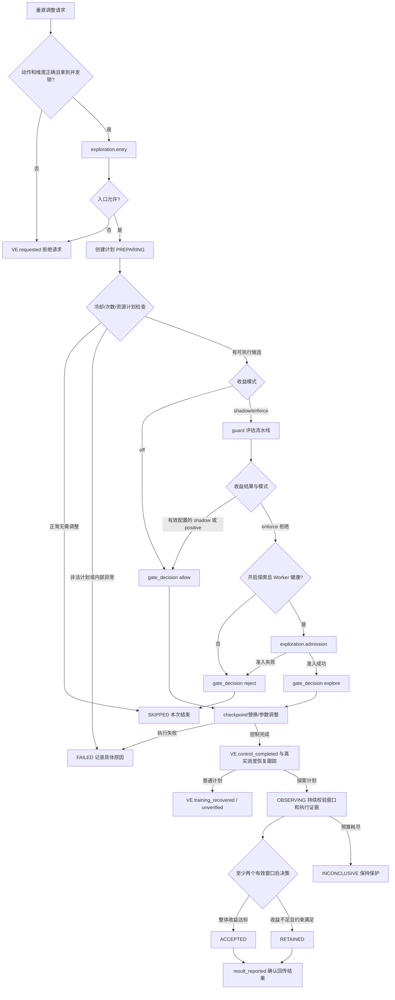
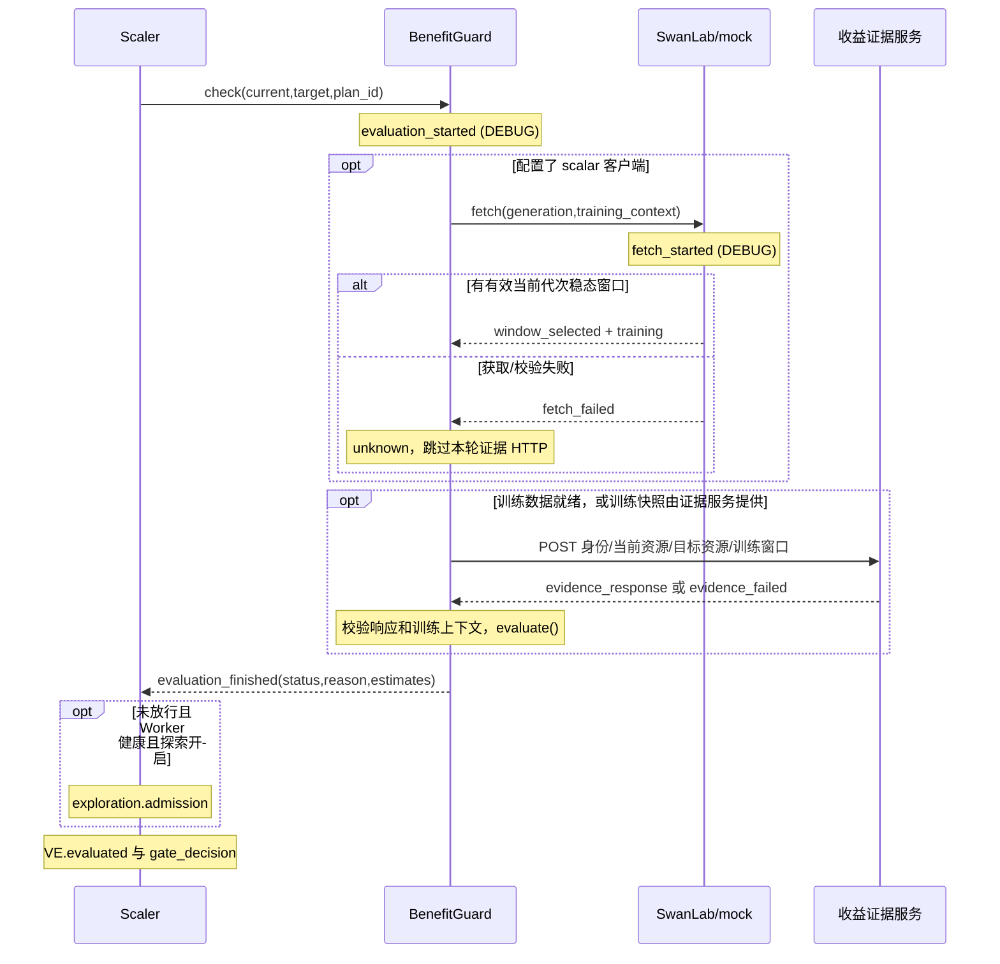
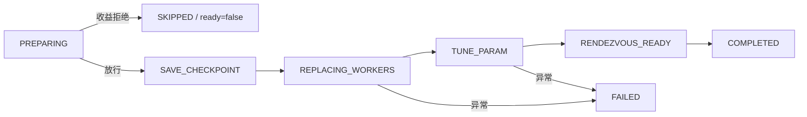

# BenefitFlow 完整流程与日志说明

整理日期：2026-10-30。本文按当前仓库实现说明所有 BenefitFlow 事件及其所在控制流程，包括收益拒绝后保留 Worker 的修复。配置默认值不代表运行中 Master 的实际值。示例日志为说明用片段，不是集群验收记录。

## 1. BenefitFlow 是什么

`BenefitFlow` 是 Master 的结构化诊断日志前缀，后面是一行 JSON。它描述数据获取、收益评估、门禁决策、资源执行和探索观测。它本身不是执行引擎，不是独立服务，也不是持久化收益账本。

业务控制分布在四个组件中：

| component | 实现 | 职责 |
| --- | --- | --- |
| `guard` | [benefit.py](../../dlrover/python/master/resource/benefit.py) | 配置、组装请求、调用证据服务、预测收益 |
| `swanlab` | [swanlab.py](../../dlrover/python/master/resource/swanlab.py) | HTTP/mock scalar 获取、当前代次窗口与稳态校验 |
| `execution` | [job_resource_scaler.py](../../dlrover/python/master/node/job_resource_scaler.py) | 最终门禁、checkpoint、Worker 替换 |
| `exploration` | [exploration.py](../../dlrover/python/master/resource/exploration.py) | 探索准入、目标授权、journal、实测、观测后保留 |

`VerticalElasticEvent` 是另一种日志，负责计划生命周期、控制完成、恢复和最终资源观测。以下图中标为 **VE** 的节点属于该事件体系，不是 BenefitFlow 的 event。

## 2. 先区分四种结果

| 结果层 | 字段及取值 | 回答的问题 |
| --- | --- | --- |
| 收益评估 | `evaluation_finished.status=positive/negative/unknown` | 当前证据能否支持收益结论？ |
| 最终门禁 | `gate_decision.decision=allow/reject/explore` | 这一计划是否可以进入执行？ |
| 资源执行 | `phase=preparing/save_checkpoint/replacing_workers/tune_param/rendezvous_ready/completed/skipped/failed` | 执行协议走到哪一步？ |
| 探索状态 | `state_saved.status=OBSERVING/ACCEPTED/...` | 试运行与后续决策走到哪一步？ |

因此：

- `unknown` 是证据不足，不是负收益，也不是 Worker 故障。
- `negative` 是未达目标或违反约束，不必然意味着预测耗时更长；正收益不足阈值也属于 negative。
- `allow` 不等于执行成功；shadow/off 也会放行。
- `COMPLETED` 表示控制流程完成，仍需确认训练恢复。
- `RETAINED` 表示保留新配置，不能写成“验证了正收益”。
- `BenefitFlow.finished` 是探索结束；普通门禁跳过使用的是 **VE.finished**，不能仅按 event 名混在一起统计。

## 3. 完整总流程



动作、并发、冷却、次数或空计划检查可能在门禁前结束。因此，并非每次 RPC 都会出现 `evaluation_finished` 或 `gate_decision`。入口线程和请求回报并发，外层 requested 与 preparing 日志的打印顺序也不保证严格串行。

## 4. 启动与请求入口

### 4.1 training_metrics_configured

初始化 BenefitGuard 时，如果配置了 SwanLab URL 或启用了 mock，会创建 scalar 客户端并输出：

```json
{"component":"guard","event":"training_metrics_configured","job_uid":"job-uid","task_id":"123","task_id_source":"job_label","valid":true,"data_source":"mock","suppressed":0}
```

`task_id` 来自 ElasticJob 顶层 `low_code_platform_task_id` label。缺少 label 时 `task_id_source=missing_job_label`，不能用进程环境中的同名任务 ID 补救。
`valid=true` 只证明客户端静态配置通过，不证明 mock 文件存在、窗口有效或训练已经恢复。门禁为 off 时也可能看到这条初始化日志。
未配置 scalar 客户端时，不产生这条日志；完整训练快照改由收益证据服务提供。

### 4.2 entry

通过动作/维度/并发检查后调用 `Exploration.enter()`。它检查开关、配置、持久化锁和历史 journal。

| 字段 | 含义 |
| --- | --- |
| `recovering` | false 为新请求；true 为 Master 恢复观测 |
| `allowed` | 是否允许进入本次调整/恢复流程，不是收益放行结论 |
| `enabled` | 探索开关 |
| `valid` | 探索预算等静态配置是否合法 |
| `plan_id/status` | 已加载 journal 对应的探索 ID/状态，首次可能为 null |

`enabled=false, valid=false, allowed=true` 可以是正常结果：没有探索状态目录、也没有启用探索时，普通资源调整仍可进入。
若历史状态不允许自动继续，返回 `allowed=false`，外层请求原因是 `exploration_fenced`；此时还没有新的收益评估。

## 5. 一次普通收益评估的时序



### 5.1 evaluation_started

生成新的证据 `request_id`，记录 current/target、mode、objective、generation。每轮探索观测和资源授权也会生成新 ID。
如果 URL、job_uid 或门禁配置在构造请求之前就不合法，会直接返回 `unknown/invalid_configuration`；此时可以只有 `evaluation_finished`，没有 `evaluation_started`，`request_id` 为 null。

### 5.2 fetch_started 与数据来源

传入 `timeout_seconds`、`max_age_seconds`、`min_window_seconds`、`after`。

- `data_source=http`：按 task ID 请求 scalar 接口。
- `data_source=mock`：读取本地 mock JSON，每轮重新加载；不访问真实 SwanLab 兜底。
- 普通评估的 `after=0`；探索为 `max(observation_after,last_window_end)`。

mock 只替换获取方式，后续身份、时间、恢复、步数、稳态检查不变。

### 5.3 当前代次窗口的筛选和验证

筛选下界：

```text
boundary = max(started_at, recovered_at) + warmup
lower = max(boundary, after)
保留 observed_at >= lower 且 observed_at > started_at 的采样
```

检查按以下顺序进行：

1. 时间来源必须为 sample；generation 与训练上下文一致；开始/恢复时间合法；`recovery_ready=true`。
2. 响应为指标序列列表，每条 taskId 匹配；key 必需且唯一。
3. 使用 `(epoch, createTime解析后的时间)` 对齐各指标点；拒绝不一致的重复点。
4. 时间不得在未来；步数和 batch 等计数合法；work 不超过 target_work。
5. 过滤后必须有样本，最新样本年龄不超过 max_age。
6. 同代次进度不能倒退；采样间隔过长或训练目标/batch 改变时，重新建立连续稳定段。
7. 稳定段要能组成至少 steady_windows 个子窗口，总长度至少 min_window。
8. 每个子窗口有正进度，吞吐波动满足 `(max(rate)-min(rate))/min(rate) <= max_variation`。

带 `+00:00` 的时间按 UTC 解析；`DLROVER_SWANLAB_UTC_OFFSET` 只补充没有时区的时间字符串，不会覆盖已有偏移。

### 5.4 window_selected

它说明找到合格的**当前配置训练窗口**，不代表候选配置有收益。

| 字段 | 解释 |
| --- | --- |
| `window_start/window_end` | 最终窗口两端的 Unix 秒时间 |
| `work_start/work_end/target_work` | 累计 optimizer step 和总目标 |
| `throughput` | `(work_end-work_start)/(window_end-window_start)`，steps/s |
| `series_count` | 返回指标序列数 |
| `sample_count` | 原响应所有序列点数之和，包含最终窗口之外的点，不是 batch 数或样本数 |
| `steady_source=inferred` | 通过子窗口推断稳态 |
| `steady_windows/warmup_seconds` | 本次实际稳态配置 |
| `batch_size_source/global_batch_size` | 测量 batch，或显式固定 batch 假设 |
| `reported_train_speed/speed_relative_difference` | 上报速度与计数差分速度的对照；不直接替代 throughput |
| `http_status` | HTTP scalar 响应状态；mock 时为 null |

三个指标各有三个点时，sample_count=9，但只有三个采样时刻。`window_selected` 也不能替代探索 journal 的 `windows` 计数。

### 5.5 fetch_failed

发生错误即抛回 guard，普通评估转为 unknown；不会继续用缺失数据推算吞吐。

| stage | 发生位置 | 常见 reason |
| --- | --- | --- |
| `configuration` | 客户端或 generation 不可用 | swanlab_not_configured_or_no_generation |
| `mock_file` | 文件不存在、不可读或 JSON 无效 | swanlab_mock_file_error |
| `http` | scalar HTTP 状态异常、网络异常 | swanlab_http_error / swanlab_http_or_payload_error |
| `decode` | HTTP 成功但 JSON 解析失败 | swanlab_http_or_payload_error |
| `window` | 数据内容、身份、代次或稳态不合格 | 见下表 |

窗口/标量校验原因完整分组：

| 类别 | reason |
| --- | --- |
| 配置与代次 | invalid_swanlab_configuration、untrusted_sample_time、missing_or_changed_training_context、invalid_generation_boundary、training_recovery_pending |
| 响应与指标结构 | invalid_scalar_response、task_identity_mismatch、unexpected_or_duplicate_key、invalid_scalar_series、invalid_scalar_point、missing_training_keys |
| 样本身份与对齐 | missing_sample_identity、invalid_sample_time、conflicting_scalar_sample、unaligned_scalar_samples、conflicting_training_sample |
| 数值与进度 | invalid_scalar、invalid_step_counter、invalid_training_sample、progress_regressed_within_generation、no_progress |
| 时效与稳态 | stale_or_missing_generation、insufficient_steady_samples、insufficient_progress_window、unstable_throughput |

`stale_or_missing_generation` 合并了“当前边界过滤后没有样本”和“最新样本过期”两种情况。单凭该 reason 不能区分，需联合 started_at/recovered_at、warmup、max_age 和实际 createTime 排查。

### 5.6 evidence_response / evidence_failed

SwanLab 窗口合格后，向收益证据服务请求候选吞吐、切换成本、调度约束、时限及可比性证据。

| 结果 | 日志与评估 |
| --- | --- |
| HTTP 200 | DEBUG evidence_response，继续解析和校验，不保证最后 positive |
| 非 200 | WARNING evidence_response；unknown/http_error |
| 网络、超时、解析或部分载荷异常 | WARNING evidence_failed；unknown/http_or_payload_error |
| 完整性/身份/数值检查失败 | evaluate 返回 unknown/invalid_or_missing_evidence，未必有 evidence_failed |

配置独立 scalar 客户端时，用其已验证 training 替换服务返回的 training 数据，但 `comparable=true` 仍须由证据服务明确确认。
请求过程中上下文变化会返回 `training_context_changed_during_fetch`；generation 单独变化会返回 `generation_changed_during_fetch`。
两次 HTTP 分别使用 timeout，并不是共享一个总 timeout。

## 6. 收益计算与最终门禁

### 6.1 常规计算公式

令 R 为剩余工作量，q0/q1 为当前吞吐/候选保守吞吐，D 为切换丢失秒数，W 为重放工作量，C 为切换 GPU 秒开销，G0/G1 为总卡数：

```text
T0 = R / q0
T1 = D + (R + W) / q1
时间收益 = T0 - T1
H0 = G0 × T0 / 3600
H1 = [C + G1 × (R + W) / q1] / 3600
卡时收益 = H0 - H1
```

`time` 以 T0 为收益比例分母；`gpu_hours` 以 H0 为分母。
`cluster_jct` 还需要完整队列影响，将本作业及其他受影响作业的预计剩余完成时间差按权重求和，使用对应加权基线作分母；缺队列证据返回 unknown。
判定必须同时满足 `gain > 0` 与 `gain >= min_gain_ratio × denominator`。默认最小比例0.05。
候选吞吐必须来自 profile/history/trial 证据及 evidence_id，不能按 GPU 数成比例推断，也不能直接用 GPU 利用率代替。

### 6.2 evaluation_finished

| status / reason | 含义 |
| --- | --- |
| positive / gain_above_threshold | 目标收益达到阈值 |
| negative / insufficient_gain | 收益不正或比例不足 |
| negative / no_remaining_work | 没有剩余训练工作 |
| negative / target_infeasible | 明确无法调度目标资源 |
| negative / scheduler_constraints | 明确违反调度约束 |
| negative / delay_budget | 预计延后超过允许值 |
| negative / deadline | 预计完成晚于 deadline |
| unknown / candidate_unavailable | 明确没有候选性能证据，是探索资格的必要条件 |
| unknown / invalid_or_missing_evidence | 快照缺失、不可比、身份/窗口/数值/队列等验证失败 |
| unknown / invalid_configuration | 门禁配置、URL 或 job_uid 不合法 |
| unknown / http_error、http_or_payload_error | 证据服务 HTTP 或载荷问题 |
| unknown / training_context_changed_during_fetch、generation_changed_during_fetch | 获取证据期间训练上下文改变 |
| unknown / SwanLab reason | 上节训练数据获取/窗口错误原样传播 |

常规 estimates 包括 current_throughput、candidate_throughput、remaining_work、baseline_seconds、candidate_seconds、time_gain_seconds、baseline_gpu_hours、candidate_gpu_hours、gpu_hours_saved；cluster_jct 另含 cluster_jct_gain_seconds。
错误发生早时 estimates 可以为空；candidate_unavailable 可只有 q0、剩余工作量和基线时间。

`operation` 分别为 evaluation、observation、authorize_mutation、report_result（另兼容旧journal的release_reservation）。后两种为控制请求，会跳过 scalar 获取；即使 evaluation_finished.status=unknown，也要继续看授权/回传专用日志，不能按普通收益结果判定授权是否成功。

### 6.3 gate_decision

| 模式/情况 | 最终决定 | 后续动作 |
| --- | --- | --- |
| off | allow，reason=disabled | 不调用收益检查；该事件不包含 status、request_id、workers_healthy 等普通分支字段 |
| 配置有效的 shadow | allow | 记录 positive/negative/unknown 后继续执行 |
| enforce + positive | allow | 进入 checkpoint/替换流程 |
| enforce + 未放行 + 探索准入成功 | explore | 进入有授权和观测约束的试运行 |
| enforce + 其他情况 | reject | 结束本次扩容/缩容，保留原有训练 |
| 非法模式/门禁配置 | 通常 reject | 不应把 shadow 理解为无条件绕过所有配置校验 |

这里“配置有效”特指 guard.valid：模式、数值预算、阈值和 objective 等检查。URL/job_uid 是后续请求校验；若 guard.valid=true 的 shadow 因这些请求字段返回 unknown/invalid_configuration，代码仍会放行。因此应结合 mode 与 decision 解读 invalid_configuration，不能只按 reason 推断被拦截。

`workers_healthy` 检查当前 Worker 数量、RUNNING、未释放和 GPU 配置是否一致。它是探索前提，不是对普通 positive/shadow 放行增加的一道健康门禁。
当前实现即使探索关闭也会读取真实 Worker 状态，不再因构造空列表而误报 false。
只有“门禁未放行、Worker 健康、探索开启”才调用 admission；没有 admission 日志不一定是日志缺失。

### 6.4 拒绝和真实替换失败的边界



修复后的拒绝路径：

1. `vertical_metrics.finish("skipped", "benefit_" + status)`，记录本次 skipped 结果。
2. 阶段管理器 `skip("Benefit gate: " + reason)`，置 SKIPPED、ready=false。
3. `_old_worker_ids` 只在门禁通过后选取，拒绝不会把原 Worker 标记成待替换对象。
4. 无 execution_started、无 checkpoint 请求、无资源替换；外层释放锁并结束本次调整。
5. `_replacement_started` 仅在进入 REPLACING_WORKERS 后置 true。`should_early_stop()` 的“Vertical replacement failed”分支必须同时满足该标记和 FAILED。

checkpoint/目标授权失败可以在替换前记录 FAILED；不能因此说“Worker 已替换失败”。也不能承诺所有执行前故障都不影响训练：checkpoint 协议已经启动时，Agent 自身仍可能报错。收益拒绝则发生在该协议之前。
作业原本的 OOM、Worker 故障、hang 等其他停止条件继续生效。

## 7. 放行后的资源执行

| 顺序 | 日志/阶段 | 可以确认的事实 |
| --- | --- | --- |
| 1 | execution_started | 进入执行函数；带 target_gpus，尚未证明 checkpoint 成功 |
| 2 | VE.phase_changed / save_checkpoint | 通知训练准备 checkpoint，等待上报与转换 |
| 3 | checkpoint_ready | 当前计划 checkpoint 已就绪；记录 checkpoint_step |
| 4 | 探索专有 state_saved + mutation_authorized | 持久化切换意图，并复核外部目标授权 |
| 5 | VE.phase_changed / replacing_workers | 实际进入替换阶段，设置替换开始标记 |
| 6 | replacement_submitted | 资源计划已提交，记录 target_workers；不等于 Pod 已就绪 |
| 7 | tune_param / rendezvous_ready | 等待新 Worker 参数就绪并协调入网 |
| 8 | VE.control_completed | 控制完成，开始训练恢复跟踪 |
| 9 | VE.training_recovered 或 unverified 结果 | 通过真实进度确认恢复，或无法确认 |

常见执行失败原因是 checkpoint_failed/checkpoint_timeout、reservation_lost、param_timeout、scale_failed；具体原因查看阶段信息、VE 和普通执行错误日志，不是每种失败都有独立 BenefitFlow event。

恢复检测当前使用目标 Worker 的进度报告：同一目标 Worker 至少两次时间递增的报告，后一次 step 超过前一次和 checkpoint step，才确认 recovered。当前实现不是“每个目标 Worker 都满足两次报告”后才确认；探索另行要求执行证据中的 all_workers_ready。
超时没有报告为 unverified，有报告但未确认增长为 timeout。普通计划恢复完成后发 VE.finished；探索继续自己的决策流程。
SwanLab mock 不能把真实恢复跟踪中的 recovery_ready 从 false 变成 true。

## 8. 受控探索的完整流程

### 8.1 准入与预算

仅enforce、time/gpu_hours、探索开启、明确candidate_unavailable且当前worker健康时申请探索。服务须显式返回policy=observe_only、allowed/checkpoint_compatible/quiescent_checkpoint=true；只允许GPU相邻档位变化，其他资源形状不变。无需回退能力、回退预算或预留。

共享持久POSIX目录保证文件锁与原子保存；每个job_uid最多一次探索。有效时长D=min(trial_seconds,Tbase)，必须>2×min_window，max_delay≥D，deadline若存在需≥now+Tbase+D，max(G0,G1)×D≤GPU秒预算。D包含checkpoint、切换、恢复、预热和观测，不是纯采样时间。

### 8.2 切换与观测

保存checkpoint后持久化SWITCHING，替换前重新核验目标可调度、约束与observe_only授权。控制切换完成后进入OBSERVING，持续校验真实applied_plan_id、恢复checkpoint、worker readiness、新generation、单位/目标/batch和累计GPU秒。

观测请求current/target均为候选配置，原资源在exploration.original。进度超过checkpoint，窗口不早于observation_after和上一窗口末端；至少接受两个独立完整窗口，候选保守吞吐q1取最小值。每个SwanLab窗口内部的稳定子窗口与探索的两个完整窗口是不同层次，重复文件不能凑数。

### 8.3 记录整体收益

保存原吞吐q0和基线剩余时间Tbase。令E为已耗时间，R为当前剩余工作，S为累计GPU秒，G0/G1为原/候选总GPU数：

```text
K = max(0,R)/q1
整体时间收益 = Tbase - E - K
整体资源收益 = G0*Tbase - S - G1*K  （GPU秒）
```

result保存吞吐、整体收益及比例、保持预计时间、elapsed、remaining、累计卡秒、evaluation_status、constraints_satisfied、窗口数和候选资源；另存candidate_generation/observed_at。仍是实测吞吐外推收益，不是整个作业实际收益结算。

### 8.4 决策与保护

| 条件 | 结果 |
| --- | --- |
| 两窗口有效、满足延迟/deadline、整体正收益达到阈值 | ACCEPTED/positive_observed_gain，保留候选 |
| 两窗口有效、满足约束但收益不足 | RETAINED/insufficient_observed_gain，保留候选，evaluation_status=negative |
| 有效结果违反延迟/deadline | INCONCLUSIVE/constraint_violation，保存负向结果并保护后续调整 |
| 时间或卡秒耗尽、训练完成前不足两窗口 | INCONCLUSIVE，保留保护，不冒充有效正收益 |
| checkpoint或切换执行失败 | FAILED，保留保护 |

以上均不自动回退，不生成反向计划；异常不代表训练健康，需要核对现场。限额采用基线和当前更严格值。详细协议和升级兼容见[HTTP契约](vertical-elastic-benefit-http-cn.md)。

### 8.5 日志与终态回传

准入新拒绝原因observation_policy_required表示服务未明确返回observe_only；insufficient_remaining_time表示有效时长不足两个最小窗口。admission.allowed=true前已保存PREPARING，不额外产生state_saved(PREPARING)。checkpoint后保存SWITCHING，再发authorize_mutation；失败记录exploration_authorization_denied。

观测过程中observation_wait可记录执行/窗口不匹配、原代次、代次变化、checkpoint未超过、累计卡秒倒退、缺新窗口或无效数据。卡秒耗尽直接INCONCLUSIVE/gpu_budget_exhausted；到期为observation_budget_exhausted。有效两窗口保存result后发observed_benefit和finished。

所有新终态均report_result，回传不依赖SwanLab窗口；匹配的服务确认才写reported=true、result_reported.acknowledged=true。失败在下次进入/重启时重试；FAILED/INCONCLUSIVE即使回传成功仍阻止后续调整。RETAINED在VE日志中evaluation_status=negative，恢复证据可为verified_by_exploration，不能等同于获得正收益。

### 8.6 Master重启与升级

仅policy=observe_only且OBSERVING可恢复；保持原expires_at。PREPARING/SWITCHING或损坏journal要求人工核对；旧策略未完成状态（含OBSERVING、ROLLING_BACK、VERIFYING_ROLLBACK）不自动继续。旧已完成ROLLED_BACK仅兼容读取及必要的release_reservation通知。关闭开关不清除保护，不删除journal绕过。

正常停止保留可恢复观测状态，VE可记录suspended。ACCEPTED/RETAINED冷却后可允许普通门禁调整，但同job_uid不再探索。

## 9. 全部20种事件索引

DEBUG 事件只有启用相应日志级别时可见；所有事件都带 component/event/suppressed。

| component | event | 级别 | 关键字段/用途 |
| --- | --- | --- | --- |
| guard | training_metrics_configured | INFO | job_uid/task_id/task_id_source/valid/data_source |
| guard | evaluation_started | DEBUG | plan_id/request_id/generation/current/target/mode/objective |
| guard | evidence_response | 200为DEBUG，其余WARNING | http_status/duration_ms |
| guard | evidence_failed | WARNING | request_id/error_type |
| guard | evaluation_finished | INFO | operation/status/reason/estimates/min_gain_ratio/duration_ms |
| swanlab | fetch_started | DEBUG | timeout/max_age/min_window/after/task_id/generation/data_source |
| swanlab | fetch_failed | WARNING | stage/http_status/reason/error_type/duration_ms |
| swanlab | window_selected | INFO | 窗口起止、计数、吞吐、稳态/batch/速度对照 |
| execution | gate_decision | INFO | decision/mode/status/reason/exploration_enabled/workers_healthy；off 字段更少 |
| execution | execution_started | INFO | plan_id/target_gpus |
| execution | checkpoint_ready | INFO | plan_id/checkpoint_step |
| execution | replacement_submitted | INFO | plan_id/target_workers |
| exploration | entry | INFO | recovering/allowed/enabled/valid/plan_id/status |
| exploration | admission | INFO | allowed/reason；成功另有 q0、expires_at、gpu_budget、current_gpus/target_gpus |
| exploration | mutation_authorized | INFO | plan_id/allowed/request_id |
| exploration | state_saved | INFO | status/reason/windows/measured_lower/spent_gpu_seconds/gpu_budget/reported |
| exploration | observation_wait | INFO | status/reason/request_id/windows/remaining_seconds |
| exploration | observed_benefit | INFO | objective/windows/keep_allowed/min_gain_ratio/各收益估算 |
| exploration | finished | INFO | status/reason/windows/spent_gpu_seconds |
| exploration | result_reported | INFO | acknowledged/request_id |

## 10. ID、时间与限频规则

| 字段 | 用法 |
| --- | --- |
| job_uid | 作业实例身份，同名重建后不同 |
| task_id | scalar 所属平台任务，不是 job_uid |
| plan_id | 一次执行计划；探索全程使用同一个ID |
| policy | 当前固定observe_only |
| request_id | 单次证据请求；同一 plan 多轮请求各不相同，与 RPC 触发请求 ID 不同 |
| generation | 当前训练代次，不能用 task_id 或时间字符串替代 |
| duration_ms | 本次调用耗时，基于 monotonic 计时 |
| window时间/expires_at | Unix epoch 秒，基于墙钟，跨服务时钟需一致 |
| suppressed | 同事件最近重复结果被抑制的次数 |

带 repeat_key 的事件会限频：相同 event 的最近 key 相同且距上次输出不足60秒，则不输出并累加 suppressed；key 变化立即输出。不是每个不同 key 都有一个永久独立桶，也不是所有日志统一每分钟一次。
例如 state_saved 的 key 包含 ID/status/windows/reported，不含每个数值字段；同窗口的一些数值变化不一定立刻有新日志。日志有空档不能证明没有轮询或没有状态写入。
实现只输出选定字段，不输出 token、Authorization、完整响应/标量历史、URL 或任意异常原文。日志写入失败被捕获，不影响业务决定；这也意味着不能把“缺某条日志”单独当作业务动作未发生的证明。

## 11. 典型日志链与排查顺序

以下只写 event 名，VE 单独标出，DEBUG 关闭时会缺对应开始/HTTP成功事件。

| 场景 | 典型链路 |
| --- | --- |
| 普通正收益 | entry → evaluation_started → fetch_started → window_selected → evidence_response → evaluation_finished(positive) → gate_decision(allow) → execution_started → checkpoint_ready → replacement_submitted → VE.control_completed → VE.training_recovered → VE.finished |
| 数据过期/预热边界无样本 | entry → evaluation_started → fetch_started → fetch_failed(stale_or_missing_generation) → evaluation_finished(unknown) → gate_decision(reject) → VE.finished(skipped) |
| 明确负收益 | window_selected → evidence_response → evaluation_finished(negative) → gate_decision(reject) → VE.finished(skipped) |
| shadow 负收益 | evaluation_finished(negative) → gate_decision(allow) → 执行与恢复 |
| off | entry → gate_decision(allow,disabled) → 执行与恢复；没有本次收益获取/计算 |
| 候选 unavailable，探索关闭 | evaluation_finished(unknown,candidate_unavailable) → gate_decision(reject) |
| 探索准入拒绝 | evaluation_finished(unknown,...) → admission(false,具体原因) → gate_decision(reject) |
| 探索接受 | admission(true) → gate_decision(explore) → 执行/授权 → state_saved(OBSERVING) → 多轮窗口/等待 → observed_benefit → state_saved(ACCEPTED) → finished → result_reported |
| 探索收益不足 | observed_benefit → state_saved(RETAINED) → VE.exploration_decided → finished → result_reported；无反向执行 |
| 探索超时 | 多轮 observation_wait → state_saved(INCONCLUSIVE) → finished(observation_budget_exhausted) → VE探索结果；不能假设后面必有 result_reported |

例如此次问题的正常修复后日志应类似：

```json
{"component":"swanlab","event":"fetch_failed","plan_id":"p1","reason":"stale_or_missing_generation","data_source":"mock"}
{"component":"guard","event":"evaluation_finished","plan_id":"p1","status":"unknown","reason":"stale_or_missing_generation","estimates":{}}
{"component":"execution","event":"gate_decision","plan_id":"p1","mode":"enforce","decision":"reject","status":"unknown","exploration_enabled":false,"workers_healthy":true}
```

随后是 VE.finished 的 `execution_status=skipped`、`reason_code=benefit_unknown`。不会进入本计划的 execution_started；训练应继续。示例省略非核心字段。

排查时先定位 plan_id，再按以下顺序回答：

1. 有没有 entry / 请求受理？没有则检查动作、维度、并发和上游触发。
2. 有没有 gate_decision？没有则检查冷却、次数、空计划和线程异常。
3. reject 时看 evaluation_finished.status/reason；unknown 从 fetch_failed 或 evidence_* 向前找。
4. 有 window_selected 但 unknown，重点检查候选证据、可比性、约束、身份和队列完整性。
5. allow/explore 后没有 checkpoint_ready，查 checkpoint 回报和转换链路。
6. checkpoint_ready 后没有 replacement_submitted，探索重点看 mutation_authorized。
7. control_completed 后没有 training_recovered，查真实进度回报、checkpoint step 和恢复超时；不要直接修改 mock 伪造恢复。
8. exploration windows 不增加，看 observation_wait；增加后无预期决策，看 observed_benefit 的成本、约束与预算。
9. finished 后缺 result_reported，先区分成功终态与保护状态，再核对服务账本和 TTL。

```bash
rg 'BenefitFlow|VerticalElasticEvent' master.log
rg '具体plan_id' master.log
rg 'fetch_failed|evaluation_finished|gate_decision|observation_wait|observed_benefit|result_reported' master.log
```

普通路径没有“自动等窗口变好再重试同一门禁”的循环；拒绝后需要新请求。只有进入探索观测后，才按预算持续轮询。

## 12. 实现和验证对应关系

本文事件清单可用 Python AST 提取四个组件中 `.emit()` 的字符串事件名比对，避免遗漏；不是凭日志样例推断“所有事件”。

| 文件 | 核对内容 |
| --- | --- |
| [benefit_log.py](../../dlrover/python/master/resource/benefit_log.py) | JSON封装、默认INFO、限频、异常隔离 |
| [benefit.py](../../dlrover/python/master/resource/benefit.py) | 五种guard事件、收益公式、mode与operation |
| [swanlab.py](../../dlrover/python/master/resource/swanlab.py) | 三种scalar事件及全部窗口错误 |
| [job_resource_scaler.py](../../dlrover/python/master/node/job_resource_scaler.py) | 四种execution事件、门禁/替换边界、探索执行/恢复 |
| [exploration.py](../../dlrover/python/master/resource/exploration.py) | 八种探索事件、状态、准入、预算、观测与回传 |
| [dist_job_manager.py](../../dlrover/python/master/node/dist_job_manager.py) | 实际替换开始后的FAILED提前停止分支 |
| [vertical_metrics.py](../../dlrover/python/master/monitor/vertical_metrics.py) | 执行结果幂等结束与真实进度恢复跟踪 |
| [vertical_events.py](../../dlrover/python/master/monitor/vertical_events.py) | VE事件、root/parent关联、资源观测与最终结果 |

更多资料：[整体收益流程](vertical-elastic-benefit-flow-cn.md)、[HTTP契约](vertical-elastic-benefit-http-cn.md)、[Kubernetes场景手册](vertical-elastic-benefit-k8s-mock-test-cn.md)、[自动化执行说明](../../examples/pytorch/resource_elastic/benefit_validation/k8s-automation.md)。
