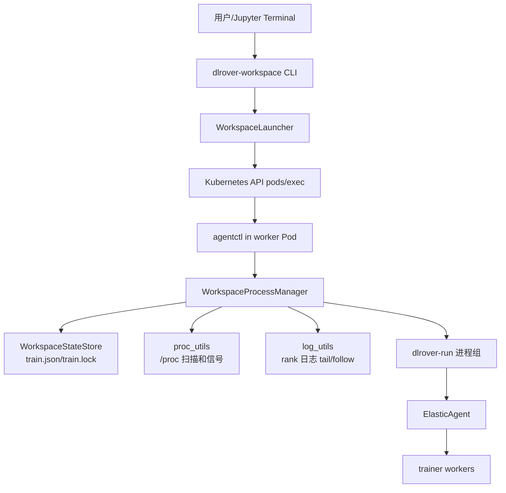
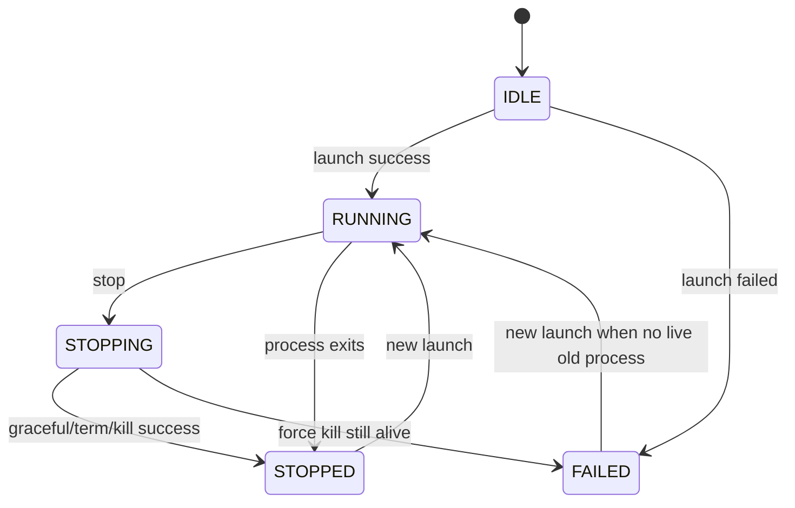
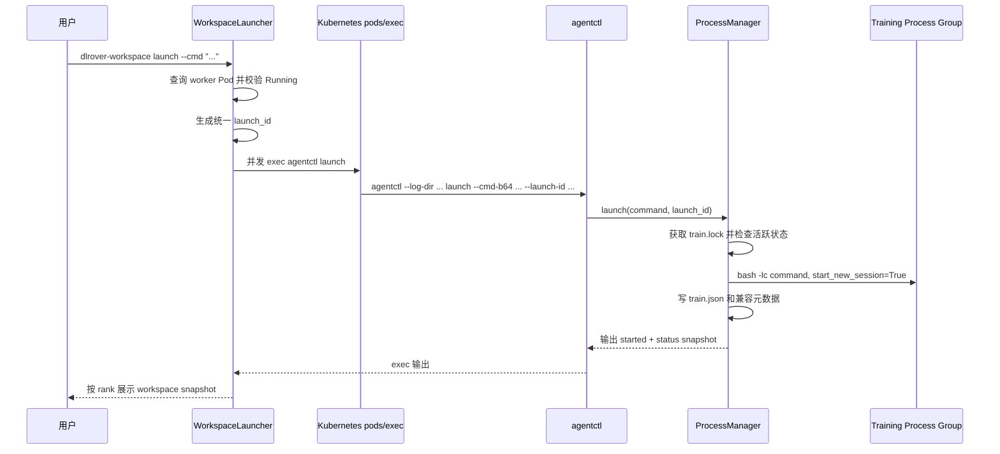
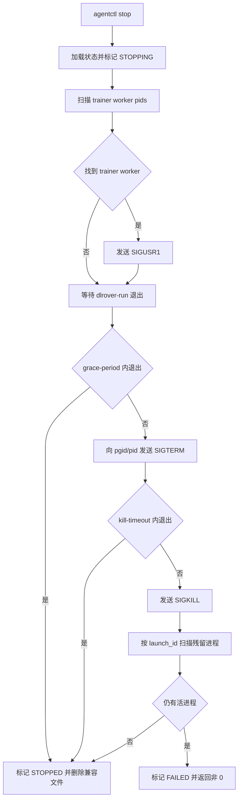

# DLRover Workspace Agentctl 训练生命周期实现设计

## 背景

DLRover Workspace 模式下，worker Pod 的生命周期和训练进程生命周期是两层
独立概念：

- worker Pod、Jupyter、idle command 属于环境生命周期，由 Kubernetes 和
  DLRover master 管理。
- `dlrover-run`、ElasticAgent、trainer 子进程属于训练生命周期，由用户在
  Workspace 中按需启动、停止和重启。

早期实现中，`dlrover-workspace launch/status/stop/logs` 通过 Kubernetes
`pods/exec` 把大段 shell 拼接后下发到每个 worker Pod。该方式可以工作，
但在生产场景有几个明显问题：

1. shell 字符串过长且难以测试，状态判断、进程扫描、停止逻辑耦合在一起。
2. 缺少统一状态机，只有 `train.pid/train.pgid/train.launch_id` 三个元数据
   文件，无法表达 `STOPPING/FAILED/UNKNOWN` 等中间或异常状态。
3. 并发 `launch/stop/status` 缺少容器内文件锁保护，可能出现重复启动或清理
   竞争。
4. `stop` 逻辑需要可靠识别同一轮训练进程，不能误杀 Jupyter、idle command
   或同 Pod 内其它辅助进程。
5. 训练停止需要先给框架侧优雅退出机会，再逐级兜底到进程组
   `SIGTERM/SIGKILL`，并在强杀后确认进程确实消失。

因此，第一阶段生产可用实现将容器内训练生命周期控制从大段 shell 中拆出，
新增 `agentctl` Python 入口。`WorkspaceLauncher` 继续负责 Kubernetes 侧
worker Pod 发现、排序、并发 exec 和输出装饰；Pod 内部的进程状态、锁、日志
和停止语义由 `agentctl` 负责。

## 目标

- 保留现有 Workspace CLI 用户体验。
- 保留 Kubernetes `pods/exec` 作为控制通道，不引入常驻 daemon。
- 将容器内生命周期逻辑从 shell 解耦为可测试 Python 模块。
- 使用文件锁和原子写入保证单 Pod 内状态一致性。
- 使用 `train.json` 表达训练状态，同时兼容旧的
  `train.pid/train.pgid/train.launch_id` 元数据文件。
- 通过 `DLROVER_WORKSPACE_LAUNCH_ID` 精确识别同一轮训练进程。
- 停止时优先通知 trainer 优雅退出，超时后按进程组兜底清理。
- 支持 DeepSpeed、MindSpeed、Swift、VL 等基于 `dlrover-run` 或 shell
  命令启动的训练工程。

## 非目标

- 不替代 `dlrover-run`、ElasticAgent 或训练框架自身的容错和 checkpoint。
- 不改变 DLRover master 的 rendezvous、弹性、worker Pod 创建逻辑。
- 不在第一阶段引入 sidecar daemon、HTTP API 或独立控制服务。
- 不保证任意被用户后台化的自定义命令都能被框架级优雅停止；兜底能力依赖
  进程组和 launch id 扫描。

## 总体架构



职责边界：

| 模块 | 职责 |
| --- | --- |
| `dlrover.python.workspace.launcher` | 查询 worker Pod、校验 Running、并发 `pods/exec`、装饰输出。 |
| `dlrover.python.workspace.agentctl` | Pod 内 CLI 入口，解析 `launch/status/stop/logs`。 |
| `dlrover.python.workspace.process_manager` | 训练进程启动、状态刷新、停止、兼容文件维护。 |
| `dlrover.python.workspace.state` | `train.json` 状态模型、`train.lock` 文件锁、原子写入。 |
| `dlrover.python.workspace.proc_utils` | `/proc` 进程信息读取、环境变量扫描、信号发送。 |
| `dlrover.python.workspace.log_utils` | rank 日志 `tail` 和 `follow`。 |

## 控制面调用方式

`WorkspaceLauncher` 仍然通过 Kubernetes exec 进入目标 worker Pod，但远端命令
变为短命令：

```bash
python_bin=${DLROVER_WORKSPACE_AGENTCTL_PYTHON:-python}
exec "$python_bin" -m dlrover.python.workspace.agentctl \
  --log-dir /tmp/dlrover-workspace <subcommand> ...
```

其中 `DLROVER_WORKSPACE_AGENTCTL_PYTHON` 用于在容器中 Python 命令不是
`python` 时覆盖解释器路径。

用户训练命令通过 base64 传入 `agentctl launch --cmd-b64`，避免复杂 shell
引号嵌套导致命令截断或转义错误。`agentctl` 解码后会构造一个很薄的运行
wrapper：

```bash
set -o pipefail
/bin/bash -lc "$DLROVER_WORKSPACE_USER_COMMAND" 2>&1 | \
  tee -a /tmp/dlrover-workspace/train.rank_<rank>.log /proc/1/fd/1 >/dev/null
```

该 wrapper 只负责 stdout/stderr 双写，不承载状态机、进程扫描或停止逻辑。
用户原始命令放在 `DLROVER_WORKSPACE_USER_COMMAND` 环境变量中，避免命令内
复杂引号、括号或多行脚本破坏 wrapper 结构。
最终仍由 Python 通过 `subprocess.Popen` 启动：

```python
subprocess.Popen(
    ["/bin/bash", "-lc", runner_command],
    stdin=subprocess.DEVNULL,
    stdout=subprocess.DEVNULL,
    stderr=subprocess.STDOUT,
    start_new_session=True,
    close_fds=True,
    env={**os.environ, "DLROVER_WORKSPACE_LAUNCH_ID": launch_id},
)
```

这样保留了用户原有 shell 命令兼容性，同时用 `start_new_session=True` 为本轮
训练创建独立 session 和 process group。训练输出会同时进入 rank 日志和容器
主进程 stdout，因此既可以通过 `dlrover-workspace logs` 查看，也可以通过
`kubectl logs` 查看。

可通过环境变量调整日志镜像行为：

```text
DLROVER_WORKSPACE_MIRROR_STDOUT=false
DLROVER_WORKSPACE_CONTAINER_STDOUT=/proc/1/fd/1
```

## 状态文件与兼容文件

默认目录：

```text
/tmp/dlrover-workspace/
```

新增权威状态文件：

```text
/tmp/dlrover-workspace/train.json
/tmp/dlrover-workspace/train.lock
```

兼容旧实现的元数据文件：

```text
/tmp/dlrover-workspace/train.pid
/tmp/dlrover-workspace/train.pgid
/tmp/dlrover-workspace/train.launch_id
```

rank 日志文件：

```text
/tmp/dlrover-workspace/train.rank_<NODE_RANK|unknown>.log
```

`train.json` 主要字段：

```json
{
  "version": 1,
  "state": "RUNNING",
  "launch_id": "uuid",
  "command": "dlrover-run ...",
  "pid": 123,
  "pgid": 123,
  "log_file": "/tmp/dlrover-workspace/train.rank_0.log",
  "started_at": 1780000000.0,
  "updated_at": 1780000001.0,
  "exit_code": null,
  "last_error": ""
}
```

兼容策略：

- 新实现启动训练后同时写 `train.json` 和三个旧元数据文件。
- 如果 `train.json` 不存在，但旧元数据文件存在，`agentctl` 会把旧元数据加载
  为 `RUNNING` 状态。
- 停止成功后删除旧元数据文件，但保留 `train.json` 中的最终状态，方便排障和
  UI 展示。

## 状态机



状态含义：

| 状态 | 含义 |
| --- | --- |
| `IDLE` | 未发现当前训练元数据。 |
| `RUNNING` | 当前训练进程组仍存活。 |
| `STOPPING` | stop 已开始，正在等待优雅退出或兜底清理。 |
| `STOPPED` | 训练已停止或自然退出。 |
| `FAILED` | 启动失败，或强制停止后仍有残留进程。 |
| `UNKNOWN` | 状态文件损坏或读取异常。 |

`launch` 防重策略：

- 进入 `agentctl launch` 后先获取 `train.lock`。
- 加载 `train.json` 或兼容元数据。
- 刷新进程存活状态。
- 如果仍存在活跃训练进程，则返回退出码 `2`，不启动新训练。

## 启动流程



启动后的训练进程继承环境变量：

```text
DLROVER_WORKSPACE_LAUNCH_ID=<launch_id>
```

该变量是后续 status、stop 和残留清理识别同一轮训练的核心依据。

## 状态查询流程

`agentctl status` 会：

1. 获取 `train.lock`。
2. 加载并刷新 `train.json` 或兼容元数据。
3. 如果 PID/PGID 已不存活，将状态更新为 `STOPPED`。
4. 扫描 `/proc/<pid>/environ`，查找同一 `launch_id` 且包含
   `TORCHELASTIC_RUN_ID/MASTER_ADDR/MASTER_PORT` 的 trainer worker。
5. 输出 `launch_id/state/process_group/log_file/dlrover-run/training`。

输出格式保持与 `WorkspaceLauncher` 的 workspace snapshot 兼容：

```text
[workspace]
  pod: worker-0
  phase: Running
  ip: 10.0.0.1
  node: node-0
  launch_id: ...
  state: RUNNING
  process_group: 123
  log_file: /tmp/dlrover-workspace/train.rank_0.log
  dlrover-run:
    process:
      pid: 123
      ppid: 1
      pgid: 123
      stat: S
      cmd: ...
  training:
    worker[0]:
      process:
        pid: 456
        ...
```

## 停止流程



停止策略：

- 优先扫描 trainer worker 进程，并发送 `SIGUSR1`。
- `SIGUSR1` 的语义由 DLRover ElasticAgent 或训练框架侧处理，用于触发优雅
  退出和 checkpoint。
- `grace-period` 超时后，对训练进程组发送 `SIGTERM`。
- `kill-timeout` 超时后，对训练进程组发送 `SIGKILL`。
- 最后按 `DLROVER_WORKSPACE_LAUNCH_ID` 扫描残留进程并清理。
- 强杀后仍发现活进程时，将状态标记为 `FAILED`，并返回非 0，避免误报停止
  成功。

不会终止的进程：

- Jupyter 主进程。
- idle command 主进程。
- 没有同一 `DLROVER_WORKSPACE_LAUNCH_ID` 的其它进程。

## 日志流程

训练 stdout/stderr 默认双写：

```text
/tmp/dlrover-workspace/train.rank_<rank>.log
/proc/1/fd/1
```

其中 rank log 供 `dlrover-workspace logs` 使用，`/proc/1/fd/1` 是容器主进程
stdout，供 `kubectl logs` 使用。对于 rank 0 主进程为 Jupyter、其它 rank
主进程为 idle command 的 Workspace Pod，这一步是让 `kubectl logs` 能看到
当前训练日志的关键。

CLI 查询：

```bash
dlrover-workspace logs --tail 100
dlrover-workspace logs --follow
```

`WorkspaceLauncher` 会在目标 worker Pod 中 exec：

```bash
python -m dlrover.python.workspace.agentctl --log-dir ... logs --tail 100
```

`--follow` 使用 Kubernetes streaming exec 持续返回 rank log。`kubectl logs`
则通过容器 stdout 镜像链路查看同一份训练输出。

## 并发与一致性

单 Pod 内所有状态修改都通过：

```text
/tmp/dlrover-workspace/train.lock
```

使用 `fcntl.flock(LOCK_EX)` 保护。状态文件写入使用临时文件加
`os.replace` 原子替换：

```text
train.json.<pid>.tmp -> train.json
```

这样可以避免：

- 两个 `launch` 同时通过存活检查。
- `stop` 清理元数据时 `status` 读到半写入状态。
- `agentctl` 异常退出导致 `train.json` 半截 JSON。

## 进程识别

进程识别依赖两层信息：

1. `pid/pgid`：用于定位 `dlrover-run` 进程组。
2. `DLROVER_WORKSPACE_LAUNCH_ID`：用于识别本轮训练所有继承环境变量的子进程。

trainer worker 识别条件：

```text
DLROVER_WORKSPACE_LAUNCH_ID=<launch_id>
TORCHELASTIC_RUN_ID=<non-empty>
MASTER_ADDR=<non-empty>
MASTER_PORT=<non-empty>
```

这样可以区分：

- `dlrover-run` 或 shell wrapper。
- ElasticAgent。
- 已进入 torch elastic rendezvous 的 trainer worker。

`proc_utils` 直接读取 `/proc/<pid>/stat`、`/proc/<pid>/cmdline` 和
`/proc/<pid>/environ`，避免依赖 `ps/awk/grep` 等外部命令，也便于单测。

## 与原有逻辑兼容性

对外保持兼容：

- `dlrover-workspace launch/status/stop/logs` 命令不变。
- Kubernetes Pod 查询、rank 排序、`--ranks`、`--max-workers` 逻辑不变。
- `train.pid/train.pgid/train.launch_id` 继续写入，便于旧排障方式和可能存在
  的外部 UI 读取。
- `foreground=True` 仍保持直接执行用户命令的旧行为。

内部变化：

- 后台训练不再由远端长 shell 直接 `nohup setsid`，而由
  `agentctl -> subprocess.Popen(start_new_session=True)` 启动。
- 训练日志默认双写到 rank log 和 `/proc/1/fd/1`，分别支持
  `dlrover-workspace logs --follow` 与 `kubectl logs`。
- 状态判断以 `train.json` 为主，旧元数据为兼容输入。

## 训练框架支持情况

该实现对训练框架的要求很低：只要训练可以通过 shell 命令启动，并继承
`DLROVER_WORKSPACE_LAUNCH_ID` 环境变量，就可以被 Workspace 管理。

| 框架/工程 | 支持情况 | 说明 |
| --- | --- | --- |
| DeepSpeed | 支持 | 通过 `dlrover-run ... deepspeed ...` 或项目启动脚本运行；stop 可先给 trainer 发 `SIGUSR1`，再兜底清理进程组。 |
| MindSpeed/Megatron | 支持 | 多进程由启动脚本和 torch elastic 管理；Workspace 负责外层进程组生命周期。 |
| Swift | 支持 | Swift CLI/脚本作为用户命令执行，日志和停止由 Workspace 管理。 |
| VL 多模态训练 | 支持 | 对训练内容无侵入，要求 checkpoint/恢复由训练脚本或框架负责。 |
| 自定义 shell 脚本 | 基本支持 | 如果脚本主动把关键子进程放到其它 session，可能只能依赖 launch id 残留扫描。 |

需要框架自身提供的能力：

- checkpoint 保存和恢复。
- 收到优雅停止信号后的退出逻辑。
- 多机多卡 rendezvous 和 rank/world size 管理。

## 生产限制

第一阶段仍有以下限制：

- `agentctl` 不是常驻 daemon，状态刷新发生在用户执行 `status/stop/launch` 时。
- 自然退出后的 exit code 不一定能在后续 `status` 中准确获取，因为
  `agentctl launch` 已经退出，后续进程不再是当前 `agentctl` 的子进程。
- 如果用户命令显式 `setsid` 或把训练进程完全脱离原进程组，停止将依赖
  `DLROVER_WORKSPACE_LAUNCH_ID` 扫描兜底。
- 如果容器禁用 `/proc/<pid>/environ` 读取，trainer worker 识别会降级，只能
  依赖 PID/PGID。
- 多 Pod 之间没有全局事务；`WorkspaceLauncher` 是并发 exec，每个 Pod 独立
  成功或失败，CLI 会按 rank 展示结果。

## 后续优化

第二阶段可考虑：

- 引入 Pod 内轻量 daemon 或 sidecar，持续采集状态和 exit code。
- 将状态上报到 DLRover master 或 CRD status，便于 UI/API 查询。
- 支持按 launch id 查询历史训练记录。
- 增加日志轮转和日志大小限制。
- 对 stop 结果增加结构化 JSON 输出，便于平台集成。
- 将 `SIGUSR1` 优雅停止协议在 DLRover ElasticAgent 和常见训练框架中进一步
  标准化。

## 验证

当前实现覆盖了以下测试：

- `WorkspaceLauncher` 生成 agentctl exec 命令。
- `logs --follow` 使用 streaming exec。
- `stop` 使用 agentctl 并保留 CLI 进度回调。
- `WorkspaceProcessManager` 在临时目录中真实启动训练进程。
- 重复启动返回冲突。
- `status` 输出运行状态。
- `stop` 清理进程和兼容元数据文件。

验证命令：

```bash
PYTHONPYCACHEPREFIX=/tmp/dlrover-pycache python -m py_compile \
  dlrover/python/workspace/state.py \
  dlrover/python/workspace/proc_utils.py \
  dlrover/python/workspace/log_utils.py \
  dlrover/python/workspace/process_manager.py \
  dlrover/python/workspace/agentctl.py \
  dlrover/python/workspace/launcher.py \
  dlrover/python/tests/test_workspace_launcher.py \
  dlrover/python/tests/test_workspace_process_manager.py

PYTHONPYCACHEPREFIX=/tmp/dlrover-pycache python -m unittest \
  dlrover.python.tests.test_workspace_process_manager \
  dlrover.python.tests.test_workspace_launcher -q
```
