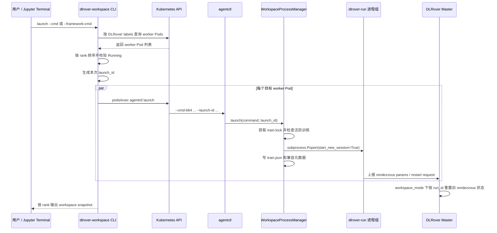
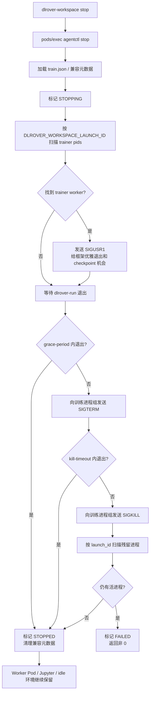

# DLRover Workspace 模式架构图

本文聚焦 Workspace 模式的核心架构关系。更详细的 Jupyter 集成、
agentctl 生命周期和参数说明可参考同目录下的专题设计文档。

Workspace 模式把生命周期拆成两层：

- 环境生命周期：ElasticJob、worker Pod、Jupyter、idle command、runtime monitor，由 Kubernetes 和 DLRover master 管理。
- 训练生命周期：`dlrover-workspace launch` 启动的 `dlrover-run`、ElasticAgent 和 trainer 子进程，由 Workspace CLI 通过 Pod 内 `agentctl` 管理。

## Workspace Unified Architecture

下图与 `dlrover-overview.md` 中的 Unified Architecture 视角类似：Workspace
不是替换 DLRover 的 Kubernetes 训练架构，而是在原有 ElasticJob、Master、
PodScaler、ElasticAgent 和 Brain 之上，把“一次提交立即训练”扩展为“先创建可复用
workspace，再在 workspace 内多次调试、启动、停止训练”。

```mermaid
flowchart LR
    subgraph LEGEND["Legend"]
        L_DLR["Original DLRover component"]
        L_WS["Workspace component"]
        L_USER["User entry"]
        L_NEUTRAL["User / Kubernetes / user code"]
    end

    subgraph USER["1. User Entry"]
        DEV["Model Developer"]
        PORTAL["Platform UI / kubectl"]
    end

    subgraph CONTROL["2. DLRover Control Plane"]
        EJ["ElasticJob"]
        ANNO["Workspace config<br/>runMode / jupyter / idle / monitor"]
        MASTER["DLRover Master"]
        JM["JobManager<br/>job lifecycle"]
        RDZV["RendezvousManager<br/>run_id / launch_id"]
        SCALER["PodScaler<br/>pod orchestration"]
        BRAIN["DLRover Brain<br/>resource optimization"]
    end

    subgraph K8S["3. Kubernetes Runtime"]
        KAPI["Kubernetes API"]
        SVC["Jupyter Service<br/>NodePort / ClusterIP / LoadBalancer"]
        W0["Worker Pod rank 0<br/>Jupyter role"]
        WN["Worker Pods rank 1..N<br/>workspace worker role"]
    end

    subgraph WS["4. Workspace Runtime"]
        CLI["dlrover-workspace<br/>status / launch / logs / stop"]
        AGENT["agentctl<br/>in each worker pod"]
        PROC["WorkspaceProcessManager<br/>process group lifecycle"]
        STATE["workspace state<br/>train.json / pid / pgid / logs"]
    end

    subgraph TRAIN["5. Training Runtime"]
        RUN["dlrover-run"]
        EA["ElasticAgent"]
        TRAINER["Trainer processes<br/>PyTorch / Swift / user command"]
        COMM["Collective communication<br/>NCCL / Gloo"]
    end

    DEV --> PORTAL
    PORTAL --> EJ
    EJ --> ANNO
    ANNO --> MASTER
    MASTER --> JM
    MASTER --> RDZV
    MASTER --> SCALER
    SCALER --> KAPI
    KAPI --> W0
    KAPI --> WN
    KAPI --> SVC
    DEV --> SVC
    SVC --> W0
    W0 --> CLI
    CLI -->|list pods / pods exec| KAPI
    KAPI --> AGENT
    AGENT --> PROC
    PROC --> STATE
    PROC --> RUN
    RUN --> EA
    EA --> TRAINER
    TRAINER <--> COMM
    EA -->|rendezvous / heartbeat / metrics| MASTER
    W0 -->|runtime resource metrics| MASTER
    WN -->|runtime resource metrics| MASTER
    MASTER --> BRAIN
    BRAIN -->|scale / optimize plan| SCALER

    classDef dlrover fill:#e8f1ff,stroke:#2563eb,stroke-width:1.5px,color:#0f172a
    classDef workspace fill:#e8faef,stroke:#16a34a,stroke-width:1.5px,color:#052e16
    classDef neutral fill:#f8fafc,stroke:#64748b,stroke-width:1.2px,color:#0f172a
    classDef user fill:#fff7ed,stroke:#f97316,stroke-width:1.2px,color:#431407

    class L_DLR,EJ,MASTER,JM,RDZV,SCALER,BRAIN,RUN,EA dlrover
    class L_WS,ANNO,SVC,W0,WN,CLI,AGENT,PROC,STATE workspace
    class L_NEUTRAL,KAPI,TRAINER,COMM neutral
    class L_USER,DEV,PORTAL user
```



核心变化：

| 维度 | 普通 Kubernetes 训练 | Workspace 模式 |
| --- | --- | --- |
| Pod 主进程 | worker Pod 启动后直接运行训练入口。 | worker Pod 启动后保持可复用环境，rank 0 可启动 Jupyter，其它 rank 进入 idle。 |
| 用户入口 | 提交 ElasticJob 后等待训练完成。 | 进入 Jupyter/终端，使用 `dlrover-workspace` 管理多轮训练。 |
| 训练进程 | 跟随 Pod 生命周期。 | 跟随 `launch_id` 和 Pod 内进程组生命周期，stop 不删除 Pod。 |
| 组网状态 | 一次任务对应一次 rendezvous。 | 每次 launch 可生成新的 `launch_id`/`run_id`，Master 重置 workspace rendezvous 状态。 |
| 资源复用 | 调试失败后通常需要重新提交或重启 Pod。 | 资源、镜像环境、挂载数据和 Jupyter 会话保留，训练可重复启动。 |

## Design Overview

下图展开 Workspace 的 Design Overview。控制面仍由 ElasticJob、DLRover Master
和 Kubernetes API 管理；交互面新增 Jupyter 与 `dlrover-workspace`；Pod 内新增
`agentctl` 和 `WorkspaceProcessManager`，负责把一次训练绑定到独立的进程组、
状态文件和日志文件。

```mermaid
flowchart LR
    subgraph LEGEND["Legend"]
        L_DLR["Original DLRover component"]
        L_WS["Workspace component"]
        L_USER["User entry"]
        L_NEUTRAL["User / Kubernetes / user code"]
    end

    subgraph INTERACTION["1. Interaction Layer"]
        BROWSER["Browser"]
        JTERM["Jupyter Terminal / Notebook"]
        WSCLI["dlrover-workspace CLI<br/>cli.py"]
    end

    subgraph CONTROL_PLANE["2. Control Plane"]
        KAPI["Kubernetes API<br/>list pods / pods exec"]
        MASTER["DLRover Master"]
        JOB["JobManager"]
        RDZV["RendezvousManager"]
        SCALER["PodScaler"]
        OPT["Brain / Optimizer"]
    end

    subgraph ENV["3. Workspace Environment Layer"]
        SVC["Jupyter Service"]
        R0["Rank 0 Worker Pod<br/>Jupyter role"]
        RN["Rank N Worker Pods<br/>worker role"]
        MON["runtime_monitor<br/>CPU / Memory / GPU"]
    end

    subgraph POD["4. In-Pod Workspace Agent Layer"]
        ACTL["agentctl.py"]
        PM["WorkspaceProcessManager"]
        LOCK["train.lock"]
        META["train.json<br/>train.pid / train.pgid / train.launch_id"]
        LOG["train.rank_<rank>.log"]
        PROCUTIL["proc_utils<br/>pid / pgid / launch_id scan"]
    end

    subgraph RUNTIME["5. Training Runtime Layer"]
        DLROVER_RUN["dlrover-run process group"]
        ELASTIC_AGENT["ElasticAgent"]
        TRAIN_WORKER["trainer worker processes"]
        USER_CODE["User training code"]
    end

    BROWSER --> SVC
    SVC --> R0
    R0 --> JTERM
    JTERM --> WSCLI
    WSCLI -->|query labels| KAPI
    WSCLI -->|pods/exec| KAPI
    KAPI --> ACTL
    MASTER --> SCALER
    SCALER --> R0
    SCALER --> RN
    SCALER --> SVC
    R0 --> MON
    RN --> MON
    MON --> MASTER
    MASTER --> JOB
    MASTER --> RDZV
    MASTER --> OPT
    OPT --> SCALER
    ACTL --> PM
    PM --> LOCK
    PM --> META
    PM --> LOG
    PM --> PROCUTIL
    PM -->|launch| DLROVER_RUN
    PM -->|status / stop / logs| PROCUTIL
    DLROVER_RUN --> ELASTIC_AGENT
    ELASTIC_AGENT --> TRAIN_WORKER
    TRAIN_WORKER --> USER_CODE
    ELASTIC_AGENT -->|MasterClient<br/>rendezvous / restart / finish| MASTER
    TRAIN_WORKER <-->|NCCL / Gloo| TRAIN_WORKER

    classDef dlrover fill:#e8f1ff,stroke:#2563eb,stroke-width:1.5px,color:#0f172a
    classDef workspace fill:#e8faef,stroke:#16a34a,stroke-width:1.5px,color:#052e16
    classDef neutral fill:#f8fafc,stroke:#64748b,stroke-width:1.2px,color:#0f172a
    classDef user fill:#fff7ed,stroke:#f97316,stroke-width:1.2px,color:#431407

    class L_DLR,MASTER,JOB,RDZV,SCALER,OPT,DLROVER_RUN,ELASTIC_AGENT dlrover
    class L_WS,SVC,R0,RN,MON,JTERM,WSCLI,ACTL,PM,LOCK,META,LOG,PROCUTIL workspace
    class L_NEUTRAL,KAPI,TRAIN_WORKER,USER_CODE neutral
    class L_USER,BROWSER user
```



主要数据流：

1. **环境创建流**：用户提交 `runMode=workspace` 的 ElasticJob，Master 通过
   `PodScaler` 创建 worker Pod 并注入 workspace 环境变量；是否为 rank 0 创建
   Jupyter Service 由 `jupyter-enabled` 独立控制。
2. **训练控制流**：用户在 Jupyter 中执行 `dlrover-workspace`，CLI 查询 worker Pods，
   再通过 Kubernetes `pods/exec` 把控制命令分发到每个目标 Pod 内的 `agentctl`。
3. **Pod 内进程流**：`agentctl` 调用 `WorkspaceProcessManager`，使用
   `train.lock` 做互斥，写入 `train.json` 和兼容 pid 文件，以独立 session/process
   group 启动或停止训练。
4. **训练协同流**：`dlrover-run` 启动 ElasticAgent 和 trainer workers，ElasticAgent
   通过 MasterClient 连接 Master，完成 rendezvous、重启通知和训练结束上报。
5. **观测优化流**：`runtime_monitor` 上报资源使用，Master/Brain 根据运行时指标生成
   资源优化或弹性计划，再交给 `PodScaler` 执行。

## 启动训练链路



## 停止训练链路



## 模块职责

| 模块 | 职责 |
| --- | --- |
| `PodScaler` | 解析 Workspace annotations，创建 worker Pod 和 Jupyter Service，注入 Workspace 环境变量，改写 rank 0 为 Jupyter、其它 rank 为 idle command。 |
| `runtime_monitor` | 在 Workspace 容器内采集 CPU、内存和 GPU 使用率，并上报给 master。 |
| `dlrover-workspace CLI` | 用户入口；查询 worker Pod、按 rank 排序、校验 Running，通过 Kubernetes `pods/exec` 并发调用 Pod 内 `agentctl`。 |
| `agentctl` | Pod 内短命令入口，解析 `launch/status/stop/logs`，把生命周期操作交给 `WorkspaceProcessManager`。 |
| `WorkspaceProcessManager` | 负责训练进程启动、状态刷新、停止、日志读取和兼容元数据维护。 |
| `WorkspaceStateStore` | 使用 `train.json` 表达状态，使用 `train.lock` 做单 Pod 内互斥，原子写入状态文件。 |
| `proc_utils` | 读取 `/proc`，按 PID、PGID 和 `DLROVER_WORKSPACE_LAUNCH_ID` 识别并清理同一轮训练进程。 |
| `RendezvousManager` | Workspace 模式下根据新的 `run_id` 或组网参数重置上一轮 rendezvous 状态，避免多次 launch 互相污染。 |

## 关键数据与文件

```text
DLROVER_WORKSPACE_MODE=true
DLROVER_RUN_MODE=workspace|runtime
DLROVER_WORKSPACE_ROLE=jupyter|worker
DLROVER_WORKSPACE_LAUNCH_ID=<per launch uuid>
DLROVER_JUPYTER_SERVICE=<job-name>-jupyter
DLROVER_RUNTIME_MONITOR=true|false
```

```text
/tmp/dlrover-workspace/train.json
/tmp/dlrover-workspace/train.lock
/tmp/dlrover-workspace/train.pid
/tmp/dlrover-workspace/train.pgid
/tmp/dlrover-workspace/train.launch_id
/tmp/dlrover-workspace/train.rank_<rank>.log
```

## 边界说明

- Workspace 负责复用已申请的 worker Pod 环境，并在 Pod 内多次启动、停止训练进程。
- Workspace stop 只清理本轮训练进程组和同 `DLROVER_WORKSPACE_LAUNCH_ID` 的残留进程，不删除 worker Pod、不停止 Jupyter、不释放已申请资源。
- checkpoint、恢复语义、收到优雅停止信号后的处理仍由训练框架或用户训练脚本负责。
- GPU 垂直弹性不能原地修改运行中 Pod 的 GPU limit；需要通过按 rank 替换 worker Pod 让新的 request/limit 生效。
