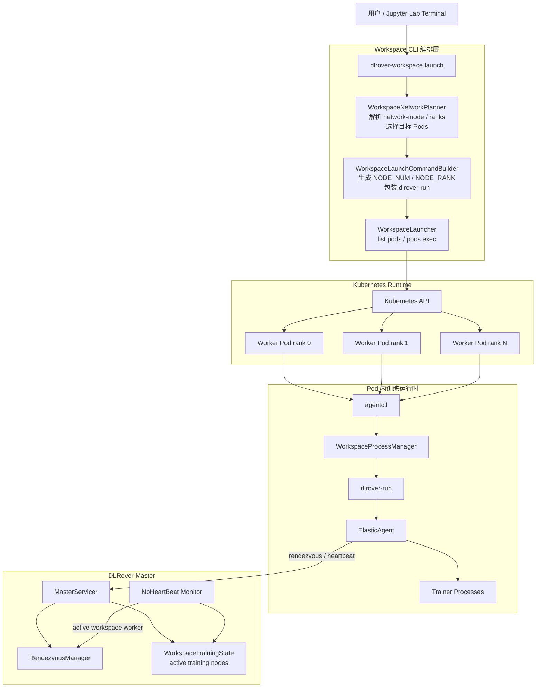
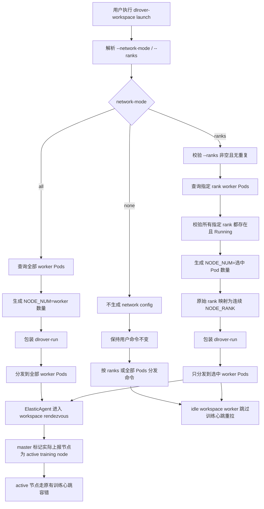
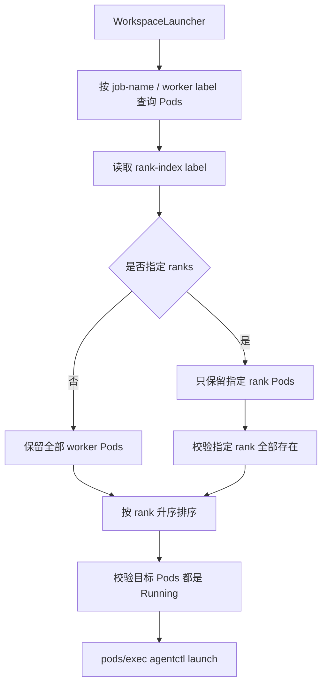
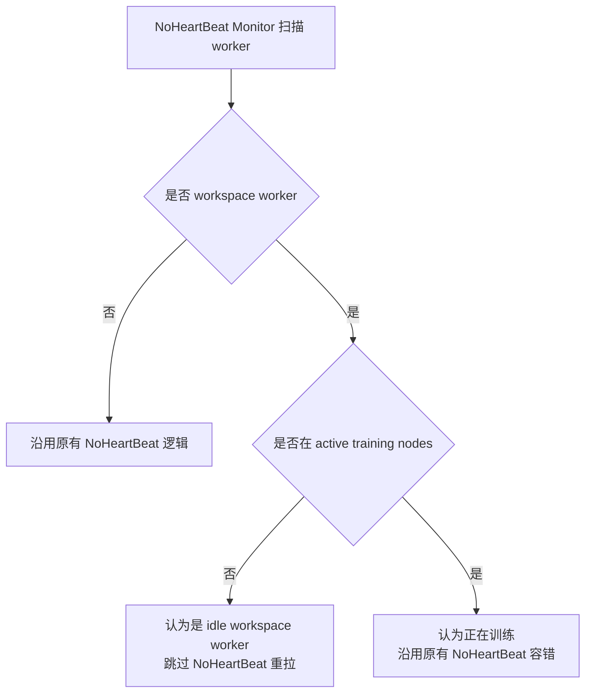

# DLRover Workspace 自动组网设计

本文档单独说明 DLRover workspace 模式下的自动组网设计，包括用户如何通过
`dlrover-workspace launch` 控制是否自动组网、如何选择全部或部分 worker
参与组网，以及该能力如何与原有 DLRover rendezvous、ElasticAgent 和 master
心跳监测配合。

## 背景

### 当前问题

workspace 模式与普通 DLRover 训练模式的启动语义不同。

普通训练模式下，用户提交作业后 worker Pod 通常立即进入训练，所有 worker 都属于
本次训练拓扑。DLRover 可以直接按提交时的 worker 数量完成 rendezvous、构建通信
world，并按训练心跳进行容错。

workspace 模式下，用户先提交 workspace YAML 创建一批长驻 worker Pod，rank 0
通常提供 Jupyter Lab，其他 worker 保持 idle。用户随后在 Jupyter Terminal 中多次
执行 `dlrover-workspace launch` 启动训练。一次 launch 可能有三种诉求：

- 只在某些 Pod 上执行普通调试命令，不需要 DLRover 自动组网。
- 使用全部 worker Pod 启动一次分布式训练。
- 只选择部分 worker Pod 启动一次分布式训练，未选中的 Pod 继续保持 idle。

如果 CLI 默认隐式拼接 `dlrover-run`，用户提交普通命令时会被意外组网。如果用户只
选择部分节点训练，而 master 仍把所有 workspace worker 都视为训练节点，未选中的
idle worker 又可能因为没有训练心跳被误判为 `NoHeartBeat` 并重拉。

因此 workspace 自动组网需要解决三个问题：

1. 用户必须能显式控制是否自动组网，默认不自动组网。
2. 用户必须能选择全部 worker 或部分 worker 参与自动组网。
3. 未参与本次训练的 workspace worker 不能影响本次 rendezvous，也不能因缺少训练
   心跳被误重拉。

### 解决方案

workspace 自动组网采用“workspace 编排层 + 原有 DLRover 训练能力复用”的设计：

- CLI 层提供 `--network-mode none/all/ranks`，默认 `none`。
- workspace 编排层负责选择目标 Pod、校验 rank、生成 `NODE_NUM`、重映射
  `NODE_RANK`，并在需要时包装 `dlrover-run`。
- worker Pod 内仍然运行原有 `dlrover-run`、ElasticAgent 和用户训练进程。
- master 仍然使用原有 rendezvous 和心跳容错逻辑，只增加 workspace 训练态判断：
  只有实际上报 workspace rendezvous restart 的 worker 才被视为 active training
  node。

该设计不重新实现 DLRover 组网协议，也不改变非 workspace 作业的组网逻辑。

## 总体设计

### 设计目标

1. `dlrover-workspace launch` 默认不自动组网。
2. 用户可以通过 CLI 显式选择：
   - 不自动组网。
   - 全部 worker 自动组网。
   - 指定部分 worker 自动组网。
3. 自动组网时，CLI 自动生成正确的 `NODE_NUM` 和连续的 `NODE_RANK`。
4. 用户可以通过 `--dlrover-run-args` 指定 `dlrover-run` 额外参数。
5. 不影响 DLRover 原有 `dlrover-run`、rendezvous、ElasticAgent 和 master
   容错逻辑。
6. 未参与训练的 workspace worker 保持 idle，不参与 rendezvous，不触发训练心跳
   误重拉。

### 非目标

- 不重新实现 DLRover rendezvous 协议。
- 不新增一套 workspace 专属 ElasticAgent。
- 不改变非 workspace 作业的参数更新和节点重拉逻辑。
- 不提供跨 Pod 启动事务。某个 Pod 启动失败时，已启动成功的 Pod 不自动回滚。
- 不把 `--cmd` 强制改写为 `dlrover-run`。`--cmd` 被视为用户完整命令。

### 架构图



### 模式总览

| 模式 | 参数 | 目标 Pod | 是否包装 `dlrover-run` | 典型场景 |
| --- | --- | --- | --- | --- |
| 不自动组网 | `--network-mode none` | `--ranks` 指定 Pod 或全部 Pod | 否 | 普通 shell/python 调试命令 |
| 全部节点组网 | `--network-mode all` | 全部 worker Pod | 是，仅 `--framework-cmd` | 全量分布式训练 |
| 部分节点组网 | `--network-mode ranks --ranks 0,2` | 指定 rank 的 worker Pod | 是，仅 `--framework-cmd` | 选择部分资源调试或小规模训练 |

`--network-mode` 也可以通过别名 `--auto-network` 指定。

### 总体流程图



## 详细设计

### CLI 参数设计

#### `--network-mode`

用于控制 workspace launch 是否自动使用 DLRover 组网：

```bash
--network-mode none   # 默认，不自动组网
--network-mode all    # 全部 worker 自动组网
--network-mode ranks  # 指定 ranks 自动组网
```

默认值必须是 `none`。这样用户提交 workspace YAML 后，即使直接执行普通命令，也不会
被 CLI 隐式改写成分布式训练。

#### `--ranks`

用于选择目标 worker rank：

```bash
--ranks 0,1,3
```

约束：

- rank 必须是非负整数。
- rank 不能重复。
- `--network-mode ranks` 必须同时指定 `--ranks`。
- `--network-mode all` 不能同时指定 `--ranks`，避免“全部组网”和“部分选择”语义冲突。

`--ranks` 是底层稳定接口，但用户通常不知道哪个实例对应哪个 rank。因此生产上建议在
平台 UI 或 Jupyter 指引中先展示：

```bash
dlrover-workspace status --cli-log on
```

让用户看到 rank、Pod name、namespace、Pod IP 和所在 node 的映射关系。

#### `--framework-cmd`

表示用户训练框架命令，例如：

```bash
--framework-cmd "python train.py --data /data"
--framework-cmd "swift sft --model /models/qwen"
```

当 `--network-mode` 不是 `none` 时，CLI 会自动包装为：

```bash
dlrover-run <dlrover-run-args> <framework-cmd>
```

如果 `--framework-cmd` 本身已经以 `dlrover-run` 开头，CLI 不重复包装。

#### `--cmd`

表示完整用户命令。CLI 不理解、不改写、不自动包装：

```bash
--cmd "dlrover-run --nnodes=2 --nproc_per_node=8 python train.py"
--cmd "python debug.py"
```

这样可以保留专家用户对启动命令的完整控制权。

#### `--dlrover-run-args`

用于指定自动包装 `dlrover-run` 时的参数：

```bash
--dlrover-run-args "--nnodes=$NODE_NUM --nproc_per_node=8 --max_restarts=3"
```

默认值：

```bash
--nnodes=$NODE_NUM --nproc_per_node=1
```

`NODE_NUM` 由 workspace 组网编排层根据目标 Pod 数量自动注入。

### WorkspaceNetworkPlanner

`WorkspaceNetworkPlanner` 负责把用户选择转换为组网计划。

输入：

- `network_mode`
- `ranks`
- `WorkspaceLauncher`

输出：

- launch 实际目标 ranks
- `WorkspaceNetworkConfig`

核心逻辑：

```text
network-mode none:
    不查询网络拓扑
    返回原始 ranks
    network_config = None

network-mode all:
    要求 ranks 为空
    查询全部 worker Pods
    node_num = 全部 worker Pod 数量
    rank_map = None

network-mode ranks:
    要求 ranks 非空
    查询指定 worker Pods
    校验指定 rank 全部存在
    node_num = 选中 Pod 数量
    rank_map = {原始 rank: 连续 rank}
```

### WorkspaceLaunchCommandBuilder

`WorkspaceLaunchCommandBuilder` 负责生成最终在 Pod 内执行的命令。

不自动组网：

```bash
python train.py
```

全部节点组网：

```bash
export NODE_NUM=4; \
dlrover-run --nnodes=$NODE_NUM --nproc_per_node=8 python train.py
```

部分节点组网，例如选择原始 rank `2,5`：

```bash
export NODE_NUM=2; \
case "${NODE_RANK:-}" in \
  2) export NODE_RANK=0 ;; \
  5) export NODE_RANK=1 ;; \
  *) echo "NODE_RANK ${NODE_RANK:-} is not selected for workspace networking"; exit 1 ;; \
esac; \
dlrover-run --nnodes=$NODE_NUM --nproc_per_node=8 python train.py
```

为什么需要 rank 重映射：

- 用户选择的原始 worker rank 可能不连续，例如 `2,5`。
- 分布式训练通常要求参与节点 rank 连续，例如 `0,1`。
- 因此 CLI 在选中 Pod 内把原始 `NODE_RANK` 临时映射为本次训练内的连续 rank。

### WorkspaceLauncher

`WorkspaceLauncher` 负责 Kubernetes 交互：

1. 按 job label 查询 worker Pods。
2. 读取 `elasticjob.dlrover/rank-index`。
3. 按 `--ranks` 过滤目标 Pods。
4. 按 rank 升序排序，保证输出和 rank remap 稳定。
5. launch 前要求目标 Pods 都处于 `Running`。
6. 通过 Kubernetes `pods/exec` 并发调用每个 Pod 内的 `agentctl launch`。

Pod 查询流程：



### Rendezvous 配合

自动组网最终仍然依赖原有 DLRover `dlrover-run` 和 ElasticAgent。

workspace 模式需要额外处理“同一批 Pod 多次 launch”的问题：一次训练结束后，
用户可能再次启动一个新的 `dlrover-run`。因此 workspace ElasticAgent 在进入
rendezvous 前会上报 workspace rendezvous restart，master 侧据此：

- 重置该节点之前上报的失败状态。
- 将该 worker 记入当前 workspace active training nodes。
- 在 workspace run_id 或组网参数变化时重置旧的 rendezvous waiting/rdzv 状态。

这部分是 workspace 对 rendezvous 生命周期的适配，不是新的 rendezvous 算法。
普通训练模式仍保持原有参数初始化和 rendezvous 行为。

### 心跳监测配合

workspace 模式下，master 不能简单地认为所有 worker 都在训练。心跳策略应按节点
粒度判断：



active training nodes 的来源不是 CLI 静态选择结果，而是 worker 实际上报的
workspace rendezvous restart。这样可以避免 CLI 查询结果与实际启动状态不一致时
master 误判。

### 典型使用示例

#### 不自动组网

```bash
dlrover-workspace launch \
  --job-name workspace-demo \
  --network-mode none \
  --cmd "python check_env.py"
```

CLI 不包装 `dlrover-run`。

#### 全部 worker 自动组网

```bash
dlrover-workspace launch \
  --job-name workspace-demo \
  --network-mode all \
  --dlrover-run-args "--nnodes=$NODE_NUM --nproc_per_node=8" \
  --framework-cmd "python train.py --epochs 1"
```

假设 workspace 有 4 个 worker，则 CLI 注入：

```bash
export NODE_NUM=4
```

并生成：

```bash
dlrover-run --nnodes=$NODE_NUM --nproc_per_node=8 python train.py --epochs 1
```

#### 部分 worker 自动组网

先查看 rank 映射：

```bash
dlrover-workspace status \
  --job-name workspace-demo \
  --cli-log on
```

选择 rank `0,2` 训练：

```bash
dlrover-workspace launch \
  --job-name workspace-demo \
  --network-mode ranks \
  --ranks 0,2 \
  --dlrover-run-args "--nnodes=$NODE_NUM --nproc_per_node=8" \
  --framework-cmd "python train.py"
```

本次训练内：

- 原始 rank 0 映射为训练 rank 0。
- 原始 rank 2 映射为训练 rank 1。
- 其他 worker 不执行本次训练命令，保持 idle。

### 异常处理

| 场景 | 处理方式 |
| --- | --- |
| `--network-mode ranks` 未指定 `--ranks` | CLI 直接失败 |
| `--network-mode all` 同时指定 `--ranks` | CLI 直接失败 |
| `--ranks` 包含重复 rank | CLI 直接失败 |
| 指定 rank 不存在 | CLI 直接失败，不启动训练 |
| 目标 Pod 非 Running | CLI 直接失败，不启动训练 |
| 部分 Pod exec 失败 | 返回对应 rank 的失败结果，已成功 Pod 不自动回滚 |
| `--framework-cmd` 为空 | CLI 直接失败 |
| `--dlrover-run-args` 为空且需要自动包装 | CLI 直接失败 |
| `--cmd` 中命令错误 | 由用户命令自身执行结果决定，CLI 不改写 |

### 生产建议

1. 默认使用 `--network-mode none`，避免普通调试命令被误组网。
2. 平台 UI 应展示 rank、Pod name、IP、node 的映射，降低用户直接使用 `--ranks`
   的理解成本。
3. 平台可在 UI 层提供实例选择能力，再转换为底层 `--ranks`。
4. 自动组网推荐使用 `--framework-cmd`，专家模式再使用完整 `--cmd`。
5. `--dlrover-run-args` 中建议显式指定 `--nproc_per_node`，避免 GPU 数量和训练
   进程数不一致。
6. stop 后应通过 workspace finished 事件清理 active training nodes，避免旧训练态
   影响下一次 launch。

## 与原有 DLRover 逻辑的关系

workspace 自动组网不替换原有 DLRover 组网能力：

- `dlrover-run` 仍然是训练入口。
- ElasticAgent 仍然负责 rendezvous、worker 子进程和训练心跳。
- RendezvousManager 仍然负责构建通信 world。
- master 原有 NoHeartBeat 容错仍作用于 active training worker。

workspace 新增的是编排层能力：

- 用户显式选择是否自动组网。
- 用户显式选择全部或部分 worker 参与训练。
- 对部分 worker 做 `NODE_NUM` 和 `NODE_RANK` 适配。
- 对 idle workspace worker 做心跳跳过保护。

这样可以保证 workspace 模式生产可用，同时最大限度保持 DLRover 原有训练路径稳定。
