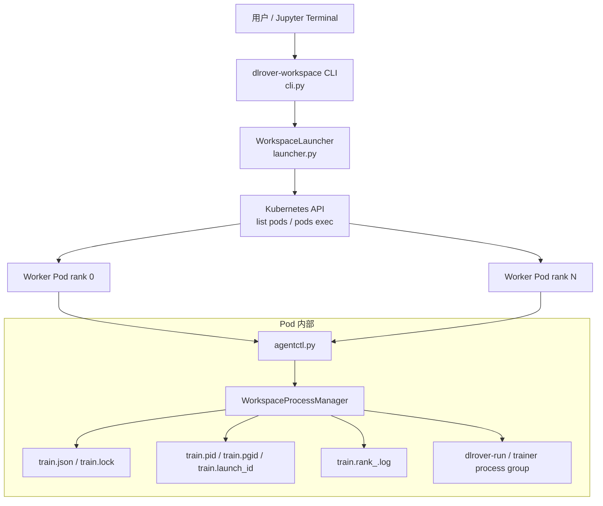
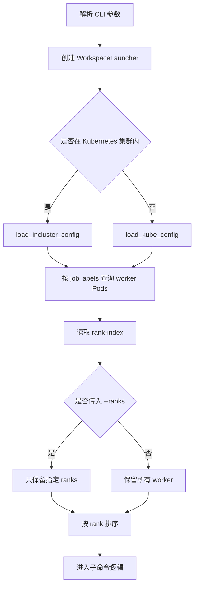
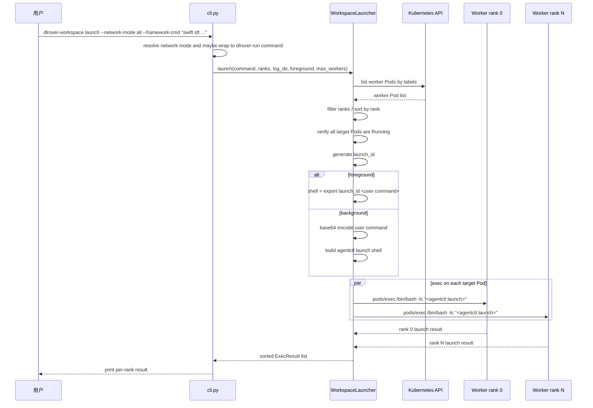
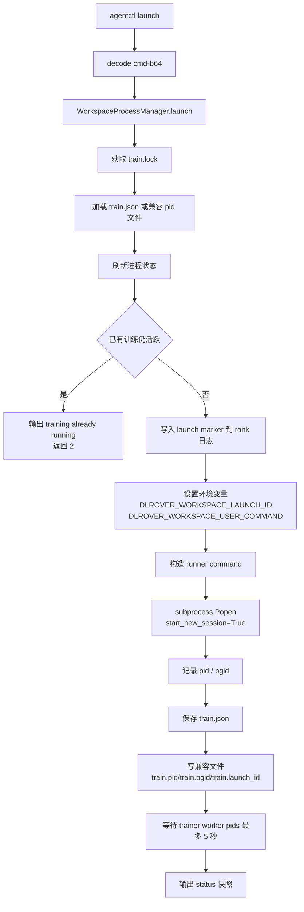
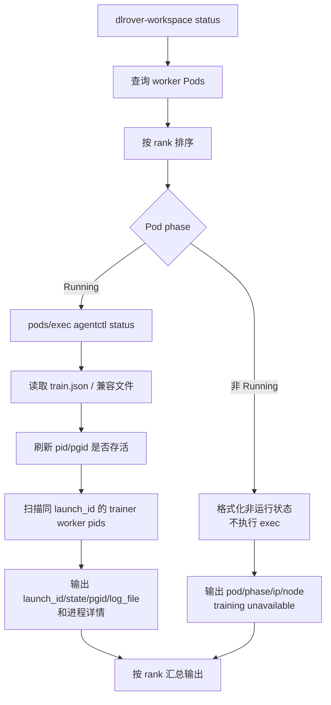
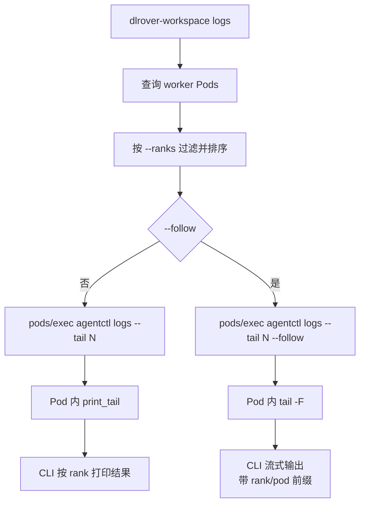
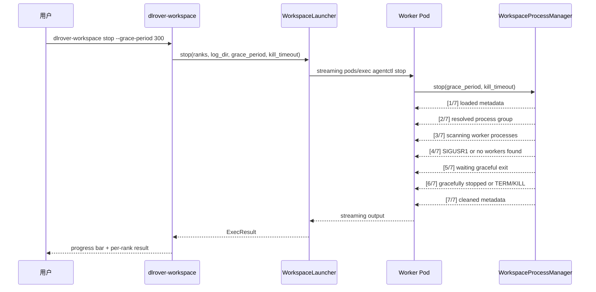
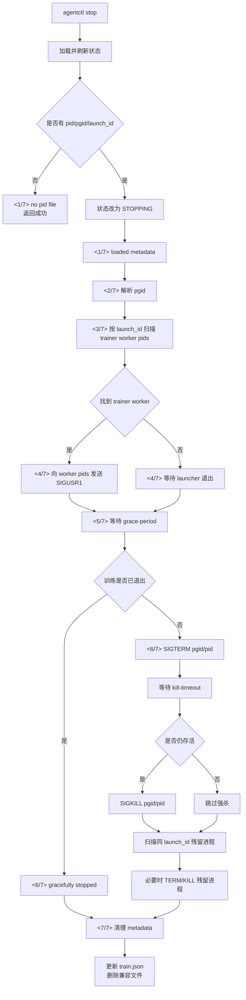

# DLRover Workspace CLI 实现逻辑

本文档说明当前 `dlrover-workspace` CLI 的实现链路，包括
`status`、`launch`、`logs` 和 `stop` 四个子命令如何通过 Kubernetes
`pods/exec` 调用 Pod 内部 `agentctl`，以及 Pod 内如何管理训练进程状态。

相关代码：

- `dlrover/python/workspace/cli.py`：用户 CLI 入口。
- `dlrover/python/workspace/launcher.py`：Kubernetes Pod 查询和 exec 分发。
- `dlrover/python/workspace/agentctl.py`：Pod 内部控制命令入口。
- `dlrover/python/workspace/process_manager.py`：Pod 内训练进程生命周期管理。
- `dlrover/python/workspace/state.py`：Pod 内状态文件和文件锁。
- `dlrover/python/workspace/proc_utils.py`：进程扫描、进程组判断和信号发送。

## 总体架构



实现分两层：

1. **控制面层**：`dlrover-workspace` 运行在 Jupyter/用户终端中，负责查找
   worker Pods、按 rank 排序、并发执行 `pods/exec`。
2. **Pod 内进程层**：`agentctl` 运行在每个 worker Pod 内，负责启动、
   查询、停止和读取本 Pod 内训练进程。

## 通用执行流程

所有子命令都会先创建 `WorkspaceLauncher`：

```python
launcher = WorkspaceLauncher(
    job_name=args.job_name,
    namespace=args.namespace,
    container=args.container,
)
```

`WorkspaceLauncher` 的初始化规则：

- `job_name = --job-name or ELASTIC_JOB_NAME`。
- `namespace = --namespace or NAMESPACE or default`。
- `container = --container or main`。
- 集群内运行时使用 `load_incluster_config()`。
- 集群外运行时使用 `load_kube_config()`。

Pod 查询规则：

```text
elasticjob.dlrover/name=<job-name>
elasticjob.dlrover/replica-type=worker
```

查询后读取 `elasticjob.dlrover/rank-index`，过滤 `--ranks` 指定的 rank，
并按 rank 升序排序。



## agentctl 调用方式

除 `launch --foreground` 外，CLI 不直接在 Pod 内拼接复杂训练命令，而是
统一调用：

```bash
python_bin=${DLROVER_WORKSPACE_AGENTCTL_PYTHON:-python}
exec "$python_bin" -m dlrover.python.workspace.agentctl \
  --log-dir <log-dir> <subcommand> <args>
```

这样做的原因：

- 训练命令只在 `launch` 时以 base64 传入，避免 shell 引号和换行破坏参数。
- Pod 内状态管理集中在 `WorkspaceProcessManager`，减少外层 shell 复杂度。
- `status/logs/stop` 可以复用统一状态文件和进程扫描逻辑。
- 如果镜像里 `python` 命令不可用，可以用
  `DLROVER_WORKSPACE_AGENTCTL_PYTHON=python3` 覆盖。

## launch 实现逻辑

### 控制面流程

`dlrover-workspace launch` 的外层逻辑：

1. CLI 解析 `--cmd` / `--framework-cmd`、`--network-mode`、
   `--dlrover-run-args`、`--foreground`、`--log-dir`、`--max-workers`
   和 `--ranks`。默认 `--network-mode none` 不自动组网，也不自动包装
   `dlrover-run`。`--network-mode all` 使用全部 worker Pod 自动组网；
   `--network-mode ranks` 只使用 `--ranks` 指定的 worker Pod 自动组网，
   并把选中 Pod 的原始 rank 临时映射为从 0 开始的连续 rank。
   如果启用自动组网且传入 `--framework-cmd`，CLI 会组装为
   `dlrover-run <dlrover-run-args> <framework-cmd>`；如果框架命令本身已
   以 `dlrover-run` 开头，则不会重复包装。
2. 查询并过滤 worker Pods。
3. 要求所有目标 Pod 都处于 `Running`。
4. 为本次 launch 生成统一的 `launch_id`。
5. 默认后台模式下，将用户命令 base64 编码，构造 `agentctl launch`。
6. 使用线程池并发对所有目标 Pod 执行 `pods/exec`。
7. 收集每个 Pod 的输出，按 rank 排序展示。



### 多 Pod 命令同步方式

`launch` 的“同步到多个 Pod 执行”由 `ThreadPoolExecutor` 完成：

```python
with ThreadPoolExecutor(max_workers=min(max_workers, len(pods) or 1)) as ex:
    futures = [ex.submit(self._exec, pod, shell) for pod in pods]
    for future in as_completed(futures):
        results.append(future.result())
```

特征：

- 所有目标 Pod 使用同一条 shell 和同一个 `launch_id`。
- 外层 CLI 并发触发 `pods/exec`，并发度由 `--max-workers` 控制。
- `as_completed` 只表示结果收集顺序，最终输出会重新按 rank 排序。
- 这不是强事务；如果某个 Pod exec 失败，已经启动成功的 Pod 不会自动回滚。
- 训练真正的分布式汇合由 Pod 内 `dlrover-run` 连接 DLRover master 后通过
  rendezvous 完成。

### Pod 内 launch 流程

后台模式下，Pod 内部执行：

```bash
python -m dlrover.python.workspace.agentctl \
  --log-dir /tmp/dlrover-workspace \
  launch \
  --cmd-b64 <base64-command> \
  --launch-id <launch_id> \
  --wait-for-workers-seconds 5
```

`agentctl launch` 解码命令后调用
`WorkspaceProcessManager.launch(command, launch_id, wait_seconds)`。



Pod 内启动训练进程时使用：

```python
subprocess.Popen(
    ["/bin/bash", "-lc", runner_command],
    stdin=subprocess.DEVNULL,
    stderr=subprocess.STDOUT,
    start_new_session=True,
    close_fds=True,
    env=env,
)
```

关键点：

- `start_new_session=True` 会创建新的 session/process group。
- `DLROVER_WORKSPACE_LAUNCH_ID` 会被训练进程及其子进程继承。
- `stop` 后续通过 `launch_id` 和 `pgid` 精确识别并清理本轮训练。
- 状态写入 `train.json`，同时写兼容文件 `train.pid`、`train.pgid`、
  `train.launch_id`。

### 日志输出逻辑

默认情况下，训练命令被包装成：

```bash
set -o pipefail
/bin/bash -lc "$DLROVER_WORKSPACE_USER_COMMAND" 2>&1 \
  | tee -a <train.rank_<rank>.log> <container_stdout> >/dev/null
```

其中：

- rank 日志默认为 `/tmp/dlrover-workspace/train.rank_${NODE_RANK}.log`。
- container stdout 默认为 `/proc/1/fd/1`。
- `DLROVER_WORKSPACE_MIRROR_STDOUT=false` 时不 tee 到容器 stdout，只写日志。
- `DLROVER_WORKSPACE_CONTAINER_STDOUT` 可覆盖 stdout 目标文件。

### foreground 模式

如果传入 `--foreground`，外层 CLI 不调用 `agentctl launch`，而是直接在每个
目标 Pod 中执行：

```bash
export DLROVER_WORKSPACE_LAUNCH_ID=<launch_id>; <user command>
```

限制：

- 不创建后台进程组。
- 不写 `train.json`、`train.pid`、`train.pgid`、`train.launch_id`。
- 命令退出前 `dlrover-workspace launch` 不返回。
- 后续 `status/logs/stop` 无法基于 workspace 元数据管理这次前台命令。

## status 实现逻辑

`status` 用于查看 Pod 状态和训练进程状态。

外层流程：

1. 查询 worker Pods。
2. 将 Pod 分成 `Running` 和非 `Running`。
3. 只对 `Running` Pod 执行 `agentctl status`。
4. 非 `Running` Pod 不执行 exec，只输出 Pod 层信息和 unavailable。
5. 输出按 rank 排序。



Pod 内 `agentctl status` 会调用：

```python
manager.status(wait_for_workers_seconds=0)
```

状态内容包括：

- `launch_id`
- `state`
- `process_group`
- `log_file`
- `exit_code`
- `last_error`
- `dlrover-run` 进程信息
- trainer worker 进程信息

trainer worker 进程通过 `DLROVER_WORKSPACE_LAUNCH_ID` 扫描，并要求进程环境中
存在 `TORCHELASTIC_RUN_ID`、`MASTER_ADDR`、`MASTER_PORT`。

## logs 实现逻辑

`logs` 用于读取每个 Pod 的 rank 日志。

外层流程：



Pod 内日志文件由 `WorkspaceProcessManager` 根据当前 `NODE_RANK` 生成：

```text
<log-dir>/train.rank_${NODE_RANK:-unknown}.log
```

默认：

```text
/tmp/dlrover-workspace/train.rank_<rank>.log
```

非 follow 模式会等待所有 Pod exec 完成后，按 rank 输出结果。
follow 模式使用 streaming exec，持续读取每个 Pod 的 stdout/stderr，并加上：

```text
[rank <rank> <pod-name>] <log line>
```

## stop 实现逻辑

`stop` 用于停止训练进程，但保留 worker Pod、Jupyter/idle 主进程和资源。

外层流程：

1. 查询目标 worker Pods。
2. 构造 `agentctl stop --grace-period <n> --kill-timeout <n>`。
3. 对所有目标 Pod 使用 streaming exec。
4. CLI 解析 Pod 内输出的 `[x/7]` 阶段号。
5. 在 TTY 中显示总进度条，并逐行输出每个 rank 的停止日志。
6. 收集所有 Pod 的执行结果，按 rank 打印。



Pod 内停止流程：



停止优先级：

1. 先找 trainer worker pids，发送 `SIGUSR1`，让训练框架有机会保存
   checkpoint 并优雅退出。
2. `grace-period` 超时后，对进程组或 pid 发送 `SIGTERM`。
3. `kill-timeout` 超时后发送 `SIGKILL`。
4. 最后按 `DLROVER_WORKSPACE_LAUNCH_ID` 扫描残留进程兜底清理。

## 状态文件模型

Workspace 使用两类状态文件。

主状态文件：

```text
<log-dir>/train.json
<log-dir>/train.lock
```

`train.json` 字段包括：

```text
state
launch_id
command
pid
pgid
log_file
started_at
updated_at
exit_code
last_error
```

兼容文件：

```text
<log-dir>/train.pid
<log-dir>/train.pgid
<log-dir>/train.launch_id
```

兼容文件用于保留旧版本行为和便于人工排查；`train.json` 是当前主要状态。

状态写入通过 `train.lock` 加 `fcntl.flock` 保护，避免同一个 Pod 内并发
launch/stop/status 造成状态文件竞争。

## 失败和一致性边界

当前实现的边界如下：

- `launch` 前会保证所有目标 Pod 都是 `Running`，但 `pods/exec` 下发不是事务。
- 多 Pod launch 是并发触发，不保证纳秒级同时启动。
- 某个 Pod launch 失败时，已成功启动的 Pod 不会自动回滚，需要执行
  `dlrover-workspace stop` 清理。
- 同一 Pod 内通过 `train.lock` 和 active 状态检测防止重复 launch。
- 跨 Pod 没有全局锁；一致性依赖同一轮 launch 使用同一个 `launch_id`，以及
  `dlrover-run` rendezvous 汇合。
- `--foreground` 不写状态文件，不参与 workspace 生命周期管理。
- 正式多机多卡训练应使用后台模式，并保证 `dlrover-run --nnodes` 与实际启动
  worker 数一致。

## 总结

Workspace CLI 的核心设计是：

- 外层 CLI 只做 Kubernetes 控制面操作：查 Pod、过滤 rank、并发 exec。
- Pod 内 `agentctl` 做本机训练进程管理：启动、状态、日志和停止。
- 通过统一 `launch_id` 把同一轮训练的 `dlrover-run`、ElasticAgent 和 trainer
  子进程串起来。
- 通过 `start_new_session=True` 创建独立进程组，保证 `stop` 能清理完整训练树。
- 多 Pod 的“同步执行”由线程池并发 exec 实现，训练层同步由 `dlrover-run`
  rendezvous 完成。
