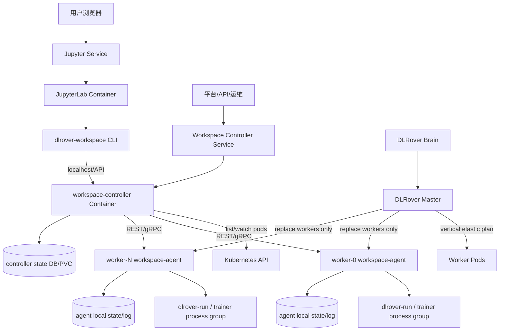
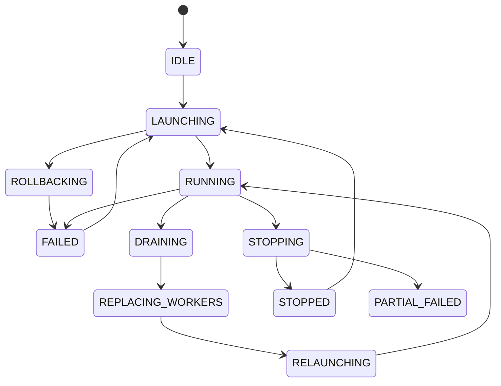
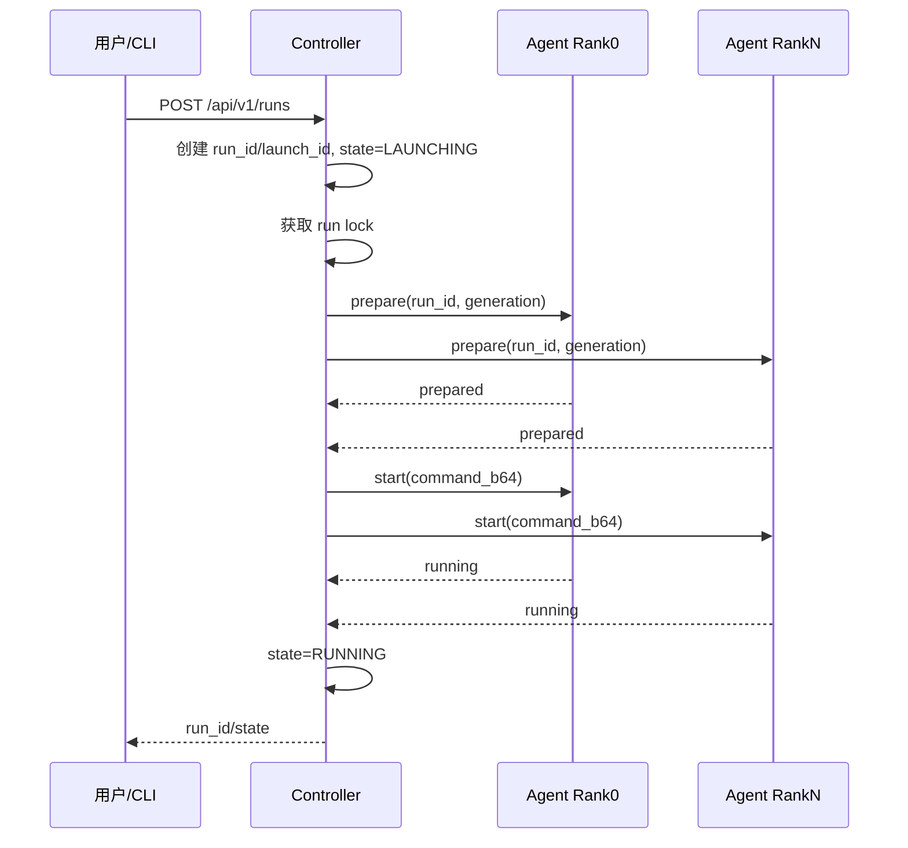
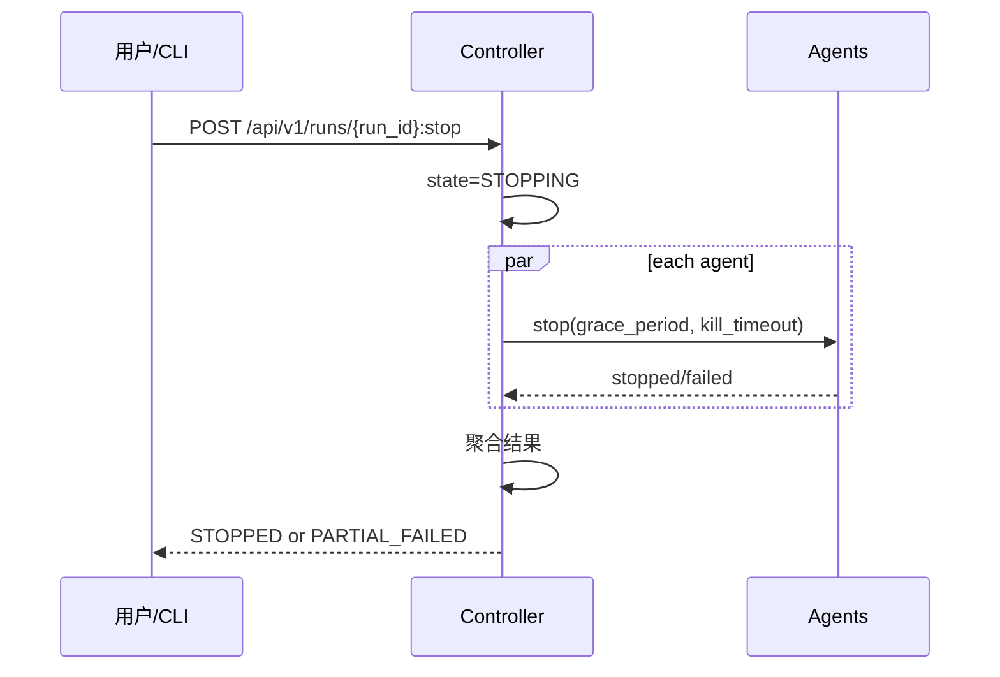
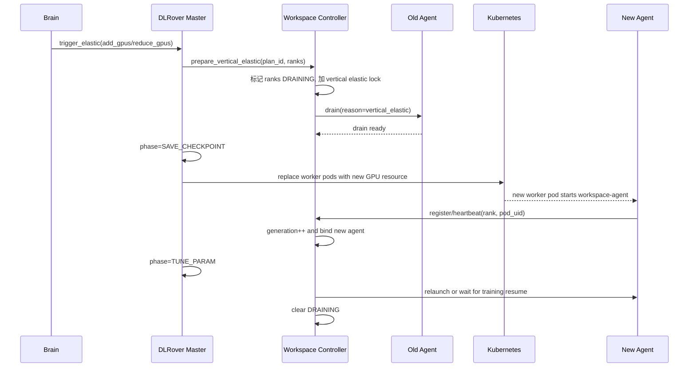

# DLRover Workspace 第二阶段：控制面解耦生产实现方案

## 背景

第一阶段 Workspace 方案中，Jupyter 运行在 worker rank 0 中，其它 worker
运行 idle command，用户通过 `dlrover-workspace` 使用 Kubernetes `pods/exec`
进入每个 worker，并调用 Pod 内 `agentctl` 管理训练进程。

该方案已经解决了大段 shell 生命周期逻辑不可维护的问题，但仍存在一个生产级
架构限制：

- Jupyter/Notebook 与 worker 训练资源耦合。
- rank 0 worker 同时承担 Notebook 和训练节点职责。
- 当 DLRover 垂直弹性替换 worker Pod 时，如果被替换的是 rank 0 worker，
  Notebook 会中断。
- CLI 依赖 `pods/exec`，Jupyter 所在环境需要 Kubernetes API 权限，控制面
  权限边界较粗。
- worker Pod 的主进程仍然承担“保活 + 被 exec 管理”的过渡形态，不利于后续
  API 化、审计和平台集成。

第二阶段的核心目标是控制面解耦：新增独立 Jupyter/controller Pod，worker
只运行 `workspace-agent`。用户、CLI 或平台通过 controller API 控制 workers；
DLRover 垂直弹性只替换 worker，不影响 Notebook。

## 目标

- Jupyter/Notebook 从 worker Pod 中剥离，独立部署，不参与训练 worker 替换。
- worker Pod 主进程只运行 `workspace-agent`，作为训练进程 supervisor。
- CLI/Jupyter/controller 通过稳定 API 控制 worker agent，不再依赖
  Kubernetes `pods/exec` 作为主控制通道。
- 垂直弹性替换 worker 时，controller/Jupyter Pod 不受影响。
- 支持训练 launch、stop、status、logs、worker drain、垂直弹性 worker
  generation 切换。
- 控制面具备生产级认证授权、状态持久化、故障恢复、审计和可观测能力。
- 第一阶段 agentctl/process manager 逻辑可复用，降低迁移风险。

## 非目标

- 不改变 DLRover master 的核心 rendezvous 和 elastic agent 语义。
- 不要求第一阶段 `pods/exec + agentctl` 立即下线；第二阶段应支持灰度回退。
- 不在第二阶段实现多 controller active-active。每个 workspace job 先采用
  单 controller Pod，依赖重启恢复和持久化状态。
- 不替代训练框架自身 checkpoint、恢复和参数调整逻辑。

## 总体架构



推荐部署形态：

```text
workspace-control Pod
  container: jupyterlab
  container: workspace-controller
  volume: workspace-home PVC
  volume: controller-state PVC

worker Pod
  container: workspace-agent
  volume: code/data/checkpoint PVC
  volume: agent-state EmptyDir or PVC
```

说明：

- Jupyter 和 controller 放在同一个 Pod 中，CLI 可以默认访问
  `http://127.0.0.1:<controller-port>`。
- controller 也可以通过 ClusterIP Service 暴露给平台 API，但需要鉴权。
- worker 不再启动 Jupyter 或 idle command，主进程是 `workspace-agent serve`。
- worker 被垂直弹性替换时，只影响对应 agent 和训练进程，不影响 Notebook。

## 组件职责

| 组件 | 职责 |
| --- | --- |
| `workspace-controller` | 统一 Workspace 控制面，负责 worker registry、run 状态机、API、并发控制、日志聚合、垂直弹性 drain/fencing。 |
| `workspace-agent` | 每个 worker Pod 内的训练进程 supervisor，负责本地 launch/stop/status/logs/runtime metrics。 |
| `dlrover-workspace CLI` | 用户命令入口；优先调用 controller API，保留第一阶段 `pods/exec` fallback。 |
| DLRover Master | 创建 controller/Jupyter Pod、worker agent Pod；执行垂直弹性 worker 替换。 |
| DLRover Brain | 根据 runtime metrics 做垂直弹性决策。 |

第一阶段模块复用关系：

| 第一阶段模块 | 第二阶段复用方式 |
| --- | --- |
| `WorkspaceProcessManager` | 被 `workspace-agent` 直接复用，负责本地训练进程生命周期。 |
| `proc_utils/state/log_utils` | 继续作为 agent 本地状态、进程扫描和日志工具。 |
| `agentctl` | 保留为本地调试工具；生产控制路径改为 agent API。 |
| `WorkspaceLauncher` | 逐步退化为 fallback；新 CLI 默认走 controller API。 |

## Pod 与 Service 设计

### Workspace Control Pod

名称建议：

```text
<job-name>-workspace-control
```

容器：

```yaml
containers:
  - name: jupyterlab
    image: <workspace-image>
    command: ["jupyter", "lab", "--ip=0.0.0.0", "--no-browser"]
    env:
      - name: DLROVER_WORKSPACE_CONTROLLER_ADDR
        value: "http://127.0.0.1:29400"

  - name: workspace-controller
    image: <workspace-image>
    command:
      - python
      - -m
      - dlrover.python.workspace.controller
      - serve
    ports:
      - containerPort: 29400
```

Service：

```text
<job-name>-jupyter       -> 8888
<job-name>-controller    -> 29400
```

生产建议：

- Jupyter Service 面向用户暴露。
- Controller Service 默认 ClusterIP，只允许平台服务或同 namespace 内受控访问。
- controller 使用独立 ServiceAccount，拥有 list/watch worker Pod、读写必要
  CRD status 的权限，不再需要 Jupyter 用户拥有 `pods/exec` 权限。

### Worker Agent Pod

worker 主容器命令：

```bash
python -m dlrover.python.workspace.agent serve \
  --listen 0.0.0.0:29401 \
  --state-dir /tmp/dlrover-workspace \
  --controller-addr http://<job-name>-controller:29400
```

关键环境变量：

```text
ELASTIC_JOB_NAME=<job-name>
NODE_RANK=<rank>
NODE_NUM=<worker-num>
DLROVER_WORKSPACE_AGENT_PORT=29401
DLROVER_WORKSPACE_AGENT_TOKEN_FILE=/var/run/secrets/dlrover-workspace/token
```

readiness：

```text
GET /v1/agent/healthz
```

liveness：

```text
GET /v1/agent/livez
```

注意：liveness 不应因为训练进程失败而重启 agent。训练失败是 run 状态，不是
agent 健康失败。

## 控制 API 设计

第二阶段建议使用 HTTP + JSON 起步，后续可升级 gRPC。原因是 Jupyter/平台
集成简单，日志 follow 可用 Server-Sent Events 或 WebSocket。

### Controller API

#### 创建训练 Run

```http
POST /api/v1/runs
Content-Type: application/json
Authorization: Bearer <token>

{
  "command": "dlrover-run --nnodes=$NODE_NUM --nproc_per_node=8 train.py",
  "ranks": [0, 1, 2, 3],
  "env": {
    "EXPERIMENT_NAME": "exp-001"
  },
  "resume_policy": "from_checkpoint",
  "idempotency_key": "client-generated-key"
}
```

返回：

```json
{
  "run_id": "20260604-001",
  "launch_id": "9e7c...",
  "state": "LAUNCHING"
}
```

#### 查询状态

```http
GET /api/v1/runs/current
GET /api/v1/runs/{run_id}
GET /api/v1/workers
```

#### 停止训练

```http
POST /api/v1/runs/{run_id}:stop

{
  "grace_period": 300,
  "kill_timeout": 30
}
```

#### 日志

```http
GET /api/v1/runs/{run_id}/logs?rank=0&tail=100
GET /api/v1/runs/{run_id}/logs:follow?rank=0
```

日志 follow 返回 SSE：

```text
event: log
data: {"rank":0,"pod":"worker-0","line":"..."}
```

#### 垂直弹性 drain

```http
POST /api/v1/workers/{rank}:drain

{
  "plan_id": "vertical_elastic_plan_20260604_001",
  "reason": "vertical_elastic",
  "deadline_seconds": 300
}
```

该接口供 DLRover Master 或内部 controller 流程调用，用于在替换 worker 前
冻结该 rank 的新启动请求，并把当前 worker 标记为 `DRAINING`。

### Agent API

#### 健康检查

```http
GET /v1/agent/healthz
GET /v1/agent/livez
```

#### 预检查

```http
POST /v1/runs/{run_id}:prepare

{
  "launch_id": "9e7c...",
  "worker_generation": 12,
  "command_digest": "sha256:..."
}
```

返回：

```json
{
  "ok": true,
  "rank": 0,
  "state": "PREPARED"
}
```

#### 启动

```http
POST /v1/runs/{run_id}:start

{
  "launch_id": "9e7c...",
  "command_b64": "...",
  "env": {},
  "mirror_stdout": true
}
```

#### 停止

```http
POST /v1/runs/{run_id}:stop
```

#### 状态与日志

```http
GET /v1/runs/current
GET /v1/runs/{run_id}/logs?tail=100
GET /v1/runs/{run_id}/logs:follow
```

#### worker drain

```http
POST /v1/agent:drain

{
  "reason": "vertical_elastic",
  "deadline_seconds": 300
}
```

## 状态模型

### Controller Run 状态



Run 记录建议字段：

```json
{
  "run_id": "20260604-001",
  "launch_id": "9e7c...",
  "state": "RUNNING",
  "command": "dlrover-run ...",
  "command_digest": "sha256:...",
  "target_ranks": [0, 1, 2, 3],
  "worker_generations": {
    "0": 12,
    "1": 8
  },
  "created_at": 1780000000,
  "updated_at": 1780000010,
  "last_error": ""
}
```

### Worker 状态

```text
UNKNOWN
REGISTERING
READY
PREPARED
RUNNING
STOPPING
DRAINING
REPLACING
UNREACHABLE
FAILED
```

Worker registry 字段：

```json
{
  "rank": 0,
  "pod_name": "worker-0",
  "pod_uid": "...",
  "pod_ip": "10.0.0.10",
  "agent_addr": "http://10.0.0.10:29401",
  "generation": 12,
  "state": "READY",
  "last_heartbeat_at": 1780000000
}
```

`generation` 是第二阶段的关键 fencing 字段。每次 worker Pod 被替换，controller
为该 rank 生成新的 generation。所有 agent 请求和响应都带 generation；
旧 worker 的迟到响应会被丢弃。

## 状态持久化

controller 需要可恢复状态。第一阶段建议使用 SQLite + PVC：

```text
/var/lib/dlrover-workspace/controller/state.db
```

表：

- `runs`
- `workers`
- `events`
- `idempotency_keys`

SQLite 配置：

- WAL mode。
- 每次状态变更写事务。
- controller 重启后先加载 DB，再向所有当前 worker agent reconcile。

后续可以迁移到 CRD status 或外部 DB，但第一阶段不建议直接依赖外部数据库，
以降低部署复杂度。

agent 本地仍保留：

```text
/tmp/dlrover-workspace/train.json
/tmp/dlrover-workspace/train.lock
/tmp/dlrover-workspace/train.rank_<rank>.log
```

## 启动训练流程



生产要求：

- `prepare` 阶段只加锁和校验，不启动训练。
- 所有目标 ranks prepare 成功后才进入 start。
- start 部分失败时，controller 对已启动 ranks 执行补偿 stop，并将 run 标记
  为 `FAILED`。
- `idempotency_key` 用于处理 CLI 重试，避免重复创建 run。

## 停止训练流程



停止策略：

- agent 内部继续复用 `WorkspaceProcessManager.stop`。
- controller 聚合每个 rank 结果。
- 部分 rank stop 失败时，整体状态为 `PARTIAL_FAILED`，并保留失败 rank 明细。
- 用户可以重复调用 stop，stop 必须幂等。

## 日志流程

agent 负责本地日志双写：

```text
rank log: /tmp/dlrover-workspace/train.rank_<rank>.log
container stdout: /proc/1/fd/1
```

controller 日志能力：

- `logs --tail`：controller 并发请求 agent tail log。
- `logs --follow`：controller 建立到多个 agent 的 streaming 连接，再聚合为
  SSE/WebSocket 返回 CLI/Jupyter。
- `kubectl logs worker`：仍可看到 worker 当前训练日志。
- `kubectl logs workspace-control -c workspace-controller`：只看控制面日志。
- `kubectl logs workspace-control -c jupyterlab`：只看 Notebook 服务日志。

## 垂直弹性流程

第二阶段的关键收益是：垂直弹性只替换 worker，不替换 Notebook。



关键点：

1. controller/Jupyter Pod 不属于 worker set，不参与替换。
2. Master 替换 worker 前，controller 将对应 rank 标记为 `DRAINING`。
3. DRAINING 期间拒绝新的 user launch，或要求用户等待当前 vertical elastic
   完成。
4. 新 worker agent 注册后，controller 更新该 rank 的 `generation`。
5. 所有旧 generation 的 agent 响应都被忽略，避免旧 Pod 延迟响应污染状态。
6. 如果训练需要重新拉起，controller 使用 run 记录中的 command 和 checkpoint
   resume policy 触发 relaunch。

与 DLRover 现有 vertical elastic phase 的关系：

| Master Phase | Controller 行为 |
| --- | --- |
| `SAVE_CHECKPOINT` | controller/agent 不删除 checkpoint，不提前清理 run 记录；必要时进入 DRAINING。 |
| `REPLACING_WORKERS` | controller 暂停对被替换 rank 的 start/stop 新请求，等待新 agent 注册。 |
| `TUNE_PARAM` | controller 根据新 worker generation 聚合状态，允许训练参数调整或 relaunch。 |
| `COMPLETED` | 清理 vertical elastic lock，worker 回到 READY/RUNNING。 |

## 认证、授权与网络隔离

生产建议采用三层保护：

1. **NetworkPolicy**
   - 只允许 workspace-control Pod 访问 worker agent 端口。
   - 只允许 Jupyter 或平台入口访问 controller 端口。

2. **Bearer Token 或 mTLS**
   - DLRover Master 创建 per-job Secret。
   - controller 和 worker agent 挂载同一个 job-scoped token。
   - agent 校验 controller 请求 token。
   - controller API 对 CLI/Jupyter 用户校验 Jupyter session token 或平台 token。

3. **RBAC 最小权限**
   - controller ServiceAccount 可以 list/watch 本 job worker Pod。
   - controller 不再需要 `pods/exec` 权限。
   - Jupyter 用户不直接持有 Kubernetes API 凭证。

## 故障处理

| 故障 | 处理策略 |
| --- | --- |
| controller Pod 重启 | 从 SQLite/PVC 恢复 run/worker 状态，重新 list/watch Pod，并向 agent 拉取当前状态 reconcile。 |
| JupyterLab 容器重启 | 不影响 controller 和 worker 训练；用户重新连接 Notebook。 |
| worker agent 重启 | 由于 agent 是 worker 主进程，Pod 通常会重启；controller 将旧 generation 标记 UNREACHABLE，等待新 Pod/agent 注册。 |
| agent 网络不可达 | heartbeat 超时后标记 UNREACHABLE；禁止新 launch；stop 返回 PARTIAL_FAILED 并保留 rank 明细。 |
| launch 部分成功 | controller 对成功启动的 rank 执行补偿 stop，run 标记 FAILED。 |
| stop 部分失败 | run 标记 PARTIAL_FAILED，允许重复 stop。 |
| controller 到 agent 请求超时 | 使用 request timeout + retry；所有写操作带 run_id/launch_id/generation 保证幂等。 |
| 垂直弹性替换期间用户 launch | controller 返回 409 conflict，提示 workspace 正在 vertical elastic。 |

## 可观测性

controller metrics：

```text
workspace_controller_runs_total
workspace_controller_run_state
workspace_controller_worker_state
workspace_controller_agent_request_latency_seconds
workspace_controller_agent_request_errors_total
workspace_controller_vertical_elastic_inflight
```

agent metrics：

```text
workspace_agent_run_state
workspace_agent_training_process_alive
workspace_agent_stop_duration_seconds
workspace_agent_log_bytes_total
workspace_agent_runtime_gpu_utilization
```

事件审计：

- run created
- run started
- run stopped
- launch rollback
- worker registered
- worker generation changed
- vertical elastic drain started/completed
- auth failed

## CLI 兼容设计

CLI 优先级：

1. 如果设置 `DLROVER_WORKSPACE_CONTROLLER_ADDR`，调用 controller API。
2. 如果当前 job 开启第二阶段 annotation，自动发现 controller Service。
3. 否则 fallback 到第一阶段 `WorkspaceLauncher + pods/exec + agentctl`。

示例：

```bash
dlrover-workspace status
dlrover-workspace launch --cmd "dlrover-run ..."
dlrover-workspace logs --follow
dlrover-workspace stop --grace-period 300
```

用户命令保持不变，控制路径由 CLI 内部切换。

## ElasticJob 配置建议

annotation：

```yaml
metadata:
  annotations:
    dlrover.io/run-mode: workspace
    dlrover.io/workspace-control-plane: decoupled
    dlrover.io/workspace-agent-port: "29401"
    dlrover.io/workspace-controller-port: "29400"
```

Master 行为：

- 创建独立 workspace-control Pod。
- 创建 Jupyter Service 和 controller Service。
- worker template command 改写为 `workspace-agent serve`。
- worker labels 保留 job/rank 信息，供 controller list/watch。
- 垂直弹性时只选择 worker Pod 替换，不选择 workspace-control Pod。

## 落地阶段

### 阶段 2.1：Agent Daemon

- 新增 `dlrover.python.workspace.agent`。
- 将 `WorkspaceProcessManager` 包装为 HTTP API。
- agent 支持 health/status/launch/stop/logs。
- worker command 从 idle 改为 agent serve。
- 保留 agentctl 本地调试。

### 阶段 2.2：Controller

- 新增 `dlrover.python.workspace.controller`。
- 实现 run 状态机、worker registry、SQLite 状态存储。
- CLI 增加 controller client。
- 支持 launch/status/stop/logs。

### 阶段 2.3：DLRover Master 集成

- Master 根据 annotation 创建 workspace-control Pod/Service。
- worker Pod 注入 agent command、token secret、agent port。
- controller watch worker Pod 并建立 rank 到 agent 的映射。

### 阶段 2.4：垂直弹性集成

- Master 替换 worker 前通知 controller drain。
- controller 引入 worker generation fencing。
- 新 worker agent 注册后 controller reconcile。
- 支持 active run 的 checkpoint resume/relaunch 策略。

### 阶段 2.5：生产加固

- NetworkPolicy、RBAC、token/mTLS。
- Prometheus metrics 和审计事件。
- controller restart recovery 测试。
- partial launch/stop 故障注入测试。
- vertical elastic replacement e2e 测试。

## 测试计划

单元测试：

- controller run 状态机。
- worker registry generation fencing。
- idempotency key。
- agent API 到 `WorkspaceProcessManager` 的适配。
- partial launch rollback。
- stop 幂等。

集成测试：

- 单机多 worker agent launch/status/logs/stop。
- controller 重启后恢复状态。
- agent 不可达时状态聚合。
- worker Pod 替换后 generation 更新。
- CLI controller path 与 fallback path。

端到端测试：

- Jupyter/control Pod 独立存在。
- worker 垂直弹性替换期间 Notebook 不断连。
- `kubectl logs worker` 可看训练日志。
- `dlrover-workspace logs --follow` 可聚合多 rank 日志。
- DeepSpeed/MindSpeed/Swift/VL 典型启动命令可运行、停止、恢复。

## 与第一阶段对比

| 项目 | 第一阶段 | 第二阶段 |
| --- | --- | --- |
| Jupyter 位置 | worker rank 0 | 独立 workspace-control Pod |
| worker 主进程 | Jupyter/idle | workspace-agent |
| 控制通道 | Kubernetes `pods/exec` | controller API -> agent API |
| Jupyter 权限 | 需要间接使用 K8s exec | 不需要 K8s exec 权限 |
| 垂直弹性影响 | 替换 rank 0 可能中断 Notebook | 只替换 worker，不影响 Notebook |
| 状态聚合 | CLI 并发 exec 后聚合 | controller 持久化聚合 |
| 故障恢复 | 依赖 Pod 内状态文件 | controller DB + agent 状态 reconcile |
| 平台集成 | CLI 为主 | API/CLI/UI 均可 |

## 风险与约束

- controller 成为每个 workspace job 的单点控制面，需要 PVC 状态恢复和健康
  检查；后续可做 leader election。
- worker agent 是主进程，agent 崩溃会导致 worker Pod 重启；需要严格区分
  agent 健康和训练失败。
- 多 Pod launch 没有真正分布式事务，只能通过 prepare/start/rollback 实现
  最终一致。
- active run 在垂直弹性后是否自动 relaunch，依赖训练框架 checkpoint 和
  resume 参数约定。
- controller 与 DLRover Master 的 vertical elastic 交互需要明确 API 或事件
  通道，避免两个控制面各自修改 worker 状态。

## 结论

第二阶段通过独立 workspace-control Pod 和 worker-side `workspace-agent`，
将 Notebook、控制面和训练 worker 生命周期彻底拆开。这样既保留
Workspace 的交互式体验，又让 worker 成为可替换、可扩缩、可观测的纯训练
执行单元。垂直弹性只作用于 worker Pod，Notebook 和 controller 不参与替换，
从架构上解决了“垂直弹性导致 Notebook 中断”的核心问题。
