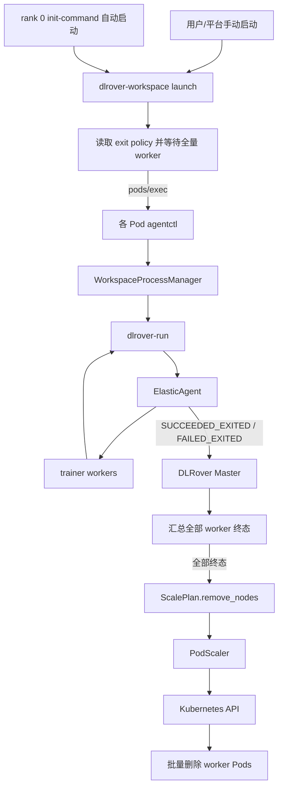

# DLRover Workspace 训练结束资源释放策略设计

终态 RPC、Pod 清理和 Master 退出时序以
[release 终态收尾优化](dlrover-workspace-release-finalization-cn.md) 为准。
新实现不再在终态 RPC 内同步清理或提前设置节点已释放。

## 背景

当前 DLRover Workspace 将生命周期拆成两层：

- 环境生命周期：ElasticJob、worker Pod、Jupyter、idle command 和 runtime
  monitor，由 Kubernetes 和 DLRover Master 管理。
- 训练生命周期：由 `dlrover-workspace launch` 启动的 `dlrover-run`、
  ElasticAgent 和 trainer 进程，由 Pod 内的 `agentctl` 和
  `WorkspaceProcessManager` 管理。

现有 Workspace 训练成功、失败或被 `dlrover-workspace stop` 停止后，只退出本轮
训练进程，worker Pod 的主进程继续运行 Jupyter 或 idle command，CPU、内存和
GPU 资源不会释放。

部分生产训练场景希望继续使用 Workspace 的延迟启动、统一组网和进程管理能力，
但每个环境只运行一次训练，训练结束后自动释放全部 worker 资源。

## 参数建模原则

`dlrover.io/run-mode` 只区分普通 DLRover 和 Workspace，不再承载 Jupyter 形态或
Pod 退出策略。Workspace 内部能力使用独立参数控制：

```text
dlrover.io/run-mode               是否进入 Workspace 架构
dlrover.io/jupyter-enabled        是否提供 Jupyter 交互入口
dlrover.io/workspace-exit-policy  训练终态后保留还是释放 worker Pod
```

这样可以避免把多个正交维度组合成 `workspace`、`runtime`、`runtime-once` 等不断
扩展的 run mode 枚举。

## 目标

- `dlrover.io/run-mode` 只使用 `workspace` 表示启用 Workspace 架构。
- 复用现有 `dlrover.io/jupyter-enabled` 控制 Jupyter。
- 新增 `dlrover.io/workspace-exit-policy=retain|release`。
- `retain` 保持现有训练结束后 Pod 继续运行的行为，并作为默认值。
- `release` 在全量训练进入最终终态后批量删除仍在运行的 worker Pod，释放资源；
  已进入 Kubernetes Failed phase 的 Pod 保留用于诊断。
- `release` 首版只允许一次训练使用当前 ElasticJob 的全部 worker。
- 支持在 `dlrover.io/init-command` 中配置完整的
  `dlrover-workspace launch --network-mode all --framework-cmd ...` 命令，由
  DLRover 自动限定为 rank 0 执行，实现容器创建后自动训练。
- 复用 ElasticAgent 已有训练终态事件，不新增第二套 Workspace 训练协议。
- 使用新的正交参数完整替换旧 `dlrover.io/run-mode=runtime`，不保留兼容入口。
- 普通 DLRover 和 `run-mode=workspace` 下默认 retain 的生命周期不受影响。

## 非目标

- 首版 `release` 不支持通过 `--ranks` 选择部分 worker。
- 首版 `release` 不支持显式传入 `--network-mode ranks`。
- 首版 `release` 不支持裸 `--cmd`，手动和自动启动都使用 `--framework-cmd` 交给
  `dlrover-run` 管理。
- 首版 `release` 不支持 `--foreground`。
- `release` 不支持在同一组 worker Pod 上再次 launch。
- 首版不支持某个 worker 完成后立即逐个释放；全局训练收尾完成后批量释放。
- 不新增 `auto-launch-command`、controller 或 Kubernetes Lease。
- 不修改普通非 Workspace ElasticJob 的生命周期。

## 参数定义

### run-mode

新配置统一使用：

```yaml
metadata:
  annotations:
    dlrover.io/run-mode: workspace
```

其职责仅包括：

- 将 worker Pod 改为 Jupyter/idle 启动方式。
- 启用 workspace CLI、agentctl 和 WorkspaceProcessManager。
- 启用 workspace rendezvous 和多轮训练状态管理。
- 将训练生命周期与 Pod 主进程生命周期解耦。

未配置 `run-mode=workspace` 时，继续执行普通 DLRover 训练流程。

### jupyter-enabled

继续使用现有参数：

```yaml
dlrover.io/jupyter-enabled: "true"
```

该参数只决定：

- rank 0 是否启动 Jupyter。
- 是否创建 Jupyter Service。

默认值保持为 `true`。

### workspace-exit-policy

新增参数：

```yaml
dlrover.io/workspace-exit-policy: retain
```

| 值 | 行为 |
| --- | --- |
| `retain` | 训练结束后保留 worker Pod，允许再次 launch；默认值。 |
| `release` | 训练成功、最终失败或主动 stop 后删除运行中的 worker；Pod-level Failed Pod 保留诊断。 |

PodScaler 向 worker 注入：

```text
DLROVER_WORKSPACE_EXIT_POLICY=retain|release
```

`DLROVER_WORKSPACE_MODE=true` 和 `DLROVER_RUN_MODE=workspace` 继续表示 Workspace
能力已启用，不能再用它们判断训练终态后是否保留 Pod。

### workspace-debug-mode

新增可选调试开关：

```yaml
dlrover.io/workspace-debug-mode: "false"
```

默认值为 `false`。该参数不改变 Pod 退出策略，只在 release 模式下允许
`<setup> && dlrover-workspace launch ...` 形式的运行时依赖准备。Pod 中同时注入
`DLROVER_WORKSPACE_DEBUG_MODE=true|false`；未配置时不会改变严格生产路径。

## 配置组合

### 交互式、可复用 Workspace

```yaml
metadata:
  annotations:
    dlrover.io/run-mode: workspace
    dlrover.io/jupyter-enabled: "true"
    dlrover.io/workspace-exit-policy: retain
```

### 无 Jupyter、可复用 Workspace

```yaml
metadata:
  annotations:
    dlrover.io/run-mode: workspace
    dlrover.io/jupyter-enabled: "false"
    dlrover.io/workspace-exit-policy: retain
```

### 无 Jupyter、训练结束后释放资源

```yaml
metadata:
  annotations:
    dlrover.io/run-mode: workspace
    dlrover.io/jupyter-enabled: "false"
    dlrover.io/workspace-exit-policy: release
```

手动启动时推荐命令：

```bash
dlrover-workspace launch \
  --network-mode all \
  --framework-cmd "bash train.sh"
```

## 参数校验和默认值

| 配置 | 处理方式 |
| --- | --- |
| Workspace 未配置 exit policy | 使用 `retain`，保证现有 Workspace 行为不变。 |
| 未配置 workspace debug mode | 使用 `false`，执行严格的 release init-command 校验。 |
| exit policy 为 `retain` | 保持现有 Workspace 行为。 |
| exit policy 为 `release` 且 Jupyter 为 `false` | 启用一次性资源释放。 |
| exit policy 非 `retain/release` | 启动失败，不静默回退。 |
| 非 Workspace 配置 exit policy | 忽略并输出告警。 |
| `release` 与 Jupyter 为 `true` | 首版启动失败。 |
| `release` 的 init-command 非空但不是完整的全量 workspace launch | 启动失败。 |
| `release + workspace-debug-mode=true` | 允许 `<setup> && dlrover-workspace launch ...` 调试兼容形式。 |

首版拒绝 `release + jupyter-enabled=true`，因为训练结束会删除承载 Jupyter 的
rank 0 Pod，容易造成交互会话和未保存内容丢失。如果未来需要支持，应作为显式能力
单独评审。

## 旧 runtime 配置替换

旧配置：

```yaml
dlrover.io/run-mode: runtime
```

统一替换为：

```yaml
metadata:
  annotations:
    dlrover.io/run-mode: workspace
    dlrover.io/jupyter-enabled: "false"
    dlrover.io/workspace-exit-policy: retain
```

替换规则：

1. 删除 `runtime` run mode 常量和识别分支。
2. `run-mode=runtime` 作为非法值处理，任务启动失败并给出上述迁移配置，不能静默
   降级为普通训练或 Workspace。
3. 新创建的 Pod label 和 `DLROVER_RUN_MODE` 只使用 `workspace`。
4. 使用旧 runtime 配置的任务必须在升级前完成配置迁移，不提供新旧版本混跑。
5. 文档、示例和测试全部改用新参数，不继续展示 runtime 别名。

## 首版 release 边界

### 全量 worker

“全量 worker”指 Master 当前管理的全部未释放 worker。release 策略不接受
`--ranks`，worker rank 必须唯一并连续为 `0..NODE_NUM-1`。

launch 分发前必须满足：

1. 至少存在一个 worker Pod。
2. Pod 数与预期 `NODE_NUM` 一致。
3. 所有 worker Pod 都属于同一 Workspace，并配置 `exit-policy=release`。
4. 所有 worker Pod 均为 Running，且 `agentctl status` 可执行。
5. 所有 worker 本地状态均为 `IDLE/STOPPED`，不存在活动 launch。

### CLI 参数限制

| 参数 | release 首版行为 |
| --- | --- |
| `--network-mode all --framework-cmd` | 手动和 init-command 自动启动都必须使用。 |
| `--ranks` | 拒绝 |
| `--network-mode ranks` | 拒绝 |
| `--network-mode none` | 拒绝 |
| `--cmd` | 拒绝 |
| `--foreground` | 拒绝 |

这些限制只由 `exit-policy=release` 触发。`retain` 继续支持现有参数。

## 通过 init-command 自动启动

### 最小实现方案

用户只在 `init-command` 中配置完整的 workspace launch 命令，worker Pod 模板的
其它配置保持不变：

```yaml
metadata:
  annotations:
    dlrover.io/run-mode: workspace
    dlrover.io/jupyter-enabled: "false"
    dlrover.io/workspace-exit-policy: release
    dlrover.io/init-command: >-
      dlrover-workspace launch
      --network-mode all
      --framework-cmd "bash train.sh"
```

PodScaler 根据 exit policy 和 worker rank 决定是否应用 init-command：

```text
exit-policy=retain:
  所有 worker: init-command -> Jupyter/idle

exit-policy=release:
  rank 0:      init-command -> release supervisor
  其它 worker: 直接进入 release supervisor

exit-policy=release + workspace-debug-mode=true:
  rank 0:      setup -> ready marker -> workspace launch -> release supervisor
  其它 worker: setup -> ready marker -> release supervisor
```

该分流只改变 release 策略。retain 下的 init-command 仍在每个 worker 执行，保持
现有 Workspace 语义。实现上由 PodScaler 在生成每个 worker 的主容器命令时判断
rank，不要求 CLI 选主，也不引入 Lease、锁或新的 annotation。

release 下 `init-command` 只能为空，或配置为使用 `--network-mode all` 和
`--framework-cmd` 的完整 workspace launch。配置其它初始化 shell、缺少训练入口或
使用部分 ranks 时启动失败，避免 rank 0 专属语义被误用于每节点初始化。

### 调试兼容模式

如需在开发镜像中临时安装 DLRover 或其它依赖，可以显式开启：

```yaml
dlrover.io/workspace-debug-mode: "true"
dlrover.io/init-command: >-
  pip install -e /nas/code/dlrover &&
  dlrover-workspace launch
  --network-mode all
  --framework-cmd 'python train.py'
```

该开关默认关闭且只允许与 `workspace-exit-policy=release` 一起使用。PodScaler 将第一个
合法的 `dlrover-workspace launch` 之前、以 `&&` 或 `;` 连接的内容识别为 setup：

- setup 在所有 worker 执行。
- 每个 worker 完成 setup 后写入调试就绪标记。
- 只有 rank 0 执行完整 launch；launch 等待全部 worker 的就绪标记和 agentctl
  `IDLE/STOPPED` 状态。
- launch 之后不允许继续拼接其它 shell 命令。
- 命令名仍必须是 `dlrover-workspace`，不兼容 `dlrover -workspace` 等错误拼写。

该模式用于共享源码目录、editable install 等开发调试场景。生产镜像仍应预装依赖，
并保持 debug mode 关闭。

执行流程：

1. PodScaler 只把配置的 init-command 拼接到 rank 0 主命令。
2. 其它 worker 直接进入 release supervisor，等待 pods/exec 和本机训练结果。
3. rank 0 执行 init-command 中唯一一次完整 launch，并等待 `NODE_NUM` 个 worker
   全部可执行。
4. CLI 使用 init-command 中的 framework command 对全部 worker 发起训练。
5. 后台训练进程在所有 worker 创建成功后，rank 0 的 launch 返回并进入 supervisor。
6. 训练终态由 WorkspaceProcessManager 上报，同时训练包装器把退出码写入 state，
   supervisor 以对应退出码结束容器。
7. Master 汇总后，成功时删除全部 worker Pod；失败时保留进入 Failed phase 的 Pod，
   删除其余 worker Pod。

launch 返回表示训练进程已经提交，不等待训练完成，因此 init-command 不会占用整个
训练周期。本方案不新增默认训练命令环境变量，也不把 worker 模板原始 command/args
作为自动启动来源；自动训练入口只以 init-command 中的完整 workspace launch 为准。

### 全量就绪等待

为解决 rank 0 早于其它 Pod 启动的竞态，release 策略下 CLI 自动等待，不新增用户
参数：

- Pod 内调用优先读取已有环境变量 `NODE_NUM`。
- Workspace 外部调用从任一已出现的 worker 读取 `NODE_NUM`。
- 默认最多等待 300 秒，每 2 秒重新 list worker Pods。
- 只有数量、rank、Running 状态和 agentctl 可执行性全部满足时才分发 launch。
- 超时前不向任何 worker 下发命令，防止部分启动。
- 等待超时后返回非零。自动启动场景下，现有 `set -e` 会令 rank 0 容器退出，
  Master 将任务判定为启动失败并释放其它 idle worker。

不能把当前已经查询到的 Pod 数当作预期数量，否则可能在 Pod 尚未创建完整时启动
一个子集。Master 仍以其管理的未释放 worker 集合作为权威 `expected_nodes`。

### 初始化职责

release 自动启动场景下，`dlrover.io/init-command` 只用于上述完整 launch 命令。
每个 worker 都必须完成的依赖安装、模型准备和挂载检查，应放到镜像构建或
Kubernetes `initContainers` 中。

不能把每节点初始化放入 release 的 init-command，因为该命令只在 rank 0 执行。
`initContainers` 已提供所有 Pod 初始化完成后才启动主容器的语义，无需在 Workspace
内再实现初始化 barrier。retain 下 init-command 继续保持每个 worker 都执行的原有
行为。

### 权限

rank 0 内的 CLI 复用现有 ServiceAccount：

```yaml
- apiGroups: [""]
  resources: ["pods"]
  verbs: ["get", "list"]
- apiGroups: [""]
  resources: ["pods/exec"]
  verbs: ["create"]
```

worker 不需要 Pod delete 权限；删除操作只由 Master/PodScaler 执行。

## 总体流程



关键原则：

- 训练进程退出不等于资源释放；资源释放必须落实为 worker Pod 删除。
- CLI 和 Pod 内进程不直接调用 Kubernetes delete API。
- 第一个 worker 完成时不立即删除其 Pod。Master 等全部 worker 完成退出屏障、日志
  刷新和终态上报后再批量删除。
- `exit-policy=retain` 完全沿用现有 idle 保活路径。

## 状态与策略分类

代码不再根据多个 run mode 判断生命周期，而是先规范化配置：

```python
workspace_enabled = normalized_run_mode == "workspace"
jupyter_enabled = workspace_enabled and configured_jupyter_enabled
exit_policy = configured_exit_policy or "retain"

persistent_workspace = workspace_enabled and exit_policy == "retain"
releasing_workspace = workspace_enabled and exit_policy == "release"
```

职责分工：

- `workspace_enabled`：Pod 命令改写、agentctl、workspace rendezvous。
- `jupyter_enabled`：Jupyter 进程和 Service。
- `persistent_workspace`：训练结束后转 idle、无心跳和 Pending 早停豁免。
- `releasing_workspace`：终态聚合、禁止再次 launch、禁止自动扩缩容和节点重建、
  批量处理 Pod。

不能仅通过 `_is_workspace_mode()` 判断是否跳过退出上报，否则 release 策略也会被
错误地当成持久 Workspace。

## 启动和终态协议

release 不引入 `WORKSPACE_TRAINING_STARTED` 或结构化 FINISHED 事件，直接复用普通
训练已经稳定使用的终态通道：

| ElasticAgent 结果 | 上报事件 | 聚合结果 |
| --- | --- | --- |
| 成功并完成退出屏障 | `SUCCEEDED_EXITED` | 全部 worker 成功时 Job 成功。 |
| 容错耗尽后的最终失败 | `FAILED_EXITED` | Job 失败。 |

`retain` 继续跳过上述 exited 事件，并使用既有
`WORKSPACE_TRAINING_FINISHED` 通知 Master 将本轮训练转回 idle；因此原有多轮 launch
语义不变。`release` 不发送 Workspace finish，并且不再在 launch 后执行默认的
`sleep infinity`，而是启动前台 release supervisor。每个 worker 上的训练包装器将
最终退出码写入现有 Workspace state 文件；supervisor 读取结果后以相同语义退出，
使训练失败真正转换为 Kubernetes Failed Pod。Master 以当前管理的全部未释放 worker
为聚合集合；只有所有 worker 都上报 exited 后才生成一个删除计划。

Node 的 reported status 已具有终态后不再覆盖的幂等语义，重复事件不会重复计数。
如果 release worker 在训练进程建立前发生 Pod 失败，Pod 事件作为启动失败处理，
直接将整组 worker 标记失败并逻辑释放。触发失败的终态 Pod 不删除，其余 idle 或
Pending worker 删除，既避免 GPU 资源泄漏，也保留 `logs/describe` 诊断入口。

## Pod 释放

全部 worker 上报终态后，JobManager：

1. 将 Job stage 切换为 `JOB_STOPPING`，阻止新 rendezvous 和故障重拉。
2. 将全部 expected worker 设置为 `relaunchable=False`。
3. 更新节点结果并设置 `is_released=True`。
4. 构造包含全部 expected worker 的 `ScalePlan.remove_nodes`。
5. 在 JobManager 锁外调用 `PodScaler.scale(plan)`；对于上报 `FAILED_EXITED` 的节点，
   PodScaler 最多等待 30 秒让 supervisor 将 Pod 转为 Failed；进入 Failed 后跳过删除，
   批量删除其余 Pod。
6. 将聚合结果提供给 Master 主循环，设置 ElasticJob 最终状态。

release 不依赖通用 `remove_exited_node` 配置，它是显式 exit policy 的强制语义。
release 是一次性全量训练，Master 即使读到 `autoScale: true` 或 AllReduce 默认重建
配置，也强制关闭 worker 自动扩缩容，并在节点状态流入口拒绝 relaunch，避免训练
结束或失败后创建 `worker-1`。YAML 仍建议显式配置 `autoScale: false`、
`restartCount: 0` 和 `restartPolicy: Never`，用于表达意图并避免 kubelet 重启容器。
删除前的 phase 复核同时覆盖训练终态 RPC 早于 Pod phase 更新、多个 worker 近乎
同时失败以及 Pod 事件到达 Master 顺序不同的竞态。若读取 Pod 失败，或 30 秒后
仍未进入 Failed，则继续执行原删除动作，避免 supervisor/集群 API 异常导致
Running/Pending GPU Pod 泄漏。等待时间可通过 Master 环境变量
`DLROVER_WORKSPACE_FAILED_POD_WAIT_SECONDS` 调整。

## 失败和竞态处理

### CLI 预检失败

手动启动时尚未下发任何命令，Pod 保留，用户可以修复后重试。init-command 自动
启动时，rank 0 等待超时返回非零并进入 Failed；Master 保留该 Failed Pod，并删除
其余仍在运行或等待的 worker。

### 训练启动前 Pod 失败

如果 release worker 在训练启动前退出，JobManager 将其识别为一次性训练启动失败，
禁止按持久 Workspace 保活或重拉，将 Job 标记为失败。失败 worker 仅设置为逻辑
released，不加入删除计划；其余 worker 加入同一个删除计划。Failed Pod 保持
OwnerReference，删除 ElasticJob 时仍会被级联清理。

### 训练失败

ElasticAgent 内部允许的容错和 worker-group restart 继续工作。只有外层
`dlrover-run` 最终非零退出才上报 FAILED 并触发最终释放。训练包装器记录非零退出码，
release supervisor 随后以非零状态退出容器。Master 等待 Pod 进入 Kubernetes Failed
phase 后保留它，GPU 等调度资源由 kubelet 释放，日志和 `describe` 信息继续可用；
如果限定时间内没有进入 Failed，则删除该 Pod 作为资源泄漏保护。

### 用户 stop

release 下 stop 不允许 ranks。CLI 向全部 worker 停止训练；ElasticAgent 完成退出后
上报 exited 事件，Master 汇总后批量释放。首版沿用现有 stop 的成功退出语义，不新增
CANCELLED 状态。

### 重复和延迟事件

- Node exited reported status 只接受第一个终态，后续重复终态不覆盖。
- 只有带有 `run-mode=workspace` 和 `exit-policy=release` 元数据的 worker 才进入释放
  聚合。
- `is_released=True` 的节点不重复加入 ScalePlan。

### Master 暂时不可用

训练进程状态仍写入本地 `train.json` 用于诊断。Master 不可用期间 ElasticAgent 沿用
现有事件上报与 Pod 失败检测机制，本设计不新增另一套本地恢复协议。

## 行为隔离要求

以下行为必须保持：

- `run-mode=workspace + exit-policy=retain` 成功、失败或 stop 后 Pod 保留。
- 未配置 exit policy 的 Workspace 等价于 retain。
- `run-mode=runtime` 明确报错，不能静默转成普通训练或 Workspace。
- 普通训练继续使用 `SUCCEEDED_EXITED/FAILED_EXITED` 和原有 Job 停止流程。
- 新 Master 接受旧格式 workspace finish，并仅按 retain 处理。
- release 要求 Master、CLI 和训练镜像同时支持 exit-policy，不能静默降级。

## 改动范围

### 核心代码

| 文件 | 计划改动 |
| --- | --- |
| `dlrover/python/master/scaler/pod_scaler.py` | 新增 exit-policy annotation/env；release 下只为 rank 0 拼接完整 workspace launch init-command，所有 rank 使用 release supervisor，并等待失败 Pod phase 后决定是否删除；retain 保持原有 idle 行为。 |
| `dlrover/python/master/node/workspace_state.py` | 从 run-mode 判断改为 workspace capability + exit policy；retain 才应用 idle 心跳和 Pending 豁免。 |
| `dlrover/python/master/main.py` | release 模式强制关闭 worker 自动扩缩容。 |
| `dlrover/python/master/node/dist_job_manager.py` | 复用 worker exited 事件聚合全量终态；Pod-level 失败时保留失败 Pod、删除其余 worker；禁止自动扩缩容和重拉并生成删除计划。 |
| `dlrover/python/elastic_agent/torch/training.py` | 增加 exit policy 判断；release 恢复普通 exited 上报且不发送 workspace finish；retain 保持现状。 |
| `dlrover/python/workspace/process_manager.py` | release 训练通过结果包装器执行并将真实退出码写入 state；release stop 完成后补发 exited，retain 继续发送 workspace finish。 |
| `dlrover/python/workspace/release_supervisor.py` | release worker 的前台生命周期监督器；等待训练 state，按最终退出码结束容器。 |
| `dlrover/python/workspace/launcher.py` | `WorkspacePod` 携带 exit policy；读取本地 NODE_NUM；轮询全量 Running；release 禁止 ranks/foreground。 |
| `dlrover/python/workspace/network.py` | 支持使用就绪 worker 快照生成全量组网配置，避免 rank 0 提前启动时使用不完整 Pod 数。 |
| `dlrover/python/workspace/cli.py` | 保持现有 cmd/framework-cmd 必填规则；根据 exit policy 校验完整全量 launch 参数并执行 300 秒就绪等待；release stop 禁止 ranks；retain 不变。 |

`dlrover/python/scheduler/kubernetes.py` 已能透传通用 run mode，预计只需增加默认值
和拒绝 runtime 旧值的测试。新参数使用 annotation，首版不修改 Go CRD 和 Helm
CRD。

### 测试代码

| 文件 | 测试内容 |
| --- | --- |
| `test_pod_scaler.py` | 正交参数、默认 retain、release env、非法组合、拒绝 runtime；release 仅 rank 0 包含完整 launch init-command，retain 所有 rank 保持原行为。 |
| `test_workspace_state.py` | capability/exit policy、retain 豁免和 release 不豁免。 |
| `test_job_manager.py` | exited 终态聚合、批量删除、禁止重拉和结果聚合。 |
| `test_elastic_training_agent.py` | retain/release 分流及普通训练回归。 |
| `test_workspace_process_manager.py` | retain/release stop 上报分流以及 release 结果包装器。 |
| `test_workspace_release_supervisor.py` | 训练成功、失败退出码记录和 supervisor 退出语义。 |
| `test_workspace_launcher.py` | NODE_NUM、延迟 Pod、等待超时和参数拒绝。 |
| `test_workspace_network.py` | 手动 release 只允许 all；默认命令路径不重复包装；校验 NODE_NUM/NODE_RANK。 |
| `test_workspace_cli.py` | release 完整全量 launch 参数校验、rank 0 自动启动和 retain 回归。 |

### 集成测试

1. retain 未显式配置时，训练结束后 Pod 保留。
2. retain 显式配置时，成功、失败和 stop 后 Pod 保留。
3. `run-mode=runtime` 在 Pod 创建前失败，并输出迁移提示。
4. release 全部 worker 成功，Pod 批量删除，Job 成功。
5. release 任一 worker 最终失败，supervisor 使对应 Pod 进入 Failed 并保留；其余
   Running/idle Pod 批量删除，Job 失败。
6. release 全量 stop，Pod 批量删除，Job 取消/失败。
7. release worker 进入 Pod Failed phase 时保留该 Pod，删除其他 Running/Pending
   worker，Job 失败且不触发重拉。
8. init-command 配置完整的 `dlrover-workspace launch --network-mode all
   --framework-cmd ...`，PodScaler 仅在 rank 0 执行并产生一个全量 launch。
9. rank 0 先启动时等待其它 worker，全部就绪后自动训练。
10. worker 300 秒内未就绪，未发生部分 launch；失败 Pod 保留，其余 worker 释放。
11. 重复 exited 事件不触发重复删除。
12. 非 Workspace 和 `release + jupyter=true` 的非法组合按定义处理。

### 文档和示例

- 更新 Workspace 参数说明，增加 exit policy、默认值和 runtime 配置替换说明。
- 更新架构文档，删除 runtime 模式，使用 Jupyter 和 exit policy 表达 Workspace
  形态。
- 增加 retain、release 手动启动、release init-command 自动启动示例。
- 增加全量等待和启动超时的故障排查说明。

## 验收标准

- `run-mode` 只决定普通 DLRover 或 Workspace，不参与退出策略判断。
- 未配置 exit policy 时默认为 retain，现有 Workspace 行为完全不变。
- 旧 `run-mode=runtime` 在启动阶段失败并提示迁移，不保留兼容逻辑。
- 只有显式配置 `workspace-exit-policy=release` 才会删除训练结束后的 worker。
- release 与 Jupyter、CLI 参数的非法组合在启动任何训练前失败。
- init-command 配置完整的全量 workspace launch 时，DLRover 自动限定为 rank 0
  执行，并且只产生一次全量 launch。
- init-command 缺少 `--network-mode all`、`--framework-cmd` 或训练入口时，在向
  任何 worker 分发前失败。
- retain 下 init-command 仍在所有 worker 执行，没有生命周期语义回归。
- workspace-debug-mode 默认关闭；关闭时带 setup 前缀的 release init-command 仍应
  在创建 Pod 前失败。
- workspace-debug-mode 开启后，setup 在所有 worker 完成，完整 launch 仍只执行一次。
- rank 0 提前启动时按 NODE_NUM 等待，等待期间不发生部分 launch。
- 自动启动超时后 Job 失败；保留终态 Failed Pod 并释放其余 worker，不遗留 idle
  GPU Pod。
- 全量训练成功或 stop 后能批量删除 worker；最终失败的 Pod 进入 Failed 并保留，
  其它 worker 删除；Job 结果正确。
- 第一个 worker 完成时不提前删除 Pod，不影响其它 worker 的退出屏障和日志收尾。
- 重复终态事件和非 release worker 不能触发重复或错误删除。
- 普通 DLRover 和 retain Workspace 的生命周期没有回归。

## 后续演进

- 支持 release 策略选择部分 ranks，并定义未参与 worker 的处置方式。
- 支持裸 `--cmd` 和外部训练框架。
- 支持 foreground 命令的可靠 supervisor。
- 将启动和终态超时开放为配置。
- 评估 `release-on-success` 等新 exit policy。
- 支持安全的 Jupyter + release 组合。
- 将 WorkspaceRun 状态持久化为独立 CRD，增强 Master 重启恢复能力。
