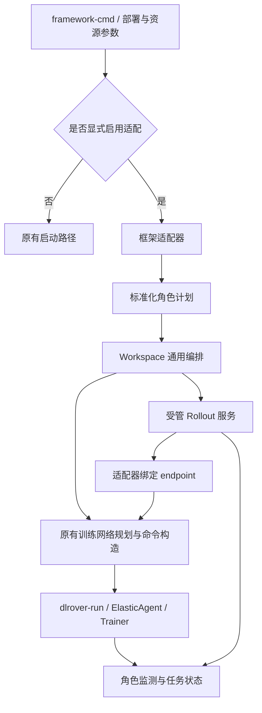

# DLRover Workspace 框架适配、角色编排与自动组网设计

## 1. 文档定位

本文是 Workspace 共卡与分离式训练支持的最终建议方案，整合并替代前一版 [Swift GRPO 专用方案](dlrover-workspace-swift-grpo-auto-network-cn.md)作为后续实现依据；旧文档保留用于追溯。

本方案保留 `dlrover-workspace launch --framework-cmd` 入口，将框架适配、部署方式、rollout 管理方式和训练组网分开。核心结构为：**通用角色编排 + 框架适配器 + 原有 DLRover 组网**。

本文所有新增参数、接口和行为均为待实现设计。此次仅新增文档，不修改代码，也不表示已验证任意 Swift、Megatron 或 Ascend 版本组合。

## 2. 目标与边界

### 2.1 目标

- 复用用户原始框架命令或受支持的脚本，不要求另写任务 YAML。
- 支持共卡（colocate）与分离式（disaggregated）部署。
- 分离式可以连接外部 rollout，也可以由 Workspace 管理 rollout。
- 通过角色参数控制 Pod 和设备布局，脚本配置可作为默认值。
- 复用现有 Pod 发现、rank 映射、命令构造、ElasticAgent 和 rendezvous。
- 为 Swift、Megatron 等框架提供适配器扩展点，通用层不包含 Swift/vLLM 专用参数。
- 支持可解释的启动计划、失败补偿、角色日志及联合停止。

### 2.2 首版范围

首个落地适配器为 Swift GRPO，验证共卡、分离式 external、分离式 managed 三条路径；以用户实际 Ascend 环境为主要验证对象。Megatron 定义接入契约，后续按具体发行版本和 RL 入口实现，不将接口存在等同于已支持。

首版不包括：任意 Bash 解释、动态扩缩容、多任务并发调度、单个 rollout 实例跨 Pod TP、自动 checkpoint 恢复、Master 重启后的透明恢复、自动设备调度和通用工作流系统。

分离式不等于异步采样。是否异步以及训练算法仍由框架业务参数决定。

## 3. 现有能力与兼容原则

| 现有接口/组件 | 保持或复用的能力 |
| --- | --- |
| `--cmd` | 执行完整命令，不进入框架脚本解析 |
| `--framework-cmd` | 统一框架输入入口，不新增独立 `--script` |
| `--network-mode none/all/ranks` | 用户显式控制训练组网，默认仍为 none |
| `--auto-network` | 保留原有别名 |
| `--ranks` | 选取本次 launch 的 Pod，不改为 trainer rank |
| `--dlrover-run-args` | 继续传递 DLRover 训练启动参数 |
| NetworkPlanner / CommandBuilder | 训练节点数、连续 rank、训练命令包装 |
| Launcher / agentctl / ProcessManager | Pod 发现、pods exec、进程管理和日志 |
| ElasticAgent / rendezvous | 分布式进程启动、训练环境和训练组网 |

**没有显式使用新增适配选项时，必须完整保留原有路径。** 不因命令中出现 `swift`、`grpo` 等关键字而自动改变执行方式。

新增适配选项包括 framework、deployment-mode、rollout-management 及角色资源参数。显式使用任意一个即进入适配路径；使用 `--cmd` 搭配这些选项报错。解析器需记录选项是否显式提供，不能用默认值意外开启适配。

原有 release 限制继续有效：要求 network-mode=all，不接受 --ranks，不接受 --foreground。新增角色 ranks 可以在 all 选中的集合内划分用途，但 release 支持必须等任务级收尾屏障完成后才能启用。

## 4. CLI 与配置语义

### 4.1 框架、部署与服务归属

| 参数 | 取值 | 语义 |
| --- | --- | --- |
| `--framework` | auto、swift、megatron 等注册标识 | 选择解析和运行时适配器 |
| `--deployment-mode` | auto、colocate、disaggregated | 训练与采样的部署方式 |
| `--rollout-management` | external、managed | 分离式 rollout 是否由本任务管理 |

进入适配路径后，未显式指定的 framework 和 deployment-mode 使用 auto；只能根据注册适配器可可靠识别的信息解析，存在歧义即报错，不能执行脚本探测。

rollout-management 不从“脚本中碰巧存在 rollout 命令”自动推断。分离式未指定时默认 external，避免未经明确配置就启动或停止服务。如果 external 输入包含待执行 rollout 命令，应报错并提示使用 managed，不能静默忽略。

colocate 不接受 rollout-management、rollout-ranks、rollout-devices；managed 模式必须能解析到框架支持的 trainer 和 rollout 命令。

`--framework megatron` 是预留的适配器标识。实现须明确具体项目、版本、命令入口和 rollout 协议；未注册时明确报“不支持”。通过 Swift 命令启动 Megatron 后端时，使用 Swift 适配器识别后端及能力，不简单按参数里的 Megatron 字样切换适配器。

### 4.2 资源与辅助参数

| 参数 | 语义 |
| --- | --- |
| `--trainer-ranks LIST` | trainer 对应的原始 workspace worker ranks |
| `--rollout-ranks LIST` | managed rollout 对应的原始 worker ranks |
| `--trainer-devices LIST` | 覆盖 trainer 设备可见性配置 |
| `--rollout-devices LIST` | 覆盖 managed rollout 设备可见性配置 |
| `--dry-run` | 展示计划，不启动进程或占用资源 |
| `--rollout-ready-timeout SECONDS` | managed 服务就绪超时，建议默认 600 秒，必须为正数 |

设备编号沿用容器内对应后端的可见性语义，不能越过容器资源分配范围。首版同一角色在不同 Pod 使用相同设备布局；异构布局作为后续扩展。

### 4.3 使用示例

既有命令保持不变：

```bash
dlrover-workspace launch \
  --framework-cmd "bash train.sh" \
  --network-mode ranks --ranks 0,2
```

显式适配 Swift 共卡脚本，rollout 由框架内部管理：

```bash
dlrover-workspace launch \
  --framework-cmd "bash grpo_colocate.sh" \
  --framework swift \
  --deployment-mode colocate \
  --network-mode ranks --ranks 0,2 \
  --trainer-devices 0,1,2
```

Swift 分离式，同 Pod 分设备；每个选中的 Pod 启动两种角色：

```bash
dlrover-workspace launch \
  --framework-cmd "bash grpo_server.sh" \
  --framework swift \
  --deployment-mode disaggregated \
  --rollout-management managed \
  --network-mode ranks --ranks 0,2 \
  --trainer-devices 1,2 \
  --rollout-devices 0
```

不同 Pod 分角色：

```bash
dlrover-workspace launch \
  --framework-cmd "bash grpo_server.sh" \
  --framework swift \
  --deployment-mode disaggregated \
  --rollout-management managed \
  --network-mode ranks --ranks 0,1,2,3 \
  --trainer-ranks 0,1 --rollout-ranks 2,3 \
  --trainer-devices 0,1 --rollout-devices 0
```

连接已有 rollout，脚本只包含 trainer 命令及外部 endpoint：

```bash
dlrover-workspace launch \
  --framework-cmd "bash trainer.sh" \
  --framework swift \
  --deployment-mode disaggregated \
  --rollout-management external \
  --network-mode all \
  --trainer-devices 0,1
```

后续 Megatron 适配器沿用相同部署和资源参数，替换 framework 和业务脚本即可，但必须先通过该具体后端的能力校验。以上命令均可追加 --dry-run。

## 5. Pod、角色与网络规则

先复用原有参数得到选中 Pod 集合 S，再划分 trainer 集合 T 和 managed rollout 集合 R。

| 部署方式 | 集合规则 |
| --- | --- |
| colocate | T=S，无独立 rollout 角色 |
| disaggregated + external | T=S，外部服务不属于 S，不分配 rollout 资源 |
| disaggregated + managed，角色 ranks 都省略 | T=R=S |
| disaggregated + managed，显式角色 ranks | 两项同时指定、均非空，T∪R=S |

trainer-only 模式显式给出的 trainer-ranks 必须等于 S，避免留下无用途 Pod；通常无需提供。所有 ranks 均不得重复、为负或引用不存在的 worker。

T 与 R 可以相交，相交 Pod 的设备集合必须互斥。不同 Pod 可使用相同设备编号。首版每 workspace 只允许一个活动适配任务，并与既有活动任务进行占用冲突检查。

network-mode 的含义保持如下：

- none：不包装 dlrover-run，不创建跨 Pod trainer world。首版适配路径要求 S 为单 Pod，原有路径的多 Pod none 行为不变。
- all：先选全部 worker，再对 T 组网；仍禁止同时指定 --ranks。
- ranks：先按 --ranks 选择 S，再对 T 组网。

T 按原始 rank 稳定排序，映射为连续 trainer node rank，NODE_NUM=|T|。原始 worker rank、训练 node rank、rollout 实例编号分别保存。

## 6. 复用 DLRover 的范围

| 通信或运行职责 | 负责方 |
| --- | --- |
| Trainer 进程派生、rendezvous、训练分布式环境 | 既有 DLRover 运行时 |
| 模型训练及框架内部 TP/PP/DP/FSDP | 训练框架 |
| 采样请求与权重同步协议 | 框架及其 rollout 后端 |
| Rollout 进程、服务发现、就绪与生命周期 | Workspace + 框架适配器 |

新增角色规划器在现有 Pod 选择结果上得到 T，仅将 T 交给训练网络规划。现有 all 路径也需处理 trainer 子集的连续 rank 映射，不能沿用原始非连续 rank。

复用现有 builder 包装 trainer 命令，不新建 MASTER_ADDR/PORT 分配、训练主节点选举或 rendezvous 协议。多个独立 rollout 服务不加入 trainer world。未来 rollout 跨 Pod 分布式执行需独立组网能力，不与 trainer 混组。

复用 DLRover 故障检测不代表自动复用局部恢复。首版 managed 关键角色故障后整任务停止；需限制该任务的局部 trainer 重启、Pod 重拉及垂直弹性独立恢复。普通训练策略不受影响。

## 7. 通用编排与适配器接口



### 7.1 标准化计划

`RunPlan` 包含适配器标识/版本、部署方式、服务归属、网络模式、Pod 快照、配置来源与角色列表。

`RoleSpec` 至少包括：

| 字段 | 用途 |
| --- | --- |
| name | trainer、rollout；首版只支持这两类受管角色 |
| command / environment / cwd | 参数数组、角色环境及工作目录 |
| resources | Pod UID、原始 rank、设备、每节点进程数 |
| launch_kind | distributed、service、local |
| dependencies | 启动依赖与所需就绪阶段 |
| readiness | 适配器提供的健康/初始化检查 |
| lifecycle | 完成条件、失败动作和清理顺序 |

distributed 表示需要框架兼容的分布式启动；service 表示独立服务实例；local 表示本地执行。launch_kind 的可支持集合由能力声明约束，不在首版实现任意角色 DAG 调度。

colocate 只产生 trainer 受管角色，内部 rollout 由框架管理；external 只产生 trainer 和外部 endpoint 引用；managed 产生 trainer 与 rollout。

### 7.2 最小适配器契约

| 接口职责 | 输入/输出 |
| --- | --- |
| detect / parse | 从命令或受支持脚本识别框架、后端、算法、部署方式与角色命令 |
| capabilities / validate | 声明版本、部署方式、设备后端、启动方式与资源约束；返回明确错误 |
| build_roles | 生成标准化角色计划，不执行进程 |
| bind_endpoints | 将有序 endpoint 绑定为框架参数或配置 |
| readiness | 提供服务就绪、通信初始化的检查方式与超时分类 |
| prepare_worker_entrypoint | 适配 DLRover 已派生进程的执行入口，避免框架再次启动 launcher |

框架适配器负责 Swift 的 vllm_mode、vllm_server_host/port 等具体参数，以及 Megatron 具体后端的并行约束。通用层只处理角色、依赖、endpoint 和状态，不直接拼接这些框架参数。

## 8. 脚本解析与参数决策

### 8.1 受支持输入

适配入口首版支持直接框架命令和 `bash PATH` 形式。PATH 在提交 CLI 所在目录解析，CLI 读取后传递结构化结果；不要求脚本本身存在于各 worker。

首版支持注释、续行、引号、命令前环境赋值、常量赋值/可确定变量引用、可解析 export 和固定 cwd。保留每个命令的环境快照和源文件行号。

managed 模式须识别出恰好一条 trainer 与一条 rollout 命令模板；其他模式只允许 trainer 模板。循环、函数、条件分支、动态 source、命令替换、管道和无法解释的命令报错；不执行整份脚本来识别命令，不静默忽略前置逻辑。需复杂准备流程的用户应将其与受支持训练入口分开。

模型、数据和 cwd 的运行时路径仍需在目标 Pod 中存在。参数以数组保存，最终 shell 构造统一转义，不能用字符串替换修改模型或 endpoint。

### 8.2 优先级

- 显式角色 devices 覆盖脚本设备配置；两处均无配置且无法安全确定时要求补充。
- 显式 DLRover nproc 参数优先；否则有显式 trainer devices 时按每设备一个进程推导，再回退到脚本 NPROC_PER_NODE 或明确设备数。
- 用户显式进程数不能被设备覆盖静默改写；若设备数量变化导致脚本默认进程数调整，必须展示覆盖结果。
- 区分原 CLI 默认 nproc=1 与用户显式值，原入口默认行为不变。
- 进程数不必等于可见设备数，但须满足适配器容量与设备映射约束。少进程时明确实际使用的设备映射，不让框架随机选卡。
- 首版 trainer 每节点进程数一致；Megatron TP/PP/DP 等约束由对应适配器验证。
- 业务参数保留；managed endpoint 由本任务实际地址覆盖；external endpoint 保留并校验。
- rollout TP/DP 不随设备数自动变化，只检查资源是否满足。
- 显式节点数等拓扑参数与 T 冲突时报错。

### 8.3 单一训练进程派生

DLRover 组网模式下，ElasticAgent 是唯一训练进程派生方。将脚本 NPROC_PER_NODE 等转为 DLRover 配置，在框架工作进程入口隔离会触发二次 launcher 的变量，保留 RANK、LOCAL_RANK、WORLD_SIZE 等必要训练环境。

Swift 的直接命令可执行检测并不能解决其内部 torchrun 派生；必须按目标版本验证入口和环境，必要时使用适配器明确支持的直接训练入口。none 模式由框架原生本地启动。不能将原脚本环境不加区分地套进 dlrover-run。

### 8.4 预检查和 dry-run

dry-run 输出解析结果、角色布局、设备映射、trainer rank、进程数、命令、参数来源和覆盖、端口模板及待运行验证项。只做静态和必要的只读检查，不加载模型、绑定端口或占用资源；凭据脱敏。

至少校验：模型结构/版本一致性、算法与部署方式、框架能力、Pod 与设备、路径、并行约束、端口配置。用户示例的 Qwen3-1.7B/qwen3 与 Qwen3.5-2B/qwen3_5 不一致，应拒绝 managed 训练，不能自动改模型。模型挂载路径不同可用可验证元数据确认，不能仅凭路径判断。external 的模型信息无法检查时标记待运行验证，不宣称已确认。

Swift 参数如 --max_step 必须按目标版本核验，不假设缩写有效；HTML 转义等异常脚本内容应定位报错。

## 9. 启动与网络通信

### 9.1 Managed 启动流程

1. 生成计划，检查所有目标 Pod，登记单任务占用和 Pod UID。
2. 在 R 中通过现有 pods exec/agentctl 启动 rollout；角色环境隔离，不继承 trainer rendezvous 配置。
3. 检查进程、模型加载和服务可用性；仅端口开放不能视为就绪。
4. 按原始 rank 稳定排序 endpoint，所有 trainer 获得同一列表。
5. 适配器注入地址，trainer 子集通过原 DLRover 链路启动。
6. 在独立初始化超时内确认训练组网、框架通信与首轮权重同步，随后进入 RUNNING。
7. 持续监测，完成或故障后统一清理。

colocate 无独立服务阶段；external 只检查外部服务所需条件并启动 trainer，禁止停止或修改外部服务进程。

### 9.2 端口与通信边界

首版沿用脚本端口，不同 Pod 网络可复用相同端口；冲突时失败，不悄悄改变用户配置。预检查不能排除端口竞争，需确认是本任务进程成功启动，不能误用既有服务。

跨 Pod 服务监听可达接口并发布 Pod IP，不能发布 127.0.0.1 或 0.0.0.0。首版直接列出 endpoint，不增加普通负载均衡 Service，以保留实例身份。

服务访问、trainer 分布式通信、权重同步是不同检查项。Ascend 适配需依据实际通信后端校验网络接口和端口，不能照搬 CUDA/NCCL 配置。所需动态通信端口或额外网络权限必须作为能力检查结果说明。

Pod UID/IP 变化导致本轮失败；首版不向已有通信组热替换 endpoint。外部服务不可用时只停止本任务 trainer。

## 10. 进程、状态与故障管理

### 10.1 最小控制面扩展

保留 CLI → Launcher → pods exec → agentctl 通道，不建设独立 controller 或数据库。Launcher 负责启动编排和失败补偿，Pod 内监管负责进程组与状态，Master 增加最小任务登记、角色状态聚合与停止决策。

需通过现有通信基础增加必要消息，而非假定当前已有角色接口。任务标识包括 run_id、执行代次、角色实例 launch_id 与 Pod UID，旧事件不得改变新任务。

首版采用失败关闭：Master 重启后不透明恢复训练；旧执行实例检测到控制代次失效或超过控制失联宽限期后停止本任务进程。可通过 Master 实例代次和角色上报核对旧执行，重启后必须完成资源/进程核对再接受新任务，不能仅因内存状态为空就认为资源空闲。

启动期间 CLI 通过有界启动期限登记状态；CLI 异常退出后，已有角色由监测器和 Master 超时清理。进入 RUNNING 后不依赖 CLI 存活。控制失联宽限期应独立于训练超时，防止短暂网络抖动立即杀任务。此机制为故障清理，不是高可用恢复。

### 10.2 状态和清理

```text
PREPARING → SERVICES_STARTING → SERVICES_READY → TRAINER_STARTING
          → RUNNING → STOPPING → SUCCEEDED / FAILED / CANCELLED
```

不需要受管服务的模式跳过服务启动阶段。初始化成功不只依据进程存活；若框架缺少可观测初始化信号，适配器须声明使用的验证方式和局限。

| 情况 | 动作 |
| --- | --- |
| 服务启动失败或超时 | 不启动 trainer，清理本任务已启动服务 |
| trainer 部分启动失败 | 先停 trainer，再清理受管 rollout |
| managed 运行中任一关键角色失败 | 发布整任务停止，清理本任务进程 |
| external 服务失败 | 停止本任务 trainer，不操作外部服务 |
| 全部 trainer 正常完成 | 清理受管 rollout，按结果收尾 |
| 单个 trainer 提前退出 | 有限完成窗口内等待其他实例，超时失败 |
| 手动 stop | 幂等停止，超时按现有进程组清理机制升级 |
| 清理失败 | 展示残留实例并保留占用状态，不报告清理成功 |

trainer 保留训练心跳；rollout 使用服务探针；idle 和 rollout-only worker 不应因无训练心跳被重拉。故障联动需在 retain、release 两条路径分别审查。

### 10.3 状态目录与用户操作

状态与日志按 run_id / role / instance 分开，防止同 Pod 两角色覆盖 train.pid 等现有文件。增加任务索引，兼容旧单任务格式。

- status：展示部署方式、角色、Pod、设备、进程和就绪状态。
- logs --role trainer|rollout：按角色筛选，未指定时带角色标签输出。
- stop：停止整任务；对活动任务只指定部分 ranks 时拒绝部分停止并提示完整范围。
- managed 的启动补偿只操作本次 launch_id 拥有的进程，不按端口或进程名粗暴清理。

retain 完成后保留 Pod/Jupyter。release 在全任务清理屏障完成后执行原释放流程，不允许 rollout 或单个 trainer 先退出就释放整任务。release 的 GRPO 支持随第三个特性验收，完成前显式拒绝。

新增适配路径首版不支持 foreground，避免悄悄重新定义原有前台执行语义；用户用 logs --follow 查看输出。原有 foreground 行为保持不变，后续需要时单独设计适配任务的等待/取消语义。

## 11. 改造范围

| 模块 | 改造内容 |
| --- | --- |
| workspace/cli.py | 适配开关、三维参数、角色资源、dry-run、参数来源与兼容校验 |
| 新增框架适配模块 | 注册表、能力声明、Swift 实现、后续 Megatron 扩展 |
| 新增角色规划模块 | 基于选中 Pod 生成 RoleSpec 和部署计划 |
| workspace/network.py | 复用训练构造，补充 trainer 子集的连续 rank 映射 |
| workspace/launcher.py | 计划执行、就绪等待、地址绑定、启动补偿 |
| agentctl / process_manager / state | 角色进程组、状态隔离、占用检查和兼容读取 |
| runtime_monitor | 角色检查、状态上报、执行停止决策 |
| Master workspace 状态、servicer、client/消息结构 | 最小任务状态、执行身份、启动超时、故障停止与重启后核对 |
| 训练入口适配 | 保证唯一 launcher；优先在框架适配层实现 |
| release supervisor 与相关退出逻辑 | 角色感知、任务收尾屏障 |

无需修改非 Workspace 组网协议，不将框架专用参数写入通用 Master 或网络规划模块。

## 12. 三个递进特性

| 特性 | 技术方案与范围 | 验收标准 |
| --- | --- | --- |
| 1. 框架适配接口与角色资源规划 | CLI 三维配置、受限脚本解析、适配器注册与 Swift 计划生成、资源校验和 dry-run；定义 Megatron 契约 | 普通入口行为不变；三种部署组合生成正确计划；错误可定位，无启动副作用 |
| 2. 复用 DLRover 的启动与自动组网 | 唯一进程派生、trainer 子集规划、受管服务启动与探针、endpoint 绑定、角色状态基础、启动超时和补偿 | 单 Pod/多 Pod 完成真实采样、权重同步和训练 step；启动失败无残留；external 服务未被管理 |
| 3. 双角色生命周期与可观测性 | 持续监管、Master 最小状态与故障协调、状态日志、统一停止、控制面故障清理及 release 屏障 | 终端断开后持续监管；角色失败和 Pod 变化有界收尾；retain/release 均符合策略 |

依赖顺序为 1 → 2 → 3。特性 2 包含运行所需的角色状态隔离，不重复实现特性 3 的完整监控；只有三个特性全部完成后才交付完整 managed 生命周期能力。

## 13. 验证与验收顺序

### 13.1 优先验证风险

1. 固定用户环境的 Swift、PyTorch、vLLM/Ascend 插件、驱动版本，确认训练入口及通信后端。
2. 单 Pod 两张训练卡验证 DLRover 是唯一 launcher，实际训练进程数正确。
3. 同 Pod rollout 设备 0、trainer 设备 1/2，模型对齐后完成训练。
4. 验证 colocate 和 external 两条路径，确认没有多余服务或外部服务清理。
5. 两 Pod 同布局，得到两个服务和四个 trainer 进程，完成训练。
6. 跨 Pod 分角色，确认 rollout-only Pod 不参与 trainer world。
7. 完成故障、控制中断、日志与资源释放验收。

### 13.2 自动化与故障用例

- 未显式启用适配时，原参数默认值、命令构造、foreground 和 release 限制不变。
- 框架 auto 歧义、未注册 Megatron、模式冲突、复杂 shell、引用/转义、源行号。
- 非连续 ranks、T/R 交并集、设备重叠、nproc 来源及并行约束。
- 一致 endpoint 顺序、角色环境隔离、禁止重复 launcher。
- 服务端口占用、HTTP 就绪但权重同步失败、模型不一致、初始化超时。
- 部分启动成功后失败、CLI 启动期间中断、重复 stop、旧事件和 Pod UID 变化。
- Master 重启/失联后的停止与资源核对，验证不会误启动第二个任务。
- external 模式不启动、不终止已有服务；managed 只清理自身进程。
- 正常完成、异常退出、残留清理失败、连续两次 launch 和 release 屏障。

仅进程存活、端口可达或 dry-run 成功不算自动组网验收；必须实际完成采样、权重同步和训练 step。Megatron 后续适配必须独立通过同类验收，不能继承 Swift 的验证结论。

## 14. 参考与实现前核验项

- [现有 Workspace 自动组网设计](dlrover-workspace-auto-network-cn.md)
- [现有 Workspace 进程生命周期](dlrover-workspace-process-lifecycle-cn.md)
- [现有 Workspace 退出策略](dlrover-workspace-exit-policy-cn.md)
- [前一版 Swift GRPO 专用设计](dlrover-workspace-swift-grpo-auto-network-cn.md)

实现前必须固定：适配器支持的版本组合、框架 worker 入口、多 endpoint 参数格式、健康检查与初始化信号、LoRA/全量权重同步限制、设备通信配置。能力不足时启动前明确拒绝，不隐式更换部署方式或降低训练语义。
