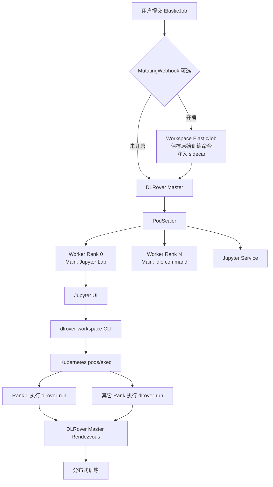
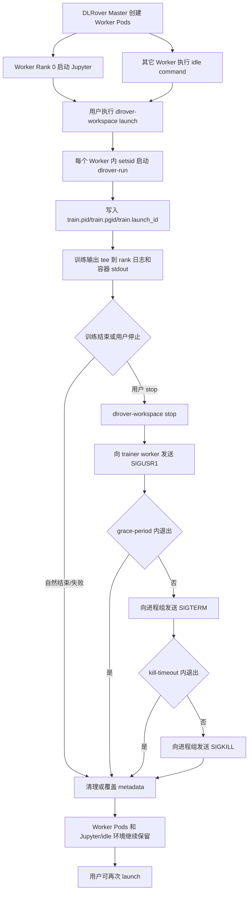
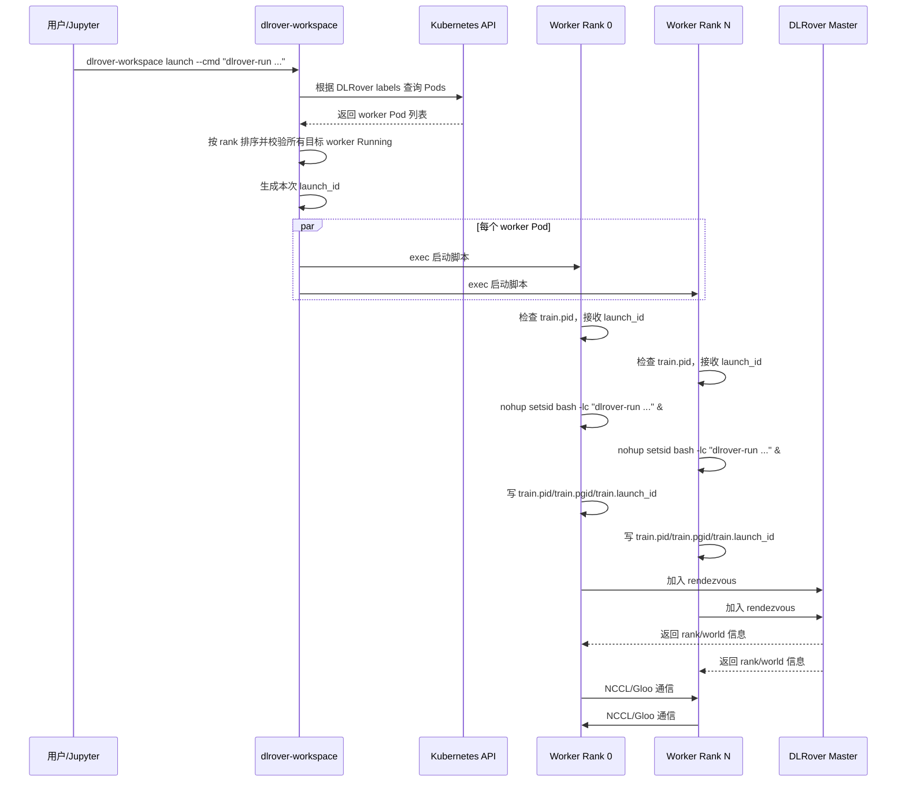
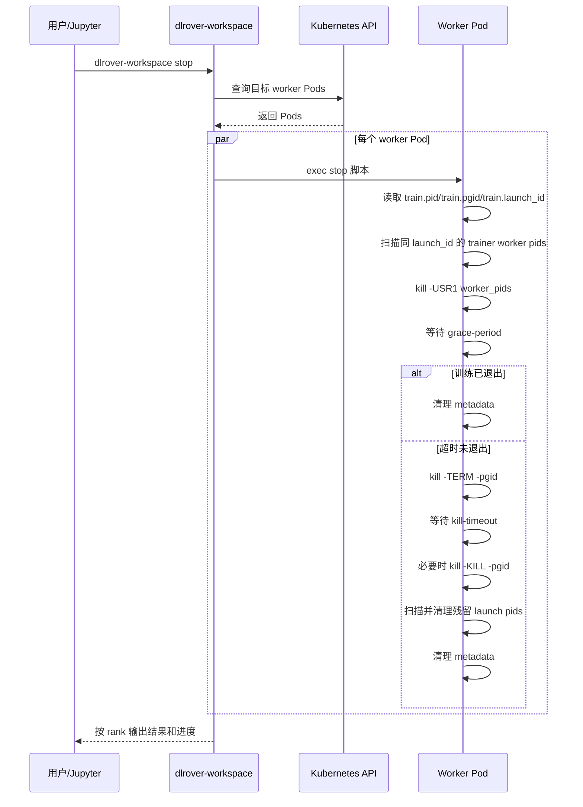
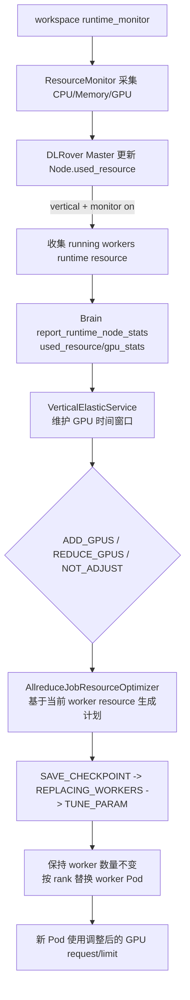

# DLRover Workspace 与 Jupyter 集成设计

## 背景

当前极算平台高开训练场景，能够为用户提供基础的训练运行环境，但仍存在以下问题：

1.卡资源申请受限：目前高开场景，只能申请单机多卡资源（如最多8张NPU卡），多机多卡资源需要申请多份资源环境，手动组网及开启训练，无法一次性申请多机多卡资源，进而影响高开环境的易用性。

2.高开卡资源利用率不高：当前高开训练环境普遍存在用户过度申请资源，由于平台缺乏任务粒度的资源监控，无法根据任务运行时资源利用率，动态调整任务的资源配置，进而影响高开环境的资源利用率。

因此，本设计引入DLRover workspace 模式，并将 Workspace/Jupyter 集成、训练进程生命周期管理、运行时资源监控与GPU垂直弹性统一。在 Workspace 模式下，DLRover 只创建训练运行环境，不立即执行训练脚本；worker rank 0 启动 Jupyter Lab，其它 worker 保活等待，之后用户可以通过`dlrover-workspace` 在所有 worker 上启动、停止、查看和重新启动训练。

利用DLRover的pod管理及动态组网能力，打破高开资源申请限制，使其能够支持多卡资源环境申请，并自动完成训练组网，提升高开环境易用性。通过DLRover的运行时资源监控及垂直弹性能力，使其能够根据任务运行时资源利用率，动态调整任务的资源配置，提升高开环境资源利用率。

## 目标

- 保持现有 Train 模式完全兼容。
- DLRover master 仍负责创建 worker Pod、注入分布式环境变量、创建 Service。
- 在 worker rank 0 上提供 Jupyter 入口。
- 其它 worker Pod 保持运行，作为训练运行节点等待命令。
- 提供 `dlrover-workspace` CLI，用于在 Jupyter 中启动、停止、查看训练。

## 整体架构




## 生命周期分层

当前 DLRover ElasticJob 会直接执行用户在 worker Pod template 中配置的训练命令。典型命令如下：

```bash
dlrover-run --nnodes=$NODE_NUM --nproc_per_node=8 train.py
```

这种方式适合一次性生产训练任务，但不适合交互式调试、反复试验和资源复用场景。实际使用中，需要解决以下问题：

1. 用户希望一次性申请多卡资源，并由 DLRover 自动完成worker Pod 创建、环境变量注入、Service 创建和训练组网准备。
2. 用户希望先进入 Notebook 检查数据、依赖、GPU/NCCL 状态和代码逻辑，再在同一批 worker Pod 上启动训练。
3. 训练需要能够中断、停止和重新启动，但停止训练不能释放已申请的 GPU资源，不能删除 worker Pod，也不能退出承载 Jupyter/idle 的 main container。
4. 同一批 Pod 可能多次启动训练，每次训练都需要独立的 rendezvous run id，避免上一轮训练残留的组网、失败或等待状态影响下一轮训练。
5. 在实例数不变的前提下，Workspace/runtime 环境需要能够复用 DLRover垂直弹性能力，根据运行时资源利用率调整同 rank worker Pod 的 GPU request/limit。
6. 方案需要兼容 DeepSpeed、Swift 以及 verl 等训练框架的通用启动方式，同时明确哪些能力依赖训练框架自身的 checkpoint、信号处理和恢复逻辑。

Workspace 模式将生命周期拆成两层：

```text
环境生命周期：ElasticJob / worker Pod / Jupyter / idle command / runtime monitor
训练生命周期：dlrover-run / ElasticAgent / trainer 子进程 / 框架 checkpoint
```

环境生命周期由 Kubernetes 和 DLRover master 管理。训练生命周期由
`dlrover-workspace` 通过 Kubernetes `pods/exec` 在 Pod 内管理。

关键原则：

- worker main container 的主进程不能是训练进程。
- worker rank 0 的主进程通常是 Jupyter。
- 其它 worker 的主进程是 idle command，例如 `sleep infinity`。
- `dlrover-run` 只能由 `dlrover-workspace launch` 作为后台进程组启动。
- `dlrover-workspace stop` 只终止训练进程组，不删除 Pod、不修改 replicas。
- DLRover master 不因 Workspace 内某次训练进程退出而关闭 Workspace 环境。

总体生命周期：



## 第一层：Train 模式

Train 模式是默认行为。如果 ElasticJob 没有配置 Workspace annotation，
DLRover 会保留用户在 worker Pod 中配置的原始 command，并在 Pod 启动后
立即开始训练。

```yaml
metadata:
  annotations: {}
```

行为：

- worker Pod 使用用户原始训练命令。
- Pod 启动即开始训练。
- 对现有任务和用户完全无影响。

## 第二层：Workspace 模式

Workspace 模式通过 ElasticJob annotation 开启。当前实现支持两类运行环境：

- `dlrover.io/run-mode: workspace`：创建 Jupyter + idle 运行环境，rank 0
  启动 Jupyter，其它 worker 保活。
- `dlrover.io/run-mode: runtime`：只创建训练运行环境，不创建 Jupyter
  Service，所有 worker 执行 idle command，适合由外部平台接入和调度。

```yaml
metadata:
  annotations:
    dlrover.io/run-mode: workspace
    dlrover.io/jupyter-enabled: "true"
    dlrover.io/jupyter-port: "8888"
    dlrover.io/jupyter-service-type: "NodePort"
    dlrover.io/jupyter-node-port: "30088"
    dlrover.io/jupyter-token: "dlrover"
    dlrover.io/idle-command: "sleep infinity"
    dlrover.io/init-command: "pip install -r /nas/requirements.txt"
    dlrover.io/runtime-monitor-enabled: "true"
```

行为：

- DLRover master 仍然创建所有 worker Pod。
- worker rank 0 的 main container command 会被改写为启动 Jupyter Lab。
- 其它 worker 执行 idle command，例如 `sleep infinity`。
- DLRover 仍然注入节点级分布式环境变量。
- 如果配置 `dlrover.io/init-command`，DLRover 会在启动 Jupyter/idle
  前先执行该命令；命令失败时 worker Pod 会退出，便于 Kubernetes 暴露
  初始化失败。
- 默认启动 `python -m dlrover.python.workspace.runtime_monitor`，用于在
  Workspace/runtime 容器内持续采集运行时资源状态；可通过
  `dlrover.io/runtime-monitor-enabled: "false"` 关闭。
- Workspace worker Pod 应使用 `restartPolicy: Always`。训练命令异常只
  影响本次训练进程；如果容器被 kubelet OOMKilled，kubelet 会重新拉起
  Jupyter/idle 环境，DLRover master 不应按普通训练任务终止 workspace。
- Jupyter 开启时，DLRover 创建 Jupyter Service，名称为
  `<job-name>-jupyter`。Service 类型由
  `dlrover.io/jupyter-service-type` 控制，默认 `NodePort`，支持
  `NodePort`、`ClusterIP` 和 `LoadBalancer`。当类型为 `NodePort` 时，
  可通过 `dlrover.io/jupyter-node-port` 指定固定 nodePort；不配置时由
  Kubernetes 自动分配。

注入的关键环境变量包括：

```text
ELASTIC_JOB_NAME
JOB_UID
NODE_TYPE
NODE_ID
NODE_NUM
NODE_RANK
RANK
WORLD_SIZE
POD_IP
NODE_IP
DLROVER_MASTER_ADDR
DLROVER_WORKSPACE_MODE
DLROVER_RUN_MODE
DLROVER_WORKSPACE_ROLE
DLROVER_JUPYTER_SERVICE
DLROVER_RUNTIME_MONITOR
NAMESPACE
```

DLRover master 生成的 Jupyter 启动命令：

```bash
jupyter lab \
  --ip=0.0.0.0 \
  --port=<jupyter-port> \
  --no-browser \
  --allow-root \
  --ServerApp.token="${JUPYTER_TOKEN:-<default-token>}"
```

访问示例：
```bash
kubectl apply -f examples/pytorch/workspace/jupyter_swift_elastic_job.yaml
kubectl get svc -n dlrover workspace-test-jupyter
NODE_IP=<k8s-node-ip>
JUPYTER_NODE_PORT=$(kubectl get svc -n dlrover workspace-test-jupyter -o jsonpath='{.spec.ports[0].nodePort}')
```

浏览器打开：
```bash
http://${NODE_IP}:${JUPYTER_NODE_PORT}/?token=dlrover
```

## 第三层：WorkspaceLauncher

WorkspaceLauncher 以 CLI 形式提供：

```bash
dlrover-workspace status
dlrover-workspace launch --cmd "dlrover-run --nnodes=\$NODE_NUM --nproc_per_node=8 train.py"
dlrover-workspace logs
dlrover-workspace stop
```

职责：

- 根据 DLRover labels 查找 worker Pod。
- 按 `elasticjob.dlrover/rank-index` 对 worker Pod 排序。
- 校验所有目标 worker Pod 是否处于 `Running` 状态。
- 默认在所有 worker Pod 中并发执行同一条训练命令；可通过 `--ranks`
  限定部分 rank。
- 通过 Kubernetes `pods/exec` 在每个 worker Pod 内启动/停止/查看训练。
- 将后台训练日志、PID、PGID 和 launch id 保存在每个 worker Pod 内。
- `launch` 使用 `setsid` 创建独立进程组，将训练输出同时 `tee` 到
  rank 日志文件和容器 stdout。
- `stop` 先向 trainer worker 进程发送 `SIGUSR1` 触发框架侧优雅退出，
  再按超时策略对进程组发送 `SIGTERM/SIGKILL`。
- `status` 展示每个 worker Pod 的 pod/phase/ip/node、`dlrover-run`
  进程、训练 worker 进程和进程组信息。
- `logs --follow` 对每个 worker Pod 内的 rank 日志执行 `tail -F`。

默认路径：

```text
/tmp/dlrover-workspace/train.rank_<rank>.log
/tmp/dlrover-workspace/train.pid
/tmp/dlrover-workspace/train.pgid
/tmp/dlrover-workspace/train.launch_id
```

## Workspace 启动训练流程




Workspace 模式下，`dlrover-run` 会把 `DLROVER_WORKSPACE_LAUNCH_ID` 拼入
`TORCHELASTIC_RUN_ID`，保证同一批 Pod 多次启动训练时使用不同的
rendezvous run id。master 仅对 workspace 请求重置上一轮组网状态，不影响
非 workspace 训练。

### 启动脚本关键逻辑

`dlrover-workspace launch` 默认会在所有 worker Pod 中并发执行同一条
启动脚本；如果传入 `--ranks`，只在指定 rank 上执行。CLI 会为本次
launch 生成一个统一的 `launch_id` 并注入到所有目标 Pod。训练命令不会
成为容器主进程，而是作为后台进程组启动。

使用 `setsid` 的原因是它会为训练命令创建新的 session 和 process group。
后续停止训练时，可以通过进程组一次性终止 `dlrover-run`、ElasticAgent、
本机多个 trainer 子进程以及训练脚本继续拉起的子进程。

### 防重复启动

每个 worker Pod 内维护以下 metadata：

```text
/tmp/dlrover-workspace/train.pid
/tmp/dlrover-workspace/train.pgid
/tmp/dlrover-workspace/train.launch_id
```

如果 PID 文件存在且进程仍然存活，`launch` 返回冲突，不会再次启动训练，避免多个训练任务争抢同一批 GPU。

## Workspace 停止训练流程



停止时只终止 Pod 内训练进程组。worker Pod、DLRover master、Jupyter/idle
主进程和挂载数据继续存在，因此用户可以再次执行 `dlrover-workspace launch`。
如果训练框架支持 checkpoint，则可以从上一次 checkpoint 恢复。

## 运行时资源监控与 GPU 垂直弹性

Workspace/runtime 容器启动时默认拉起
`python -m dlrover.python.workspace.runtime_monitor`。该进程复用
ElasticAgent 的 `ResourceMonitor`，周期性采集 CPU、内存和 GPU 使用率，
并通过 master client 上报 `ResourceStats`。默认采集间隔为 20 秒，可通过
`DLROVER_RUNTIME_MONITOR_INTERVAL` 调整。

垂直弹性触发链路：



关键约束：

- Brain 上报使用 `used_resource` 字段承载 CPU、内存、GPU 数量、GPU 类型和`gpu_stats`。
- `AllreduceJobResourceOptimizer` 在生成 GPU 扩缩容计划前，会同步当前worker 配置；后续计划以“上一次已生效的资源”为基线，而不是初始化配置。
- Kubernetes 不能原地修改运行中 Pod 的 GPU limit。垂直弹性保持 worker实例数不变，通过删除并重建同 rank worker Pod 使新的 GPU request/limit生效。
- 该流程依赖现有 vertical elastic phase：先通知训练保存 checkpoint，再替换 worker，最后进入参数调优阶段。
- 非 Workspace不会注入 runtime monitor，也不会因为 workspace失败处理逻辑改变原有 Train 模式行为。

## 框架支持与使用限制

### 对目标场景的满足情况

1. 一次性申请单机多卡/多机多卡资源，并自动为容器环境组网：
   - 当前 Workspace 模式可以满足“先申请完整训练运行环境”的诉求。
     worker Pod 数量和每个 Pod 的 GPU 数量仍由 ElasticJob 的
     `replicaSpecs.worker.replicas` 和 container resource request/limit 决定。
   - DLRover master 仍负责创建 worker Pod、注入节点级分布式环境变量、
     创建 worker Service/Jupyter Service。训练启动后，`dlrover-run`
     负责生成进程级 `LOCAL_RANK`、`RANK`、`MASTER_ADDR`、`MASTER_PORT`，
     并完成 rendezvous 组网。
   - 因此，该能力依赖用户在提交 Workspace ElasticJob 时一次性声明足够的
     worker 副本数和单 Pod GPU request/limit。Workspace 不会在 Jupyter
     打开后再临时申请初始训练资源。

2. 训练能够中断，也能够重新多次训练：
   - 当前 Workspace 模式满足该诉求。训练进程通过
     `dlrover-workspace launch` 在已有 worker Pod 内启动，退出、失败或
     `dlrover-workspace stop` 后，Jupyter/idle 容器环境继续保留。
   - 每次 launch 都会生成新的 `DLROVER_WORKSPACE_LAUNCH_ID`，并由
     `dlrover-run` 拼入 `TORCHELASTIC_RUN_ID`。DLRover master 只对
     Workspace 请求重置上一轮 rendezvous 状态，避免多次训练复用同一批
     Pod 时混入旧的组网状态。
   - 训练恢复语义仍取决于训练框架和 checkpoint 配置。Workspace 负责进程
     生命周期，不保证所有框架都能从任意中断点自动恢复。

3. 保持实例数不变，根据资源利用率自动调整已创建 Pod 的 GPU 数量：
   - 设计上通过 DLRover 垂直弹性路径支持该目标，但不是 Kubernetes 原地
     修改运行中 Pod。Kubernetes 不允许直接修改运行中 Pod 的 GPU limit，
     因此实现方式是保持 worker 实例数不变，按 rank 删除并重建 worker Pod，
     让新 Pod 使用调整后的 GPU request/limit。
   - 该能力依赖 `runtime_monitor`、Brain 的垂直弹性决策、
     `AllreduceJobResourceOptimizer`、checkpoint 保存/恢复、训练参数调优
     以及集群剩余 GPU 资源。任一环节不满足时，只能保持当前资源配置。
   - 对 Workspace 来说，垂直弹性会替换 worker Pod。rank 0 的 Jupyter
     如果也作为 worker 被替换，Notebook 会话会中断；生产使用时应明确这是
     “可重建运行环境”，不是对交互式会话的无损热更新。

### 训练框架支持情况

- DeepSpeed：支持路径最明确。DLRover 已提供 `DeepSpeedCheckpointEngine`和 `DeepSpeedCheckpointSaver`，可与 `dlrover-run`、Workspace 生命周期和
  checkpoint 恢复配合使用。
- Swift：支持通过通用命令方式接入。文档和示例均使用 `dlrover-run + swift sft`，Workspace 负责资源环境和多次 launch，Swift/DeepSpeed 负责训练语义与 checkpoint。
- Verl：LLM 后训练（RLHF/GRPO）专用强化学习框架，DLRover本身不直接支持Verl，但是设计上允许接入任何训练框架，只要实现 DLRover 约定的弹性 / Checkpoint 接口，VERL 底层支持 FSDP / FSDP2、Megatron，而 DLRover 对这两个后端有成熟适配。如果要使用，需要适配启动Trainer脚本；本质是 DLRover 管集群，VERL 管 RL 训练。

### 当前使用限制

- Workspace 模式主要解决“运行环境复用”和“训练进程多次启动/停止”，不替代训练框架自身的 checkpoint、恢复、容错和参数重配置能力。
- `dlrover-workspace launch` 默认在所有目标 worker Pod 执行同一条命令。多角色训练、异构角色、参数服务器或 actor/rollout 分离场景需要额外的启动编排，或使用 DLRover unified API/其它平台层能力。
- `stop` 通过 `SIGUSR1` 尝试优雅停止 trainer worker，随后按超时清理进程组。框架必须注册并正确处理该信号，才能在停止时可靠保存状态。
- 垂直弹性不是无损热插拔 GPU。它需要 checkpoint、替换 Pod、重新组网和恢复训练；对交互式 Notebook 会话和未持久化的本地临时状态有破坏性。
- 初始 GPU 资源仍受 Kubernetes 调度、配额、节点剩余资源和设备插件能力限制。Workspace 不能绕过集群调度约束。
- 训练命令必须适配 Workspace 中注入的环境变量，并建议通过 `dlrover-run`启动；直接使用框架原生命令时，DLRover rendezvous、故障处理和 flash checkpoint 能力可能无法完整生效。
- 需要持久化的数据、代码、checkpoint 和输出目录应挂载到 PVC/NAS/对象存储。Pod 被垂直弹性替换或 kubelet 重启后，本地容器文件系统内容可能丢失。
- Verl框架目前只能用 FSDP/Megatron 后端，不支持 VERL 其他自定义后端。
- 现在 Jupyter/idle 和训练进程还在同一个 worker pod 里，特别是 rank 0。这样简单，但垂直弹性一旦替换 rank 0，Notebook 会被打断。

## 使用方式

```bash
kubectl apply -f rbac.yaml
kubectl apply -f jupyter_elastic_job.yaml
kubectl get svc -n dlrover torch-workspace-jupyter
NODE_IP=<k8s-node-ip>
JUPYTER_NODE_PORT=$(kubectl get svc -n dlrover torch-workspace-jupyter -o jsonpath='{.spec.ports[0].nodePort}')
```

打开：

```text
http://${NODE_IP}:${JUPYTER_NODE_PORT}/?token=dlrover
```

在 Jupyter 中启动训练：

```bash
dlrover-workspace status
bash examples/pytorch/workspace/train.sh

dlrover-workspace logs

dlrover-workspace stop
```
训练脚本：
```bash
dlrover-workspace launch --cmd \
  "dlrover-run --nnodes=1 \
      --nproc_per_node=1 --max_restarts=1 \
      swift sft --model /nas/train-data/model/Qwen2.5-0.5B-Instruct \
      --dataset /nas/train-data/dataset/alpaca_data_zh_51k.json \
      --output_dir /nas/train-data/output/jupyter-elastic \
      --model_type qwen2 \
      --torch_dtype bfloat16 \
      --train_type lora \
      --num_train_epochs 3 \
      --warmup_ratio 0.1 \
      --per_device_train_batch_size 2 \
      --per_device_eval_batch_size 1 \
      --learning_rate 1e-4 \
      --gradient_accumulation_steps 1 \
      --max_length 1024 \
      --weight_decay 0.0001 \
      --lr_scheduler_type cosine \
      --logging_steps 1 \
      --save_steps 50 \
      --lora_rank 8 \
      --lora_dropout 0.05 \
      --response_prefix '<think>\n' \
      --save_total_limit 10 \
      --dataloader_num_workers 4 \
      --lora_alpha 32 \
      --target_modules all-linear \
      --dataset_num_proc 1 \
      --model_name 'jupyter-elastic' \
      --use_flash_ckpt true \
      --deepspeed /nas/train-data/deepspeed/zero.json \
      --callbacks deepspeed_elastic graceful_exit"
```

## 实现总结

核心组件：

- `PodScaler` Workspace 模式：
  - 解析 Workspace annotations。
  - 改写 worker main container command。
  - 注入 Workspace 环境变量。
  - 创建 Jupyter Service。
- 动态组网：
  - 长驻 workspace/master 支持多次训练提交，在 run_id 或 min/max/node_unit 变化时重置旧的 waiting/world 状态，避免上一次训练残留把下一次 --nnodes=1 卡死。
  - 每次 dlrover-workspace launch 自动生成唯一 launch id，同一个 workspace 里反复提交同一条命令也不会复用旧 rendezvous。。

- `dlrover-workspace` CLI：
  - `status`
    - 展示 pod/phase/ip/node、launch id、进程组、`dlrover-run`
      和 trainer worker 进程。
  - `launch`
    - 默认在所有 worker Pod 并发执行同一条训练命令。
    - 后台模式使用 `setsid` 创建进程组，并把输出 `tee` 到 rank 日志
      和容器 stdout。
  - `logs`
    - 支持 查看训练日志。
  - `stop`
    - 支持优雅停止 trainer，再按超时策略清理进程组。
