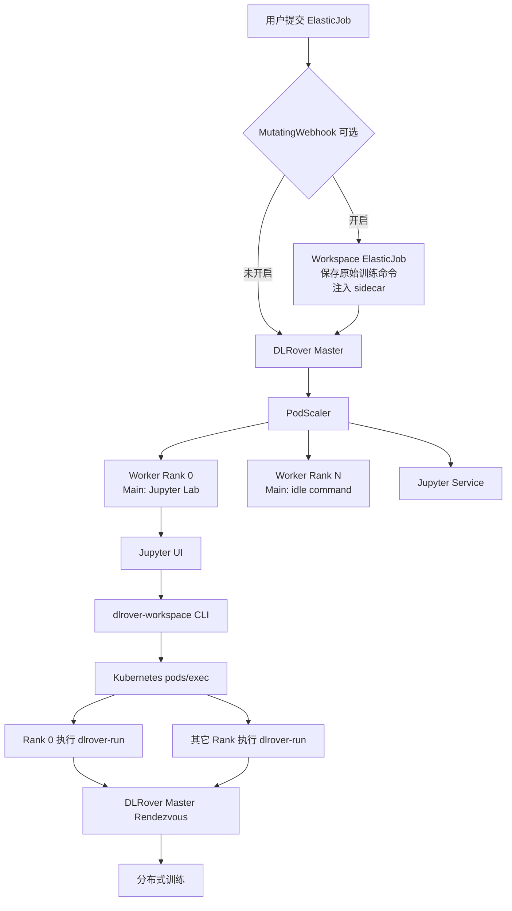
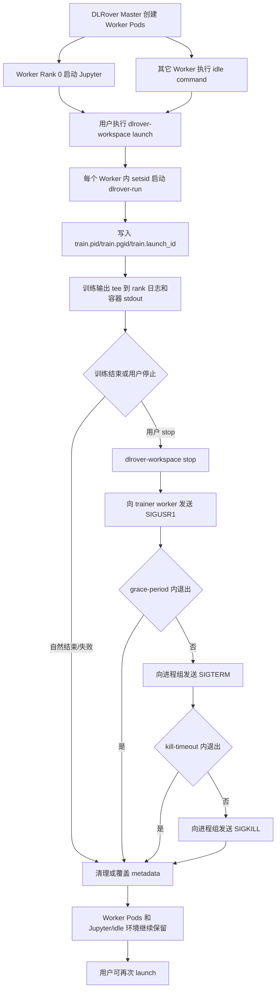
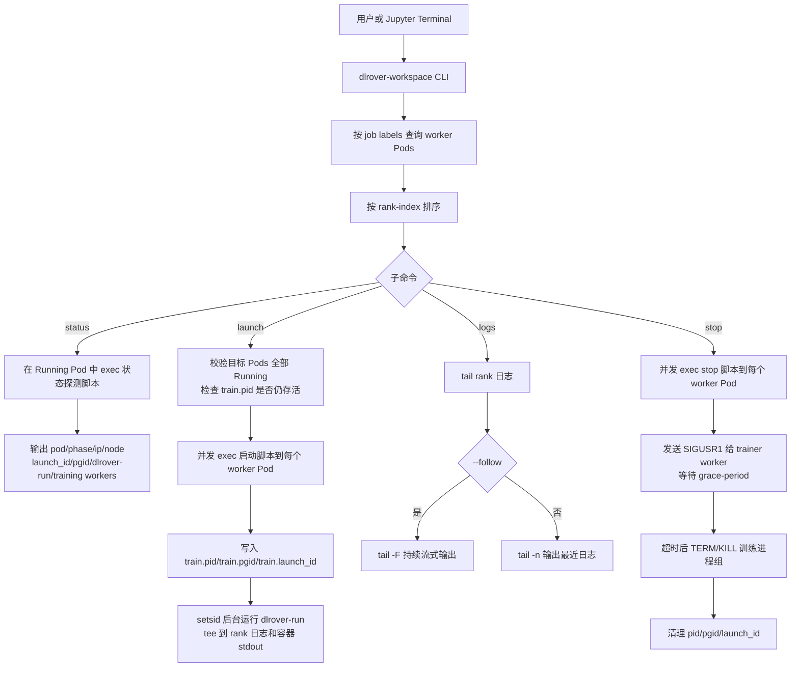
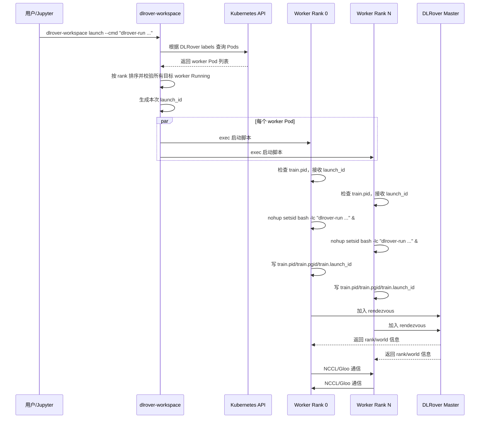
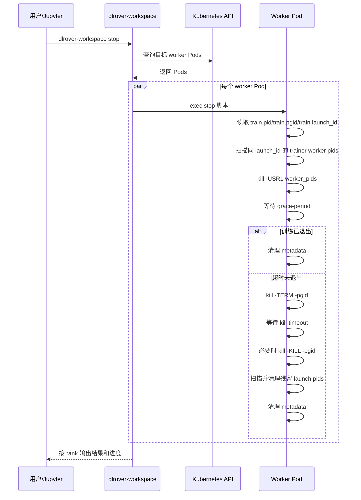
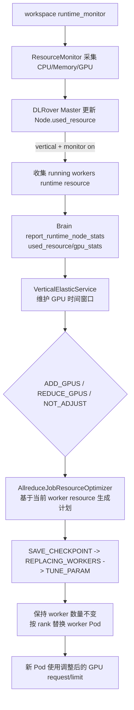

# DLRover Workspace 与 Jupyter 集成设计

## 背景

当前 DLRover ElasticJob 会直接执行用户在 worker Pod template 中配置的
训练命令。典型命令如下：

```bash
dlrover-run --nnodes=$NODE_NUM --nproc_per_node=8 train.py
```

这种方式适合一次性生产训练任务，但不适合交互式调试、反复试验和资源复用
场景。实际使用中，需要解决以下问题：

1. 用户希望一次性申请单机多卡或多机多卡资源，并由 DLRover 自动完成
   worker Pod 创建、环境变量注入、Service 创建和训练组网准备。
2. 用户希望先进入 Notebook 检查数据、依赖、GPU/NCCL 状态和代码逻辑，
   再在同一批 worker Pod 上启动训练。
3. 训练需要能够中断、停止和重新启动，但停止训练不能释放已申请的 GPU
   资源，不能删除 worker Pod，也不能退出承载 Jupyter/idle 的 main
   container。
4. 同一批 Pod 可能多次启动训练，每次训练都需要独立的 rendezvous run id，
   避免上一轮训练残留的组网、失败或等待状态影响下一轮训练。
5. 在实例数不变的前提下，Workspace 环境需要能够复用 DLRover
   垂直弹性能力，根据运行时资源利用率调整同 rank worker Pod 的 GPU
   request/limit。
6. 方案需要兼容 DeepSpeed、Swift 以及 Megatron/MindSpeed/VL 等训练工程的
   通用启动方式，同时明确哪些能力依赖训练框架自身的 checkpoint、信号处理
   和恢复逻辑。

因此，本设计引入 DLRover Workspace 模式，并将 Workspace/Jupyter 集成、
训练进程生命周期管理、运行时资源监控与 GPU 垂直弹性统一到一份设计中。
在 Workspace 模式下，DLRover 只创建训练运行环境，不立即执行训练脚本；
worker rank 0 启动 Jupyter Lab，其它 worker 保活等待，之后用户可以通过
`dlrover-workspace` 在所有 worker 上启动、停止、查看和重新启动训练。

## 目标

- 保持现有 Train 模式完全兼容。
- DLRover master 仍负责创建 worker Pod、注入分布式环境变量、创建 Service。
- 在 worker rank 0 上提供 Jupyter 入口。
- 其它 worker Pod 保持运行，作为训练运行节点等待命令。
- 提供 `dlrover-workspace` CLI，用于在 Jupyter 中启动、停止、查看训练。
- 可选支持 MutatingWebhook + sidecar 透明模式，让用户继续提交原始训练
  ElasticJob，无需修改 YAML。

## 非目标

- 不替代 `dlrover-run` 的 rendezvous 和容错能力。
- 不在训练启动前初始化 PyTorch 进程级分布式环境。
  `LOCAL_RANK`、进程级 `RANK`、`MASTER_ADDR`、`MASTER_PORT` 仍由
  `dlrover-run` 在训练启动时生成。
- 不在容器运行后拦截已经启动的进程。透明模式必须在 ElasticJob 创建阶段
  通过 webhook 改写 spec。

## 整体架构



## 生命周期分层

Workspace 模式将生命周期拆成两层：

```text
环境生命周期：ElasticJob / worker Pod / Jupyter / idle command / runtime monitor
训练生命周期：dlrover-run / ElasticAgent / trainer 子进程 / 框架 checkpoint
```

环境生命周期由 Kubernetes 和 DLRover master 管理。训练生命周期由
`dlrover-workspace` 通过 Kubernetes `pods/exec` 在 Pod 内管理。

关键原则：

- worker main container 的主进程不能是训练进程。
- worker rank 0 的主进程通常是 Jupyter。
- 其它 worker 的主进程是 idle command，例如 `sleep infinity`。
- `dlrover-run` 只能由 `dlrover-workspace launch` 作为后台进程组启动。
- `dlrover-workspace stop` 只终止训练进程组，不删除 Pod、不修改 replicas。
- DLRover master 不因 Workspace 内某次训练进程退出而关闭 Workspace 环境。

总体生命周期：



## 第一层：Train 模式

Train 模式是默认行为。如果 ElasticJob 没有配置 Workspace annotation，
DLRover 会保留用户在 worker Pod 中配置的原始 command，并在 Pod 启动后
立即开始训练。

```yaml
metadata:
  annotations: {}
```

行为：

- worker Pod 使用用户原始训练命令。
- Pod 启动即开始训练。
- 对现有任务和用户完全无影响。

## 第二层：Workspace 模式

Workspace 模式通过 ElasticJob annotation 开启。`run-mode` 只负责启用 Workspace；
是否启用 Jupyter 由 `jupyter-enabled` 独立控制，训练后是否保留 Pod 由
`workspace-exit-policy` 独立控制。

```yaml
metadata:
  annotations:
    dlrover.io/run-mode: workspace
    dlrover.io/jupyter-enabled: "true"
    dlrover.io/workspace-exit-policy: retain
    dlrover.io/jupyter-port: "8888"
    dlrover.io/jupyter-service-type: "NodePort"
    dlrover.io/jupyter-node-port: "30088"
    dlrover.io/jupyter-token: "dlrover"
    dlrover.io/idle-command: "sleep infinity"
    dlrover.io/init-command: "pip install -r /nas/requirements.txt"
    dlrover.io/runtime-monitor-enabled: "true"
```

行为：

- DLRover master 仍然创建所有 worker Pod。
- worker rank 0 的 main container command 会被改写为启动 Jupyter Lab。
- 其它 worker 执行 idle command，例如 `sleep infinity`。
- DLRover 仍然注入节点级分布式环境变量。
- 如果配置 `dlrover.io/init-command`，DLRover 会在启动 Jupyter/idle
  前先执行该命令；命令失败时 worker Pod 会退出，便于 Kubernetes 暴露
  初始化失败。
- 默认启动 `python -m dlrover.python.workspace.runtime_monitor`，用于在
  Workspace 容器内持续采集运行时资源状态；可通过
  `dlrover.io/runtime-monitor-enabled: "false"` 关闭。
- Workspace worker Pod 应使用 `restartPolicy: Always`。训练命令异常只
  影响本次训练进程；如果容器被 kubelet OOMKilled，kubelet 会重新拉起
  Jupyter/idle 环境，DLRover master 不应按普通训练任务终止 workspace。
- Jupyter 开启时，DLRover 创建 Jupyter Service，名称为
  `<job-name>-jupyter`。Service 类型由
  `dlrover.io/jupyter-service-type` 控制，默认 `NodePort`，支持
  `NodePort`、`ClusterIP` 和 `LoadBalancer`。当类型为 `NodePort` 时，
  可通过 `dlrover.io/jupyter-node-port` 指定固定 nodePort；不配置时由
  Kubernetes 自动分配。

注入的关键环境变量包括：

```text
ELASTIC_JOB_NAME
JOB_UID
NODE_TYPE
NODE_ID
NODE_NUM
NODE_RANK
RANK
WORLD_SIZE
POD_IP
NODE_IP
DLROVER_MASTER_ADDR
DLROVER_WORKSPACE_MODE
DLROVER_RUN_MODE
DLROVER_WORKSPACE_ROLE
DLROVER_JUPYTER_SERVICE
DLROVER_RUNTIME_MONITOR
NAMESPACE
```

DLRover master 生成的 Jupyter 启动命令：

```bash
jupyter lab \
  --ip=0.0.0.0 \
  --port=<jupyter-port> \
  --no-browser \
  --allow-root \
  --ServerApp.token="${JUPYTER_TOKEN:-<default-token>}"
```

访问示例：
```bash
kubectl apply -f examples/pytorch/workspace/jupyter_swift_elastic_job.yaml
kubectl get svc -n dlrover workspace-test-jupyter
export NODE_IP=$(kubectl get nodes -o jsonpath='{.items[0].status.addresses[?(@.type=="InternalIP")].address}')
export JUPYTER_NODE_PORT=$(kubectl get svc -n dlrover workspace-test-jupyter -o jsonpath='{.spec.ports[0].nodePort}')
```

浏览器打开：
```bash
http://${NODE_IP}:${JUPYTER_NODE_PORT}/?token=dlrover
```

## 第三层：WorkspaceLauncher

WorkspaceLauncher 以 CLI 形式提供：

```bash
dlrover-workspace status --cli-log on
dlrover-workspace launch --cmd "dlrover-run --nnodes=\$NODE_NUM --nproc_per_node=8 train.py"
dlrover-workspace logs --tail 100
dlrover-workspace logs --follow
dlrover-workspace stop --grace-period 300 --kill-timeout 30
```

完整命令参数、annotation、环境变量和默认文件路径见
[DLRover Workspace 命令参数说明](./dlrover-workspace-command-parameters-cn.md)。
CLI 调用链、Pod 内 `agentctl`、状态文件和进程管理实现见
[DLRover Workspace CLI 实现逻辑](./dlrover-workspace-cli-implementation-cn.md)。

职责：

- 根据 DLRover labels 查找 worker Pod。
- 按 `elasticjob.dlrover/rank-index` 对 worker Pod 排序。
- 校验所有目标 worker Pod 是否处于 `Running` 状态。
- 默认在所有 worker Pod 中并发执行同一条训练命令；可通过 `--ranks`
  限定部分 rank。
- 通过 Kubernetes `pods/exec` 在每个 worker Pod 内启动/停止/查看训练。
- 将后台训练日志、PID、PGID 和 launch id 保存在每个 worker Pod 内。
- `launch` 使用 `setsid` 创建独立进程组，将训练输出同时 `tee` 到
  rank 日志文件和容器 stdout。
- `stop` 先向 trainer worker 进程发送 `SIGUSR1` 触发框架侧优雅退出，
  再按超时策略对进程组发送 `SIGTERM/SIGKILL`。
- `status` 展示每个 worker Pod 的 pod/phase/ip/node、`dlrover-run`
  进程、训练 worker 进程和进程组信息。
- `logs --follow` 对每个 worker Pod 内的 rank 日志执行 `tail -F`。

默认路径：

```text
/tmp/dlrover-workspace/train.rank_<rank>.log
/tmp/dlrover-workspace/train.pid
/tmp/dlrover-workspace/train.pgid
/tmp/dlrover-workspace/train.launch_id
```

## Workspace CLI 控制面流程



## Workspace 启动训练流程




Workspace 模式下，`dlrover-run` 会把 `DLROVER_WORKSPACE_LAUNCH_ID` 拼入
`TORCHELASTIC_RUN_ID`，保证同一批 Pod 多次启动训练时使用不同的
rendezvous run id。master 仅对 workspace 请求重置上一轮组网状态，不影响
非 workspace 训练。

### 启动脚本关键逻辑

`dlrover-workspace launch` 默认会在所有 worker Pod 中并发执行同一条
启动脚本；如果传入 `--ranks`，只在指定 rank 上执行。CLI 会为本次
launch 生成一个统一的 `launch_id` 并注入到所有目标 Pod。训练命令不会
成为容器主进程，而是作为后台进程组启动。

核心启动方式：

```bash
mkdir -p /tmp/dlrover-workspace
launch_id=<uuid>

if [ -f /tmp/dlrover-workspace/train.pid ] && \
   kill -0 $(cat /tmp/dlrover-workspace/train.pid) >/dev/null 2>&1; then
  echo "training already running"
  exit 2
fi

export DLROVER_WORKSPACE_LAUNCH_ID=$launch_id
nohup setsid /bin/bash -lc \
  "<user train command> 2>&1 | tee -a /tmp/dlrover-workspace/train.rank_${NODE_RANK:-unknown}.log /proc/1/fd/1 >/dev/null" \
  >/dev/null 2>&1 < /dev/null &

echo $! > /tmp/dlrover-workspace/train.pid
echo $! > /tmp/dlrover-workspace/train.pgid
echo $launch_id > /tmp/dlrover-workspace/train.launch_id
```

使用 `setsid` 的原因是它会为训练命令创建新的 session 和 process group。
后续停止训练时，可以通过进程组一次性终止 `dlrover-run`、ElasticAgent、
本机多个 trainer 子进程以及训练脚本继续拉起的子进程。

### 防重复启动

每个 worker Pod 内维护以下 metadata：

```text
/tmp/dlrover-workspace/train.pid
/tmp/dlrover-workspace/train.pgid
/tmp/dlrover-workspace/train.launch_id
```

如果 PID 文件存在且进程仍然存活，`launch` 返回冲突，不会再次启动训练，
避免多个训练任务争抢同一批 GPU。

## Workspace 停止训练流程



停止时只终止 Pod 内训练进程组。worker Pod、DLRover master、Jupyter/idle
主进程和挂载数据继续存在，因此用户可以再次执行 `dlrover-workspace launch`。
如果训练框架支持 checkpoint，则可以从上一次 checkpoint 恢复。

核心停止脚本逻辑：

```bash
pid=$(cat /tmp/dlrover-workspace/train.pid)
pgid=$(cat /tmp/dlrover-workspace/train.pgid 2>/dev/null || echo $pid)
launch_id=$(cat /tmp/dlrover-workspace/train.launch_id 2>/dev/null || true)

worker_pids=$(scan_processes_by_launch_id_and_torchelastic_env "$launch_id")
if [ -n "$worker_pids" ]; then
  kill -USR1 $worker_pids
fi

wait_until_exit_or_timeout "$pid" "$pgid" "$grace_period"

if process_group_alive "$pgid"; then
  kill -TERM -$pgid
  wait_until_exit_or_timeout "$pid" "$pgid" "$kill_timeout"

  if process_group_alive "$pgid"; then
    kill -KILL -$pgid
  fi
fi

residual_pids=$(scan_processes_by_launch_id "$launch_id")
kill_residual_processes "$residual_pids"

rm -f /tmp/dlrover-workspace/train.pid \
      /tmp/dlrover-workspace/train.pgid \
      /tmp/dlrover-workspace/train.launch_id
```

其中 `kill -TERM -$pgid` 中的负号表示向进程组发送信号，而不是只杀一个
进程。

停止参数：

```bash
dlrover-workspace stop
dlrover-workspace stop --grace-period 300
dlrover-workspace stop --kill-timeout 60
dlrover-workspace stop --ranks 0,1
```

- `--grace-period`：发送 `SIGUSR1` 后等待 trainer 优雅退出的秒数，
  默认 300 秒。
- `--kill-timeout`：发送 `SIGTERM` 后等待进程组退出的秒数，默认 30 秒。
- `--ranks`：只停止指定 rank 上的训练进程，主要用于调试。

## 状态与日志

`dlrover-workspace status` 会在 Running Pod 内读取 metadata 文件，并扫描
进程表，输出：

- Pod 名称、phase、Pod IP、所在 Node。
- 本次训练 `launch_id`。
- 训练进程组 `pgid`。
- `dlrover-run` 进程的 pid、ppid、pgid、stat、cmd。
- trainer worker 进程列表；训练尚未拉起时显示 `pending: true`。

非 Running Pod 不执行 `pods/exec`，只展示 Pod 维度信息和不可用状态。

`dlrover-workspace logs` 默认读取每个 worker Pod 内的 rank 日志：

```text
/tmp/dlrover-workspace/train.rank_${NODE_RANK:-unknown}.log
```

`dlrover-workspace logs --follow` 使用 `tail -F` 持续跟随日志，适合从
Jupyter terminal 中观察多 Pod 实时训练输出。

如果训练日志时间比北京时间少 8 小时，先检查 worker 容器的时区。
DLRover 日志使用进程本地时间，训练子进程继承 worker 的环境；master
中的 `TZ` 不会自动传给 worker。需要在
`spec.replicaSpecs.worker.template.spec.containers` 对应容器的 `env` 中设置：

```yaml
- name: TZ
  value: Asia/Shanghai
```

镜像还需包含 `tzdata` 提供的 `/usr/share/zoneinfo/Asia/Shanghai`。
仓库的 GPU 训练 Dockerfile 会安装时区数据并设置系统时区。可在 worker
中执行 `date '+%F %T %Z %z'`，确认显示 `+0800`。
修改模板或重建镜像后，需要重新创建 worker Pod 才能应用配置；请在当前
训练结束或保存 checkpoint 后操作。已有日志中的时间不会被改写。

## 运行时资源监控与 GPU 垂直弹性

Workspace 容器启动时默认拉起
`python -m dlrover.python.workspace.runtime_monitor`。该进程复用
ElasticAgent 的 `ResourceMonitor`，周期性采集 CPU、内存和 GPU 使用率，
并通过 master client 上报 `ResourceStats`。默认采集间隔为 20 秒，可通过
`DLROVER_RUNTIME_MONITOR_INTERVAL` 调整。

垂直弹性触发链路：



关键约束：

- Brain 上报使用 `used_resource` 字段承载 CPU、内存、GPU 数量、GPU 类型和
  `gpu_stats`，不再从 `pod_ip` 等非资源字段推断资源。
- `AllreduceJobResourceOptimizer` 在生成 GPU 扩缩容计划前，会同步当前
  worker 配置；后续计划以“上一次已生效的资源”为基线，而不是初始化配置。
- Kubernetes 不能原地修改运行中 Pod 的 GPU limit。垂直弹性保持 worker
  实例数不变，通过删除并重建同 rank worker Pod 使新的 GPU request/limit
  生效。
- 该流程依赖现有 vertical elastic phase：先通知训练保存 checkpoint，
  再替换 worker，最后进入参数调优阶段。
- 非 Workspace 任务不会注入 runtime monitor，也不会因为 workspace
  失败处理逻辑改变原有 Train 模式行为。

## 能力评估、框架支持与使用限制

### 对目标场景的满足情况

1. 一次性申请单机多卡/多机多卡资源，并自动为容器环境组网：
   - 当前 Workspace 模式可以满足“先申请完整训练运行环境”的诉求。
     worker Pod 数量和每个 Pod 的 GPU 数量仍由 ElasticJob 的
     `replicaSpecs.worker.replicas` 和 container resource request/limit 决定。
   - DLRover master 仍负责创建 worker Pod、注入节点级分布式环境变量、
     创建 worker Service/Jupyter Service。训练启动后，`dlrover-run`
     负责生成进程级 `LOCAL_RANK`、`RANK`、`MASTER_ADDR`、`MASTER_PORT`，
     并完成 rendezvous 组网。
   - 因此，该能力依赖用户在提交 Workspace ElasticJob 时一次性声明足够的
     worker 副本数和单 Pod GPU request/limit。Workspace 不会在 Jupyter
     打开后再临时申请初始训练资源。

2. 训练能够中断，也能够重新多次训练：
   - 当前 Workspace 模式满足该诉求。训练进程通过
     `dlrover-workspace launch` 在已有 worker Pod 内启动，退出、失败或
     `dlrover-workspace stop` 后，Jupyter/idle 容器环境继续保留。
   - 每次 launch 都会生成新的 `DLROVER_WORKSPACE_LAUNCH_ID`，并由
     `dlrover-run` 拼入 `TORCHELASTIC_RUN_ID`。DLRover master 只对
     Workspace 请求重置上一轮 rendezvous 状态，避免多次训练复用同一批
     Pod 时混入旧的组网状态。
   - 训练恢复语义仍取决于训练框架和 checkpoint 配置。Workspace 负责进程
     生命周期，不保证所有框架都能从任意中断点自动恢复。

3. 保持实例数不变，根据资源利用率自动调整已创建 Pod 的 GPU 数量：
   - 设计上通过 DLRover 垂直弹性路径支持该目标，但不是 Kubernetes 原地
     修改运行中 Pod。Kubernetes 不允许直接修改运行中 Pod 的 GPU limit，
     因此实现方式是保持 worker 实例数不变，按 rank 删除并重建 worker Pod，
     让新 Pod 使用调整后的 GPU request/limit。
   - 该能力依赖 `runtime_monitor`、Brain 的垂直弹性决策、
     `AllreduceJobResourceOptimizer`、checkpoint 保存/恢复、训练参数调优
     以及集群剩余 GPU 资源。任一环节不满足时，只能保持当前资源配置。
   - 对 Workspace 来说，垂直弹性会替换 worker Pod。rank 0 的 Jupyter
     如果也作为 worker 被替换，Notebook 会话会中断；生产使用时应明确这是
     “可重建运行环境”，不是对交互式会话的无损热更新。

### 训练框架支持情况

- DeepSpeed：支持路径最明确。DLRover 已提供 `DeepSpeedCheckpointEngine`
  和 `DeepSpeedCheckpointSaver`，可与 `dlrover-run`、Workspace 生命周期和
  checkpoint 恢复配合使用。
- Swift：支持通过通用命令方式接入。文档和示例均使用
  `dlrover-run + swift sft`，Workspace 负责资源环境和多次 launch，
  Swift/DeepSpeed 负责训练语义与 checkpoint。
- MindSpeed：当前没有专用 Workspace 适配层。若任务使用 Megatron/DeepSpeed
  兼容的启动和 checkpoint 方式，可落在 DLRover 的通用路径上；否则需要按
  MindSpeed 的 checkpoint、信号处理、恢复逻辑逐项验证。
- VL/多模态训练：Workspace 不感知模型类型。只要训练命令能通过
  `dlrover-run` 启动，并且框架支持分布式 rendezvous、优雅停止和 checkpoint
  恢复，就可以使用 Workspace；模型侧的 tokenizer、数据加载、vLLM/RLHF
  rollout、多角色服务等仍需由训练工程自行保证。

### 当前使用限制

- Workspace 模式主要解决“运行环境复用”和“训练进程多次启动/停止”，不替代
  训练框架自身的 checkpoint、恢复、容错和参数重配置能力。
- `dlrover-workspace launch` 默认在所有目标 worker Pod 执行同一条命令。
  多角色训练、异构角色、参数服务器或 actor/rollout 分离场景需要额外的
  启动编排，或使用 DLRover unified API/其它平台层能力。
- `stop` 通过 `SIGUSR1` 尝试优雅停止 trainer worker，随后按超时清理进程组。
  框架必须注册并正确处理该信号，才能在停止时可靠保存状态。
- 垂直弹性不是无损热插拔 GPU。它需要 checkpoint、替换 Pod、重新组网和恢复
  训练；对交互式 Notebook 会话和未持久化的本地临时状态有破坏性。
- 初始 GPU 资源仍受 Kubernetes 调度、配额、节点剩余资源和设备插件能力限制。
  Workspace 不能绕过集群调度约束。
- 训练命令必须适配 Workspace 中注入的环境变量，并建议通过 `dlrover-run`
  启动；直接使用框架原生命令时，DLRover rendezvous、故障处理和 flash
  checkpoint 能力可能无法完整生效。
- 需要持久化的数据、代码、checkpoint 和输出目录应挂载到 PVC/NAS/对象存储。
  Pod 被垂直弹性替换或 kubelet 重启后，本地容器文件系统内容可能丢失。

## Webhook + Sidecar 透明模式

当前代码主线实现的是显式 Workspace 模式，即用户先创建 Jupyter/idle
运行环境，再通过 `dlrover-workspace` 手动控制训练生命周期。Webhook +
Sidecar 属于可选透明化扩展，用于把普通训练 ElasticJob 自动改写成
Workspace ElasticJob。

为了实现“用户无感”，可以通过 MutatingWebhook 自动将用户原始
ElasticJob 转换为 Workspace 模式。

用户原始 YAML：

```yaml
containers:
  - name: main
    command:
      - /bin/bash
      - -lc
      - "dlrover-run --nnodes=$NODE_NUM --nproc_per_node=8 train.py"
```

Webhook 自动执行以下修改：

1. 读取并序列化 worker main container 的原始训练命令。
2. 将原始训练命令保存到 sidecar 环境变量
   `DLROVER_WORKSPACE_ORIGINAL_CMD`。
3. 添加 `dlrover.io/run-mode: workspace` annotation。
4. 注入 `dlrover-workspace-autolaunch` sidecar。
5. 将 worker template 的 ServiceAccount 设置为 `dlrover-workspace`。

透明模式流程：


## Autolaunch Sidecar

sidecar 会注入到所有 worker Pod 中，但只有 worker rank 0 负责真正启动
训练命令。其它 rank 的 sidecar 保持运行即可。

伪代码：

```python
if NODE_RANK != "0":
    sleep_forever()

acquire_kubernetes_lease(f"{job_name}-workspace-launch")
wait_all_workers_running()
dlrover_workspace_launch(DLROVER_WORKSPACE_ORIGINAL_CMD)
sleep_forever()
```

使用 Kubernetes Lease 的原因：

- 避免 rank 0 Pod 重启后重复提交训练。
- 避免 sidecar 重启后重复提交训练。
- 避免 master failover 或 Pod relaunch 场景下重复触发。

## Labels

WorkspaceLauncher 依赖 DLRover 已有 labels：

```text
elasticjob.dlrover/name=<job>
elasticjob.dlrover/replica-type=worker
elasticjob.dlrover/rank-index=<rank>
elasticjob.dlrover/replica-index=<id>
```

## RBAC

Jupyter Pod 和 autolaunch sidecar 需要以下最小权限：

```yaml
rules:
  - apiGroups: [""]
    resources: ["pods"]
    verbs: ["get", "list"]
  - apiGroups: [""]
    resources: ["pods/exec"]
    verbs: ["create"]
  - apiGroups: ["coordination.k8s.io"]
    resources: ["leases"]
    verbs: ["get", "create", "update"]
```

## 安全建议

- 生产环境中，Jupyter token 应来自 Kubernetes Secret，而不是明文 annotation。
- Jupyter Service 默认使用 `NodePort`，便于 Workspace 环境直接暴露；
  也可以通过 `dlrover.io/jupyter-service-type` 配置为 `ClusterIP` 或
  `LoadBalancer`。
- 使用 `NodePort` 时，可通过 `dlrover.io/jupyter-node-port` 指定固定
  nodePort；该端口必须位于集群 `service-node-port-range` 内。
- 生产环境建议通过平台网关、Notebook Proxy、网络策略或防火墙限制
  NodePort 访问范围。
- `pods/exec` 权限必须限制在任务所在 namespace。
- Webhook 注入建议通过 namespace label 控制，例如：

```yaml
dlrover.io/workspace-injection: enabled
```

- 生产环境中，webhook 的 `failurePolicy` 建议配置为 `Fail`。

## 用户体验

### 显式 Workspace 模式

```bash
kubectl apply -f rbac.yaml
kubectl apply -f jupyter_elastic_job.yaml
kubectl get svc -n dlrover torch-workspace-jupyter
NODE_IP=<k8s-node-ip>
JUPYTER_NODE_PORT=$(kubectl get svc -n dlrover torch-workspace-jupyter -o jsonpath='{.spec.ports[0].nodePort}')
```

打开：

```text
http://${NODE_IP}:${JUPYTER_NODE_PORT}/?token=dlrover
```

在 Jupyter 中启动训练：

```bash
dlrover-workspace status
bash examples/pytorch/workspace/train.sh

dlrover-workspace logs --follow
dlrover-workspace logs --tail 100

dlrover-workspace stop
```
训练脚本：
```bash
dlrover-workspace launch --cmd \
  "dlrover-run --nnodes=1 \
      --nproc_per_node=1 --max_restarts=1 \
      swift sft --model /nas/train-data/model/Qwen2.5-0.5B-Instruct \
      --dataset /nas/train-data/dataset/alpaca_data_zh_51k.json \
      --output_dir /nas/train-data/output/jupyter-elastic \
      --model_type qwen2 \
      --torch_dtype bfloat16 \
      --train_type lora \
      --num_train_epochs 3 \
      --warmup_ratio 0.1 \
      --per_device_train_batch_size 2 \
      --per_device_eval_batch_size 1 \
      --learning_rate 1e-4 \
      --gradient_accumulation_steps 1 \
      --max_length 1024 \
      --weight_decay 0.0001 \
      --lr_scheduler_type cosine \
      --logging_steps 1 \
      --save_steps 50 \
      --lora_rank 8 \
      --lora_dropout 0.05 \
      --response_prefix '<think>\n' \
      --save_total_limit 10 \
      --dataloader_num_workers 4 \
      --lora_alpha 32 \
      --target_modules all-linear \
      --dataset_num_proc 1 \
      --model_name 'jupyter-elastic' \
      --use_flash_ckpt true \
      --deepspeed /nas/train-data/deepspeed/zero.json \
      --callbacks deepspeed_elastic graceful_exit"
```

### 透明模式

```bash
kubectl apply -f original_training_job.yaml
```

Webhook 会自动将任务转换为 Workspace 模式，并由 sidecar 在运行环境就绪后
自动提交原始训练命令。

## 失败处理

- 如果部分 worker Pod 未处于 `Running` 状态，`dlrover-workspace launch`
  会快速失败。
- 如果某个 Pod 中已经有训练进程在运行，`launch` 会根据 PID 文件返回冲突信息。
- 如果没有 PID 文件，`stop` 认为当前 Pod 无训练进程，返回成功。
- 如果 PID 文件存在但进程不存在，`stop` 清理 metadata 后返回成功。
- 如果 `SIGUSR1` 后超时未退出，`stop` 进入 `SIGTERM/SIGKILL` 强制停止流程。
- 如果 `SIGTERM` 后超时未退出，默认发送 `SIGKILL`。
- 如果某个 Pod 停止失败，CLI 返回该 rank 的失败信息，其它 Pod 不受影响。
- 如果 autolaunch sidecar 重启，Kubernetes Lease 会避免重复启动训练。
- 训练进程失败不要求 worker Pod 或 Jupyter/idle main process 退出。
- Workspace worker Pod 失败事件不应按普通训练失败处理；运行环境应由
  Kubernetes 按 Pod restart policy 保留或重新拉起。
- 用户可以通过 `dlrover-workspace logs` 收集各 worker 的训练日志。

## 生产建议

- 训练脚本应正确处理 `SIGTERM`，优先保存 checkpoint 后退出。
- 训练框架如果支持 graceful callback，应在收到 `SIGUSR1` 后保存
  checkpoint 并退出。
- `--grace-period` 应大于 checkpoint 保存的最大耗时。大模型训练建议设置
  `--grace-period 300` 或更长。
- 日志、代码、数据、checkpoint 和输出目录建议挂载到持久化存储，避免 Pod
  重启或垂直弹性替换后丢失。
- 可在 sidecar 或平台层周期性检查 `train.pid` 和训练状态，用于 UI 展示。
- 对需要垂直弹性的 Workspace，建议将 Notebook 中的重要状态及时保存到
  持久化存储，因为 rank 0 worker 被替换时 Jupyter 会话会中断。

## 实现总结

核心组件：

- `PodScaler` Workspace 模式：
  - 解析 Workspace annotations。
  - 改写 worker main container command。
  - 注入 Workspace 环境变量。
  - 创建 Jupyter Service。
- `dlrover-workspace` CLI：
  - `status`
    - 展示 pod/phase/ip/node、launch id、进程组、`dlrover-run`
      和 trainer worker 进程。
  - `launch`
    - 默认在所有 worker Pod 并发执行同一条训练命令。
    - 后台模式使用 `setsid` 创建进程组，并把输出 `tee` 到 rank 日志
      和容器 stdout。
  - `logs`
    - 支持 `--tail` 和 `--follow`。
  - `stop`
    - 支持 `--grace-period`、`--kill-timeout` 和 `--ranks`。
    - 先 `SIGUSR1` 优雅停止 trainer，再按超时策略清理进程组。
- 可选 webhook：
  - 改写 ElasticJob。
  - 保存原始训练命令。
  - 注入 autolaunch sidecar。
  - 配置 ServiceAccount 和 RBAC。
