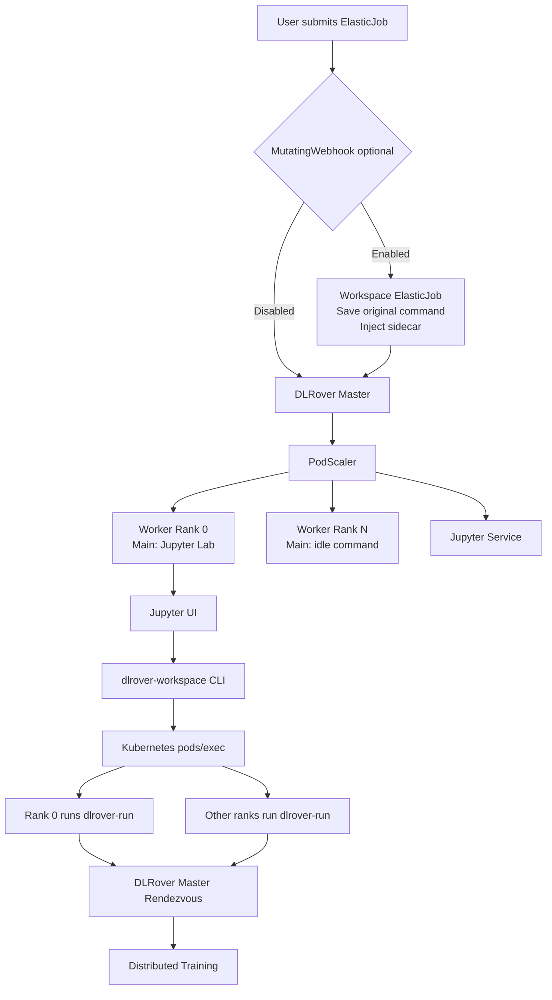
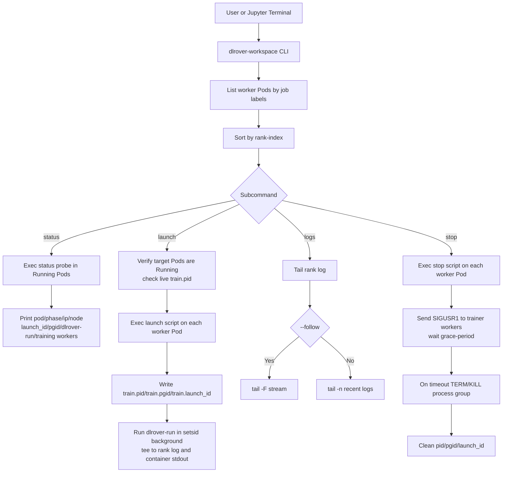
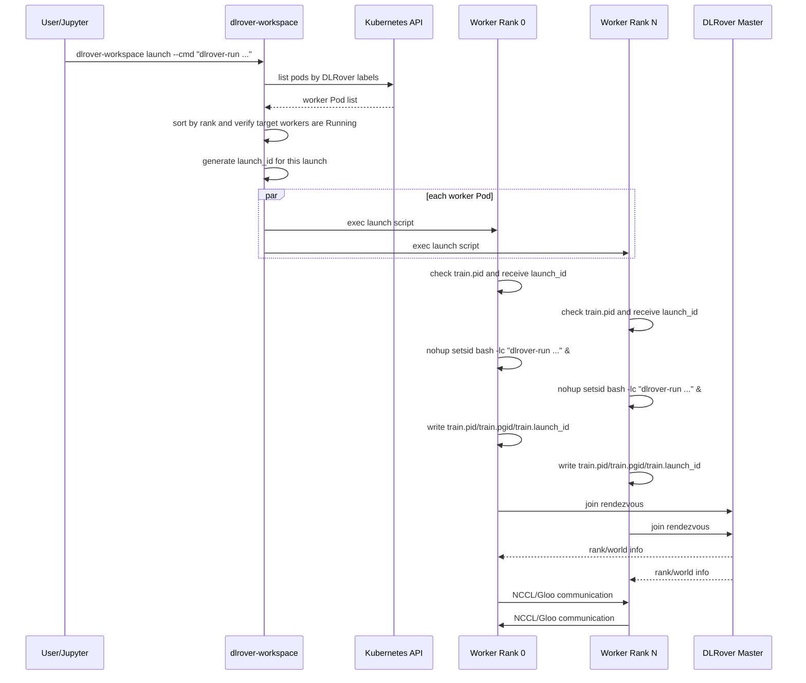
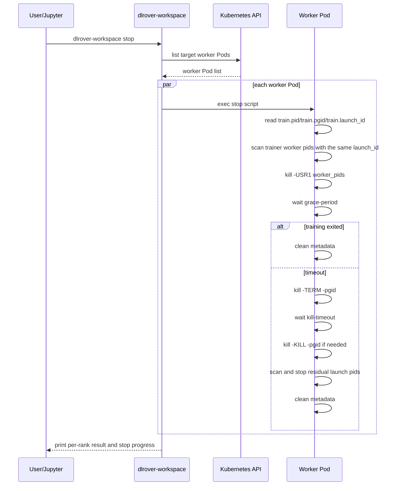
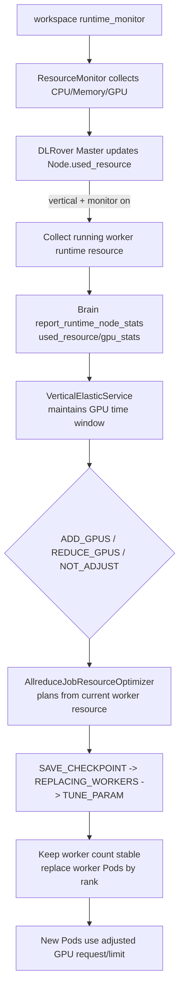

# DLRover Workspace and Jupyter Integration Design

## Background

DLRover ElasticJob normally starts the user training command directly from the
worker Pod template. A typical worker command is:

```bash
dlrover-run --nnodes=$NODE_NUM --nproc_per_node=8 train.py
```

This is suitable for production training, but it is inconvenient for interactive
debugging. Users often need to request a multi-node multi-GPU environment first,
enter a notebook, inspect data, dependencies, GPU and NCCL status, and then
launch training on the same worker Pods.

Workspace mode splits the runtime lifecycle from the training lifecycle. DLRover
creates the training runtime environment first. Worker rank 0 can start Jupyter
Lab, other workers stay alive through an idle command, and training is launched
later through `dlrover-workspace`.

## Goals

- Keep the existing Train mode unchanged.
- Let DLRover master continue to create worker Pods, inject distributed
  environment variables, and create worker Services.
- Provide a Jupyter entrypoint on worker rank 0 in Workspace mode.
- Keep other worker Pods alive as runtime nodes.
- Provide a `dlrover-workspace` CLI to launch, stop, inspect, and tail training.
- Keep worker Pods and the Jupyter/idle environment after training exits or is
  stopped.
- Optionally support transparent mode with MutatingWebhook and sidecar so users
  can submit the original training ElasticJob without changing their YAML.

## Non-Goals

- Do not replace `dlrover-run` rendezvous or fault-tolerance logic.
- Do not initialize PyTorch process-level distributed envs before training
  starts. `LOCAL_RANK`, process-level `RANK`, `MASTER_ADDR`, and `MASTER_PORT`
  are still produced by `dlrover-run`.
- Do not intercept an already running container process. Transparent mode must
  mutate the ElasticJob spec before worker Pods are created.

## Overall Architecture



## Layer 1: Train Mode

Train mode is the default behavior. If no Workspace annotation is configured,
DLRover keeps the worker Pod command from the user ElasticJob and starts
training immediately.

```yaml
metadata:
  annotations: {}
```

Behavior:

- Worker Pods use the original user command.
- Pod startup immediately starts training.
- Existing users and jobs are not affected.

## Layer 2: Workspace Mode

`run-mode` only enables the Workspace architecture. `jupyter-enabled`
independently controls Jupyter, and `workspace-exit-policy` controls whether
worker Pods are retained after training.

Example annotations:

```yaml
metadata:
  annotations:
    dlrover.io/run-mode: workspace
    dlrover.io/jupyter-enabled: "true"
    dlrover.io/workspace-exit-policy: retain
    dlrover.io/jupyter-port: "8888"
    dlrover.io/jupyter-service-type: "NodePort"
    dlrover.io/jupyter-node-port: "30088"
    dlrover.io/jupyter-token: "dlrover"
    dlrover.io/idle-command: "sleep infinity"
    dlrover.io/init-command: "pip install -r /nas/requirements.txt"
    dlrover.io/runtime-monitor-enabled: "true"
```

Behavior:

- DLRover master still creates all worker Pods.
- Worker rank 0 command is rewritten to start Jupyter Lab when Jupyter is
  enabled.
- Other workers run the idle command, for example `sleep infinity`.
- DLRover still injects node-level distributed environment variables.
- If `dlrover.io/init-command` is configured, DLRover runs it before starting
  Jupyter or the idle command. If initialization fails, the worker container
  exits so Kubernetes can surface the failure.
- `python -m dlrover.python.workspace.runtime_monitor` is enabled by default in
  Workspace Pods and can be disabled with
  `dlrover.io/runtime-monitor-enabled: "false"`.
- Workspace worker Pods should use `restartPolicy: Always`. Training command
  failures only affect the launched training process. If kubelet OOMKills the
  container, kubelet should restart the Jupyter/idle environment, and DLRover
  master should not terminate the Workspace as a normal failed training job.
- When Jupyter is enabled, DLRover creates a Jupyter Service named
  `<job-name>-jupyter`. The type is controlled by
  `dlrover.io/jupyter-service-type`, defaults to `NodePort`, and supports
  `NodePort`, `ClusterIP`, and `LoadBalancer`. For `NodePort`, users can set
  `dlrover.io/jupyter-node-port` to request a fixed nodePort. If it is not set,
  Kubernetes allocates one automatically.

Injected envs include:

```text
ELASTIC_JOB_NAME
JOB_UID
NODE_TYPE
NODE_ID
NODE_NUM
NODE_RANK
RANK
WORLD_SIZE
POD_IP
NODE_IP
DLROVER_MASTER_ADDR
DLROVER_WORKSPACE_MODE
DLROVER_RUN_MODE
DLROVER_WORKSPACE_ROLE
DLROVER_JUPYTER_SERVICE
DLROVER_RUNTIME_MONITOR
NAMESPACE
```

The Jupyter command is generated by DLRover master:

```bash
jupyter lab \
  --ip=0.0.0.0 \
  --port=<jupyter-port> \
  --no-browser \
  --allow-root \
  --ServerApp.token="${JUPYTER_TOKEN:-<default-token>}"
```

Example access:

```bash
kubectl apply -f examples/pytorch/workspace/jupyter_swift_elastic_job.yaml
kubectl get svc -n dlrover workspace-test-jupyter
export NODE_IP=$(kubectl get nodes -o jsonpath='{.items[0].status.addresses[?(@.type=="InternalIP")].address}')
export JUPYTER_NODE_PORT=$(kubectl get svc -n dlrover workspace-test-jupyter -o jsonpath='{.spec.ports[0].nodePort}')
```

Open:

```text
http://${NODE_IP}:${JUPYTER_NODE_PORT}/?token=dlrover
```

## Layer 3: WorkspaceLauncher

WorkspaceLauncher is exposed through a CLI:

```bash
dlrover-workspace status
dlrover-workspace launch --cmd "dlrover-run --nnodes=\$NODE_NUM --nproc_per_node=8 train.py"
dlrover-workspace logs --tail 100
dlrover-workspace logs --follow
dlrover-workspace stop --grace-period 300 --kill-timeout 30
```

Responsibilities:

- Find worker Pods by DLRover labels.
- Sort worker Pods by `elasticjob.dlrover/rank-index`.
- Check that all target workers are `Running`.
- Launch the same training command on all worker Pods by default; `--ranks`
  restricts the target ranks.
- Use Kubernetes `pods/exec` to launch, stop, inspect, and tail training inside
  each worker Pod.
- Store training logs, PID, PGID, and launch id inside each worker Pod.
- `launch` uses `setsid` to create an independent process group and tees output
  to both the rank log file and container stdout.
- `stop` first sends `SIGUSR1` to trainer worker processes for graceful exit,
  then falls back to `SIGTERM/SIGKILL` for the training process group.
- `status` prints pod, phase, IP, node, `dlrover-run`, training worker process,
  launch id, and process group information.
- `logs --follow` runs `tail -F` against each worker rank log.

Default paths:

```text
/tmp/dlrover-workspace/train.rank_<rank>.log
/tmp/dlrover-workspace/train.pid
/tmp/dlrover-workspace/train.pgid
/tmp/dlrover-workspace/train.launch_id
```

## Workspace CLI Control Flow



## Workspace Launch Flow



In Workspace mode, `dlrover-run` appends `DLROVER_WORKSPACE_LAUNCH_ID` to
`TORCHELASTIC_RUN_ID`, so repeated launches on the same reusable Pods use
different rendezvous run ids. DLRover master resets the previous rendezvous
state only for Workspace restart requests; non-Workspace training is not
affected.

## Workspace Stop Flow



## Runtime Resource Monitoring and GPU Vertical Elasticity

Workspace containers start
`python -m dlrover.python.workspace.runtime_monitor` by default. The monitor
reuses the ElasticAgent `ResourceMonitor`, periodically collects CPU, memory,
and GPU utilization, and reports `ResourceStats` to DLRover master. The default
interval is 20 seconds and can be changed with
`DLROVER_RUNTIME_MONITOR_INTERVAL`.

Vertical elasticity flow:



Key constraints:

- Brain reports CPU, memory, GPU count, GPU type, and `gpu_stats` through the
  `used_resource` field. It does not infer resource usage from non-resource
  fields such as `pod_ip`.
- `AllreduceJobResourceOptimizer` syncs the current worker resource before
  generating a GPU scale plan. Each new plan is based on the last effective
  worker resource instead of the initial job resource.
- Kubernetes cannot mutate GPU limits on a running Pod. Vertical elasticity keeps
  the worker replica count stable and replaces same-rank worker Pods so new GPU
  request/limit values take effect.
- The flow reuses existing vertical elastic phases: save checkpoint, replace
  workers, then tune parameters.
- Non-Workspace jobs do not inject the runtime monitor and are not
  affected by Workspace failure handling.

## Capability Assessment, Framework Support, and Limitations

### What Workspace Solves

1. One-time allocation for single-node or multi-node multi-GPU training with
   automatic container networking:
   - Workspace can satisfy the “prepare the full runtime environment first”
     workflow.
   - The number of worker Pods and the GPU request/limit per Pod are still
     declared by the ElasticJob spec. Workspace does not auto-provision the
     initial training GPU footprint after Jupyter has already started.
   - DLRover master still creates worker Pods, injects node-level distributed
     envs, and creates worker/Jupyter Services. Once training is launched,
     `dlrover-run` provides process-level `LOCAL_RANK`, `RANK`, `MASTER_ADDR`,
     `MASTER_PORT`, and rendezvous wiring.

2. Training interruption and repeated relaunch:
   - Workspace supports this well. The training process is launched inside an
     existing reusable worker Pod. After training exits, fails, or is stopped
     through `dlrover-workspace`, the Jupyter/idle runtime remains available.
   - Each launch gets a new `DLROVER_WORKSPACE_LAUNCH_ID`, which `dlrover-run`
     appends to `TORCHELASTIC_RUN_ID`. The master resets previous rendezvous
     state only for Workspace restart requests, so repeated launches on the same
     Pods do not reuse stale rendezvous state.
   - Recovery semantics still depend on the framework checkpoint and restart
     logic. Workspace manages lifecycle, not framework-specific recovery.

3. Vertical elasticity without changing replica count:
   - The design supports this through the existing DLRover vertical elasticity
     path, but it does not mutate GPU limits on a running Pod in place. Kubernetes
     does not allow that. DLRover keeps the worker count stable and replaces
     same-rank Pods so the updated GPU request/limit takes effect.
   - This depends on runtime monitoring, Brain decision making, current worker
     resource sync, checkpoint save/reload, and enough remaining GPU capacity in
     the cluster. If any of those prerequisites is missing, the current resource
     shape is preserved.
   - For Workspace, vertical elasticity means worker Pod replacement. If rank 0
     is also the interactive Jupyter host, the notebook session is not a
     lossless hot update.

### Framework Support

- DeepSpeed: the clearest first-class path. DLRover provides
  `DeepSpeedCheckpointEngine` and `DeepSpeedCheckpointSaver`, and the Workspace
  lifecycle can reuse them directly.
- Swift: supported through the generic command path. The docs and examples use
  `dlrover-run + swift sft`; Workspace provides the runtime, repeated
  launches, and Pod reuse, while Swift/DeepSpeed handle training semantics.
- MindSpeed: there is no dedicated Workspace adapter today. If the workload uses
  Megatron/DeepSpeed-compatible launch and checkpoint semantics, it can follow
  the shared DLRover path, but each checkpoint and restart behavior still needs
  validation.
- VL / multimodal training: Workspace is model-agnostic. As long as the
  training command can be started through `dlrover-run` and the framework
  supports rendezvous, graceful stop, and checkpoint recovery, Workspace can be
  used. Multi-role orchestration, data loading, rollout services, and other
  model-side concerns remain the responsibility of the training code.

### Current Usage Limits

- Workspace focuses on runtime reuse and repeated launch/stop. It does not
  replace the framework’s own checkpoint, restart, or parameter reconfiguration
  logic.
- `dlrover-workspace launch` runs the same command on the target worker Pods by
  default. Multi-role jobs, heterogeneous roles, parameter server layouts, and
  actor/rollout separation need extra orchestration or other DLRover runtime
  APIs.
- `stop` first sends `SIGUSR1` to trainer workers. The framework must trap and
  handle that signal correctly to save state reliably.
- Vertical elasticity is not in-place GPU hot-plug. It requires checkpointing,
  Pod replacement, re-rendezvous, and resume, so it is disruptive to notebook
  sessions and any local state not persisted outside the container.
- Initial GPU resources are still bounded by Kubernetes scheduling, quotas,
  node capacity, and device plugin availability. Workspace cannot bypass those
  limits.
- Training commands should be launched through `dlrover-run` so DLRover
  rendezvous, fault handling, and flash checkpoint paths are fully active.
  Direct framework-native launch commands may not get the full DLRover behavior.
- Persisted data, code, checkpoints, and outputs should live on PVC/NAS/object
  storage. Local container filesystems may be lost when Pods are replaced or
  restarted.

## Transparent Mode With Webhook and Sidecar

The current code path primarily implements explicit Workspace mode: users first
create a reusable Jupyter/idle runtime environment and then control the training
lifecycle with `dlrover-workspace`. Webhook and sidecar remain an optional
transparent extension for converting ordinary training ElasticJobs into
Workspace ElasticJobs.

Webhook mutations:

1. Read and serialize the original worker main container command.
2. Save it as `DLROVER_WORKSPACE_ORIGINAL_CMD` in an injected sidecar.
3. Add `dlrover.io/run-mode: workspace`.
4. Inject a `dlrover-workspace-autolaunch` sidecar.
5. Set the worker template ServiceAccount to `dlrover-workspace`.

Transparent mode flow:

```mermaid
flowchart LR
    A[User submits original ElasticJob] --> B[MutatingWebhook]
    B --> C[Extract main command]
    C --> D[Save command to DLROVER_WORKSPACE_ORIGINAL_CMD]
    D --> E[Add workspace annotations]
    E --> F[Inject autolaunch sidecar]
    F --> G[DLRover Master creates Pods]
    G --> H[Rank 0 sidecar acquires Lease]
    H --> I[Wait for all workers Running]
    I --> J[dlrover-workspace launch]
    J --> K[Training starts]
```



## Autolaunch Sidecar

The sidecar is injected into all workers, but only worker rank 0 starts the
training command. Other sidecars stay alive.

Pseudo logic:

```python
if NODE_RANK != "0":
    sleep_forever()

acquire_kubernetes_lease(f"{job_name}-workspace-launch")
wait_all_workers_running()
dlrover_workspace_launch(DLROVER_WORKSPACE_ORIGINAL_CMD)
sleep_forever()
```

The Kubernetes Lease prevents duplicate launches when rank 0 Pod, sidecar, or
master restarts.

## Labels

WorkspaceLauncher relies on existing DLRover labels:

```text
elasticjob.dlrover/name=<job>
elasticjob.dlrover/replica-type=worker
elasticjob.dlrover/rank-index=<rank>
elasticjob.dlrover/replica-index=<id>
```

## RBAC

The Jupyter Pod and autolaunch sidecar require minimal permissions:

```yaml
rules:
  - apiGroups: [""]
    resources: ["pods"]
    verbs: ["get", "list"]
  - apiGroups: [""]
    resources: ["pods/exec"]
    verbs: ["create"]
  - apiGroups: ["coordination.k8s.io"]
    resources: ["leases"]
    verbs: ["get", "create", "update"]
```

## Security Considerations

- Jupyter token should be sourced from a Kubernetes Secret in production.
- Jupyter Service defaults to `NodePort` for direct Workspace access. It can be
  configured as `ClusterIP` or `LoadBalancer` with
  `dlrover.io/jupyter-service-type`.
- For `NodePort`, `dlrover.io/jupyter-node-port` can request a fixed nodePort.
  The value must be within the cluster `service-node-port-range`.
- In production, restrict NodePort access with a platform gateway, an
  authenticated notebook proxy, network policies, or firewall rules.
- `pods/exec` permission must be scoped to the job namespace.
- Webhook injection should be enabled by namespace label, for example:

```yaml
dlrover.io/workspace-injection: enabled
```

- Production webhook `failurePolicy` should be `Fail`.

## User Experience

### Explicit Workspace Mode

```bash
kubectl apply -f rbac.yaml
kubectl apply -f examples/pytorch/workspace/jupyter_swift_elastic_job.yaml
kubectl get svc -n dlrover workspace-test-jupyter
```

Launch training from Jupyter:

```bash
dlrover-workspace status
dlrover-workspace launch --cmd \
  "dlrover-run --nnodes=\$NODE_NUM --nproc_per_node=8 train.py"
dlrover-workspace logs --follow
dlrover-workspace logs --tail 100
dlrover-workspace stop --grace-period 300 --kill-timeout 30
```

### Transparent Mode

```bash
kubectl apply -f original_training_job.yaml
```

The webhook converts the job to Workspace mode and the sidecar automatically
launches the original training command after the runtime environment is ready.

## Failure Handling

- If some worker Pods are not `Running`, `dlrover-workspace launch` fails fast.
- If training is already running in a Pod, `launch` returns a conflict message
  based on the PID file.
- If the autolaunch sidecar restarts, the Kubernetes Lease prevents repeated
  launch.
- Training process failure does not require the worker Pod or Jupyter/idle main
  process to exit.
- Workspace worker Pod failure events are not handled as normal training
  failures by DLRover master; the runtime environment is expected to be kept or
  restarted by Kubernetes according to the Pod restart policy.
- Logs can be collected from each worker through `dlrover-workspace logs`.

## Implementation Summary

Core components:

- `PodScaler` Workspace mode:
  - parse Workspace annotations;
  - rewrite worker main container command;
  - inject Workspace envs;
  - run optional initialization command before Jupyter/idle;
  - start optional runtime monitor;
  - create Jupyter Service when Jupyter is enabled.
- `dlrover-workspace` CLI:
  - `status`: print pod, launch id, process group, `dlrover-run`, and trainer
    worker process details;
  - `launch`: execute the same training command on all target worker Pods,
    create a process group with `setsid`, and tee output to the rank log and
    container stdout;
  - `logs`: support `--tail` and `--follow`;
  - `stop`: support `--grace-period`, `--kill-timeout`, and `--ranks`; send
    `SIGUSR1` to trainer workers first, then clean the process group by timeout
    policy.
- Optional webhook:
  - mutate ElasticJob;
  - preserve original command;
  - inject autolaunch sidecar;
  - configure ServiceAccount and RBAC.
