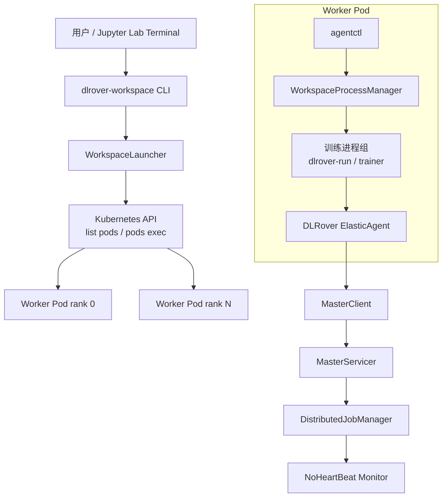
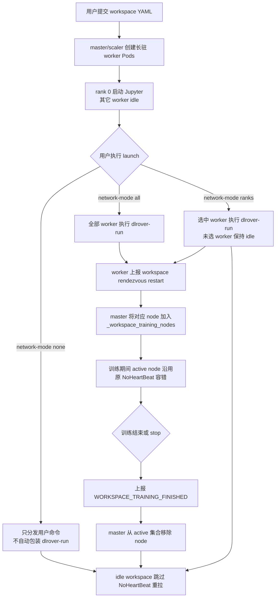
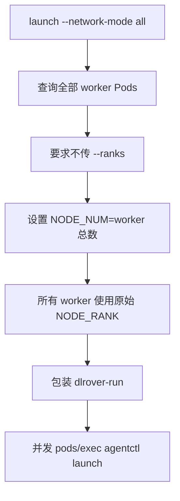
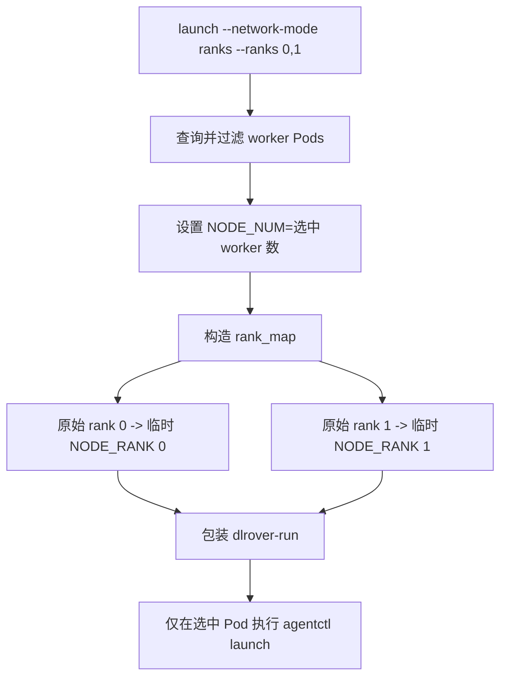
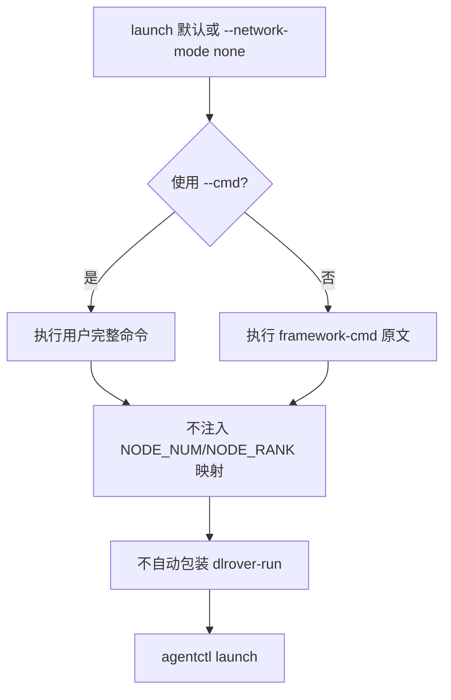
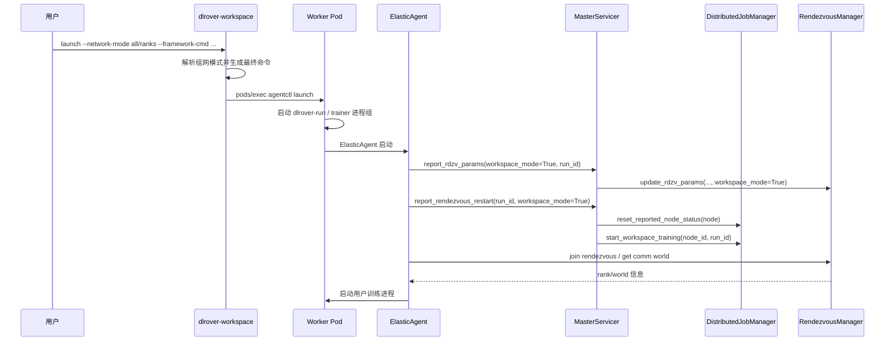
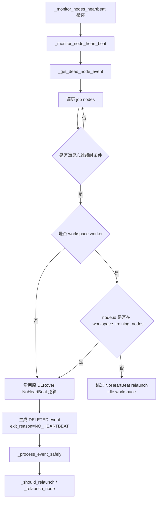
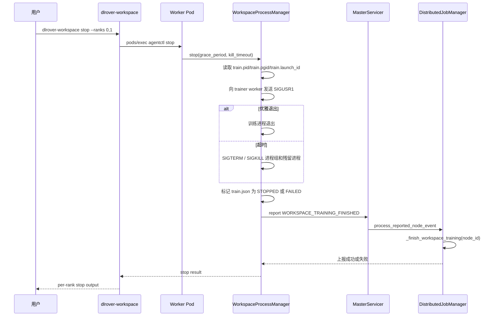

# DLRover Workspace 组网与心跳监测设计

本文档说明 DLRover workspace 模式下，如何通过 CLI 显式控制是否自动组网，
以及 master 如何区分“空闲 workspace Pod”和“正在训练的 workspace worker”，
避免 Jupyter/idle 环境因为没有训练心跳而被误判为 `NoHeartBeat` 并重拉 Pod。

相关代码：

- `dlrover/python/workspace/cli.py`：解析 `--network-mode`、`--ranks` 和
  `--dlrover-run-args`，生成最终训练命令。
- `dlrover/python/workspace/launcher.py`：查询 worker Pods，并通过
  Kubernetes `pods/exec` 分发 `agentctl` 命令。
- `dlrover/python/workspace/process_manager.py`：Pod 内训练进程生命周期管理，
  `stop` 时兜底上报 workspace training finished。
- `dlrover/python/elastic_agent/torch/training.py`：workspace 训练退出时上报
  workspace training finished。
- `dlrover/python/master/servicer.py`：接收 rendezvous restart 和 node event。
- `dlrover/python/master/node/dist_job_manager.py`：维护 workspace 训练态，并在
  NoHeartBeat 检测中跳过空闲 workspace worker。

## 背景

### 当前问题

workspace 模式的目标是先创建一批可复用的 worker Pod，并在 rank 0 上提供
Jupyter Lab。用户可以在 Jupyter 中多次执行 `dlrover-workspace launch` 启动
训练，也可以执行 `dlrover-workspace stop` 停止当前训练，但保留 Pod、挂载盘、
Jupyter 会话和已申请资源。

这个使用方式与普通 DLRover 训练作业不同：

- 普通 DLRover worker Pod 创建后通常立即进入训练。
- workspace worker Pod 创建后可能长时间处于 Jupyter/idle 状态。
- 同一批 workspace worker Pod 可能反复启动、停止、再启动训练。
- 用户可能只选择部分 worker Pod 参与一次训练，其余 Pod 保持空闲。

在原有逻辑中，master 会周期性检查 worker 的训练心跳。如果 worker 长时间没有
上报训练心跳，会生成 `NoHeartBeat` 事件，并按原 DLRover 容错逻辑重拉 worker
Pod。该机制对普通训练作业是正确的，但在 workspace 空闲态会产生误判：

```text
workspace 创建 4 个 worker Pod
worker Pod 处于 Jupyter/idle 或 WAIT_PRE_CHECK 状态
master 600s 后检测不到训练心跳
master 生成 NoHeartBeat 事件
原 worker-0/worker-1 被认为失败
master 额外创建 worker-4/worker-5
```

这会导致用户看到“明明创建了 4 个 worker，又多创建了 2 个 Pod”的现象。根因
不是 Kubernetes 自动扩容，而是 master 将 workspace 空闲 Pod 按普通训练 worker
处理了。

同时，workspace CLI 还存在两个容易混淆的问题：

- 如果 CLI 隐式自动包装 `dlrover-run`，用户提交普通脚本时可能被意外组网。
- 如果用户只想选择部分节点组网，需要确保未选节点仍保持 idle，不能被训练心跳
  监测误重拉。

另外，`dlrover-workspace stop` 只停止 Pod 内训练进程组，不删除 Pod，也不停止
master。若训练进程被 `SIGKILL` 强杀，ElasticAgent 可能来不及上报训练结束，
master 侧 active 训练态可能残留，后续仍可能按训练态监测心跳。

### 解决方案

本设计从 CLI 组网控制和 master 心跳状态机两侧修复：

1. **CLI 默认不自动组网**

   `dlrover-workspace launch` 默认 `--network-mode none`。CLI 只负责把命令分发
   到目标 Pod，不隐式包装 `dlrover-run`。

2. **用户显式选择组网范围**

   用户可以通过 `--network-mode all` 选择全部 worker Pod 组网，也可以通过
   `--network-mode ranks --ranks 0,1` 只选择部分 worker Pod 组网。

3. **只把实际进入 rendezvous 的 workspace worker 标为训练态**

   master 不因为 workspace job 存在就认为所有 worker 都在训练。只有 worker
   上报 `RendezvousRestartRequest(workspace_mode=True)` 后，才加入
   `_workspace_training_nodes`。

4. **NoHeartBeat 按节点粒度判断**

   master 心跳监测线程仍然运行，但在生成 NoHeartBeat 事件前判断：

   - 非 workspace worker：完全沿用原 DLRover 逻辑。
   - workspace worker 且不在 `_workspace_training_nodes`：视为空闲，跳过重拉。
   - workspace worker 且在 `_workspace_training_nodes`：视为训练中，沿用原
     DLRover NoHeartBeat 容错逻辑。

5. **训练结束和 stop 都清理训练态**

   workspace ElasticAgent 正常退出时上报 `WORKSPACE_TRAINING_FINISHED`。同时
   `dlrover-workspace stop` 在优雅停止、强杀和失败路径都会兜底上报 finished，
   避免 active 状态残留。

6. **不影响原有 DLRover 组网和容错**

   workspace finished 是内部控制事件，不写入普通节点 `reported_status`；active
   workspace worker 仍走原 `_should_relaunch` 和 `_relaunch_node` 流程。

## 总体设计

### 设计目标

1. `dlrover-workspace launch` 默认不自动组网，避免用户提交普通脚本时被隐式
   包装成 DLRover 分布式训练。
2. 用户可以显式选择全部节点组网、部分节点组网，或不自动组网。
3. 不影响 DLRover 原有 `dlrover-run`、rendezvous、节点重拉和训练容错逻辑。
4. workspace Pod 在空闲状态下不因缺少训练心跳被重拉。
5. workspace Pod 一旦参与训练，仍沿用 DLRover 原有 NoHeartBeat 容错逻辑。
6. `dlrover-workspace stop` 后，即使训练进程被强杀，也尽量清理 master 侧
   workspace 训练态，避免后续误重拉 Pod。

### 非目标

- 不重新实现 `dlrover-run` 的组网协议。
- 不改变非 workspace 作业的节点状态机。
- 不删除、缩容或释放 workspace Pod；`stop` 只停止训练进程。
- 不提供跨 Pod 启动事务。某个 Pod exec 失败时，已经启动成功的 Pod 不会自动回滚。

### 架构图



workspace 模式把“Pod 生命周期”和“训练生命周期”拆开：

- Pod 生命周期由 ElasticJob/master/scaler 管理，workspace Pod 长驻。
- 训练生命周期由 `dlrover-workspace launch/status/logs/stop` 管理。
- 只有显式进入 DLRover 训练组网的 worker 才被 master 视为 active training node。

### 核心状态模型

`DistributedJobManager` 维护以下 workspace 训练态：

```python
self._workspace_training_active = False
self._workspace_training_run_id = ""
self._workspace_training_nodes = set()
```

| 字段 | 作用 |
| --- | --- |
| `_workspace_training_active` | 当前是否存在 workspace 训练。主要用于日志和可观测性。 |
| `_workspace_training_run_id` | 当前 workspace 训练轮次。用于忽略旧 run 的迟到 finished 事件。 |
| `_workspace_training_nodes` | 当前参与训练的 workspace worker node id 集合。NoHeartBeat 是否生效以该集合为准。 |

### 总体流程



### 兼容性原则

1. CLI 默认 `--network-mode none`，不会隐式包装 `dlrover-run`。
2. 自动组网只在用户显式指定 `all` 或 `ranks` 时发生。
3. `--cmd` 永远不被 CLI 改写，用户可以自行控制所有 `dlrover-run` 参数。
4. master 只对带 workspace/runtime label 或 annotation 的 worker 做 idle
   NoHeartBeat 跳过。
5. workspace finished 是内部控制事件，不写入普通节点 `reported_status`。
6. active workspace worker 仍走原 `_should_relaunch` 和 `_relaunch_node` 流程。
7. 非 workspace worker 不会进入 `_workspace_training_nodes`，也不会触发
   workspace 特殊判断。

## 详细设计

### CLI 组网模式

`dlrover-workspace launch` 支持三种组网模式：

| 模式 | 参数 | 行为 |
| --- | --- | --- |
| 不自动组网 | `--network-mode none` | 默认值。CLI 不包装 `dlrover-run`，只把命令分发到目标 Pod。 |
| 全部节点组网 | `--network-mode all` | 使用当前 workspace job 的全部 worker Pod 组网。 |
| 部分节点组网 | `--network-mode ranks --ranks 0,1` | 只使用指定 rank 的 worker Pod 组网。 |

rank 是 DLRover worker 的系统标识，不一定是用户在平台页面上直接看到的实例名。
因此用户选择部分节点前，推荐先执行 `dlrover-workspace status --cli-log on`
查看 rank 与 Pod、namespace、IP、node 的映射关系。`--ranks` 保留为底层稳定
选择方式，后续可在平台层提供 Pod/实例选择入口并转换为 rank。

兼容别名：

```bash
--auto-network none|all|ranks
```

#### 命令构造规则

`--cmd` 表示用户提供完整命令，CLI 不自动包装：

```bash
dlrover-workspace launch --cmd \
  "dlrover-run --nnodes=2 --nproc_per_node=8 python train.py"
```

`--framework-cmd` 表示用户提供训练框架命令。只有当 `--network-mode` 不为
`none` 时，CLI 才会包装为：

```bash
dlrover-run <dlrover-run-args> <framework-cmd>
```

默认 `--dlrover-run-args` 为：

```bash
--nnodes=$NODE_NUM --nproc_per_node=1
```

示例：

```bash
dlrover-workspace launch \
  --network-mode all \
  --dlrover-run-args "--nnodes=$NODE_NUM --nproc_per_node=8 --max_restarts=3" \
  --framework-cmd "python train.py --epochs 10"
```

如果 `--framework-cmd` 已经以 `dlrover-run` 开头，CLI 不会重复包装。

#### 全部节点组网



全部组网适用于希望当前 workspace 的所有 worker 都参与同一个 DLRover
分布式训练的场景。

#### 部分节点组网

部分组网用于只选择 workspace 中的一部分 worker 执行训练，例如 4 个 worker
Pod 中只使用 rank 0、1。

CLI 会校验 `--ranks` 不能重复；指定 rank 必须全部找到。真正启动前，
`WorkspaceLauncher` 还会再次校验目标 Pod 全部存在并处于 `Running`，避免
缺失 rank 被静默降级为更小规模训练。



部分组网会在命令前注入环境变量前缀：

```bash
export NODE_NUM=<selected_worker_count>;
case "${NODE_RANK:-}" in
  0) export NODE_RANK=0 ;;
  1) export NODE_RANK=1 ;;
  *) echo "NODE_RANK ... is not selected"; exit 1 ;;
esac;
```

这样可以保证选中节点的 rank 从 0 开始连续，避免原始 rank 不连续导致
rendezvous 组网失败。

#### 不自动组网



该模式适用于调试、单机脚本、数据准备、环境检查，或用户希望完全手写
`dlrover-run` 参数的场景。

### Launch 到 Rendezvous 流程



关键点：

- `report_rdzv_params` 只更新 rendezvous 参数，不直接把所有 workspace worker
  标记为训练态。
- 每个 worker 在 `report_rendezvous_restart(workspace_mode=True)` 时才加入
  `_workspace_training_nodes`。
- 因此部分组网时，只有被选中的 worker 会进入训练态；未选中的 worker 保持
  idle，不参与 NoHeartBeat 重拉。

### Master 侧训练态更新

#### 进入训练态

```python
start_workspace_training(node_type, node_id, run_id)
```

触发条件：

- master 收到 `RendezvousRestartRequest(workspace_mode=True)`。
- node type 是 `worker`。

处理规则：

- 如果 `run_id` 与当前 `_workspace_training_run_id` 不同，清空旧的
  `_workspace_training_nodes`。
- 设置 `_workspace_training_active=True`。
- 记录 `_workspace_training_run_id=run_id`。
- 将当前 `node_id` 加入 `_workspace_training_nodes`。

#### 退出训练态

```python
_finish_workspace_training(node_id, run_id="")
```

触发条件：

- workspace ElasticAgent 正常退出，在 `finally` 中上报
  `WORKSPACE_TRAINING_FINISHED`。
- `dlrover-workspace stop` 停止或强杀训练进程后，Pod 内
  `WorkspaceProcessManager` 兜底上报 `WORKSPACE_TRAINING_FINISHED`。

处理规则：

- 如果事件携带 `run_id`，并且与当前 `_workspace_training_run_id` 不一致，
  说明是旧训练轮次迟到消息，忽略。
- 否则将 `node_id` 从 `_workspace_training_nodes` 移除。
- 如果集合为空，设置 `_workspace_training_active=False`，清空
  `_workspace_training_run_id`。
- 该事件是 workspace 内部控制事件，不写入节点 `reported_status`，不影响普通
  `SUCCEEDED_EXITED` / `FAILED_EXITED` 逻辑。

### NoHeartBeat 监测流程

master 的 heartbeat monitor 线程仍然持续运行。workspace 修复的核心不是关闭
监测线程，而是在生成 dead node event 前判断该 worker 是否是空闲 workspace。



判断函数：

```python
def _should_skip_no_heartbeat_relaunch(node):
    return (
        node.type == NodeType.WORKER
        and _is_workspace_node(node)
        and node.id not in self._workspace_training_nodes
    )
```

效果：

- 普通 DLRover worker：完全走原 NoHeartBeat 逻辑。
- workspace idle worker：跳过 NoHeartBeat 重拉。
- workspace active worker：继续走原 NoHeartBeat 逻辑。
- 部分组网中未选 worker：因为不在 `_workspace_training_nodes`，跳过重拉。

### Stop 流程与心跳状态清理

`dlrover-workspace stop` 只停止训练进程组，不删除 Pod，不停止 master。
因此 master heartbeat monitor 仍然运行。为了避免 stop 后 active 状态残留，
stop 流程会做兜底上报。



`stop` 的上报策略：

- 仅在 `DLROVER_WORKSPACE_MODE=true/1/yes/y` 时执行。
- 使用 master client 懒加载，避免 workspace 本地进程管理强依赖 `grpc`。
- 上报失败只记录 warning，不改变 stop 命令返回码。
- 兜底上报不携带 `run_id`，用于训练进程被强杀、无法从 agent `finally` 正常
  上报的场景。

### 典型场景

#### 4 个 worker，默认不组网

```bash
dlrover-workspace launch --framework-cmd "python preprocess.py"
```

结果：

- CLI 不包装 `dlrover-run`。
- master 不会收到 workspace rendezvous restart。
- `_workspace_training_nodes` 为空。
- 所有 workspace worker 即使没有训练心跳，也会被识别为 idle workspace，
  不触发 NoHeartBeat 重拉。

#### 4 个 worker，全部组网

```bash
dlrover-workspace launch \
  --network-mode all \
  --dlrover-run-args "--nnodes=$NODE_NUM --nproc_per_node=8" \
  --framework-cmd "python train.py"
```

结果：

- 4 个 worker 都执行 `dlrover-run`。
- 4 个 worker 依次上报 `workspace_mode=True` 的 rendezvous restart。
- `_workspace_training_nodes={0,1,2,3}`。
- 任意 active worker 训练心跳超时，仍按原 DLRover 逻辑重拉。

#### 4 个 worker，只用 2 个组网

```bash
dlrover-workspace launch \
  --network-mode ranks \
  --ranks 0,1 \
  --dlrover-run-args "--nnodes=$NODE_NUM --nproc_per_node=8" \
  --framework-cmd "python train.py"
```

结果：

- 只有 rank 0、1 执行 `dlrover-run`。
- `NODE_NUM=2`。
- rank 0、1 进入 `_workspace_training_nodes`。
- rank 2、3 保持 idle workspace，即使无训练心跳也不会被重拉。

#### stop 后不再误重拉

```bash
dlrover-workspace stop --ranks 0,1
```

结果：

- stop 尝试优雅停止训练进程。
- 超时后会 SIGTERM/SIGKILL 训练进程组。
- stop 完成后兜底上报 `WORKSPACE_TRAINING_FINISHED`。
- master 将 rank 0、1 从 `_workspace_training_nodes` 移除。
- 后续 NoHeartBeat 检测仍运行，但 rank 0、1 已变成 idle workspace，不会误重拉。

### 异常与边界

| 场景 | 处理 |
| --- | --- |
| `pods/exec` 某些 Pod 失败 | CLI 返回该 rank 失败；已启动 Pod 不自动回滚。用户可执行 `stop` 清理。 |
| 旧 run 的 finished 事件迟到 | 如果事件携带旧 `run_id`，master 忽略。 |
| stop 强杀训练进程 | `WorkspaceProcessManager.stop` 兜底上报 finished。 |
| stop 上报 master 失败 | stop 仍完成；master 可能短期保留 active 状态，后续可再次 stop 或等待下一轮 run_id 重置。 |
| 非 workspace 节点误发 finished | master 忽略并记录 warning，不写 `reported_status`。 |
| 用户用 `--cmd` 手写 `dlrover-run` | CLI 不改写命令；由用户自行保证 `nnodes`、`nproc_per_node` 等参数正确。 |

### 可观测性

建议关注以下日志：

- CLI/launcher：
  - `Workspace pod exec failed`
  - `no worker pods found`
- Pod 内 process manager：
  - `reported workspace training finished to master`
  - `Failed to report workspace training finished to master`
- master/job manager：
  - `Workspace training started by node ...`
  - `Workspace training finished on node ...`
  - `Ignore stale workspace training finish ...`
  - `Skip no-heartbeat relaunch for idle workspace node ...`

排查命令：

```bash
dlrover-workspace status --cli-log on
dlrover-workspace logs --tail 200 --ranks 0
dlrover-workspace stop --ranks 0 --grace-period 300 --kill-timeout 30
```

### 测试覆盖

当前设计应覆盖以下测试场景：

- 默认 `--network-mode none` 不包装 `dlrover-run`。
- `--network-mode all` 包装 `dlrover-run` 并设置 `NODE_NUM`。
- `--network-mode ranks` 只选择指定 worker，并生成连续 rank 映射。
- idle workspace worker NoHeartBeat 不生成 relaunch event。
- active workspace worker NoHeartBeat 仍生成 relaunch event。
- 部分组网未选中的 workspace worker 保持 idle。
- workspace finished 事件按 `run_id` 过滤迟到消息。
- `dlrover-workspace stop` 在 workspace 环境下兜底上报 finished。
- 非 workspace 环境下 `stop` 不构造 master client，不做特殊上报。
